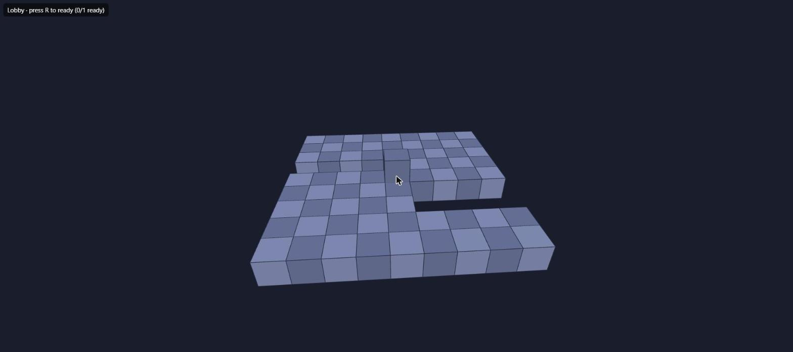
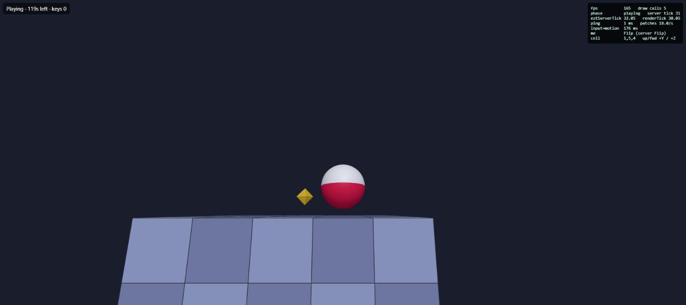
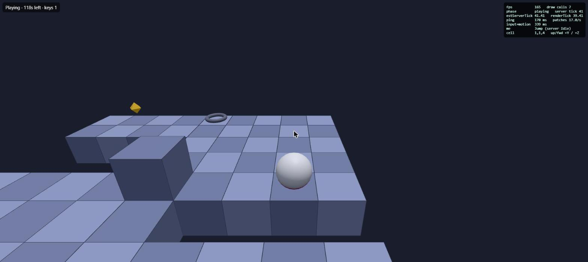
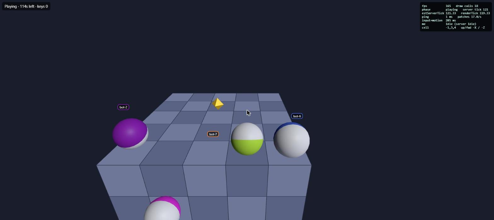

# Phase 04 report: Client rendering, camera, controls

## What was built
- **`shared/src/pose.ts`**: `poseAt(action, from, to, progress, out?)` returns `{ position, quat, up, spin }` per §10. It uses pure float math with no three.js, and it writes into `out`, so the render loop doesn't allocate.
- **`client/src/net.ts`**
  - Connects using `?name` / `?server`.
  - `estServerTick` resets when the phase changes or the tick jumps back more than 5. It snaps if the error is over 5 ticks, and otherwise corrects smoothly without ever going backwards.
  - Ping comes from `room.ping()` every 2 s. The patch rate is also tracked.
- **`client/src/input.ts`**
  - Keys: W/↑ hold forward, A/D/←/→ turn, Space jumps, R readies, F3 debug, F8 freeze, F9 PNG.
  - It sends only on change, sends each pulse once per press (key repeat ignored), and releases forward when the window loses focus or the tab is hidden.
- **`client/src/render/`**
  - `scene.ts`: renderer, fog, hemisphere light plus a key light attached to the camera, CSS2D labels.
  - `level.ts`: one `InstancedMesh` with checkerboard shading, plus one merged `LineSegments` for all edges. Levels load through `import.meta.glob` from `levels/`.
  - `players.ts`: balls are two hemispheres (player colour and white). Labels are shown for other players. It also holds the render-side segment history described below.
  - `items.ts`: spinning key octahedrons, and an exit torus that is grey when locked and green when unlocked.
  - `camera.ts`: follow cam, level orbit, and a hold mode while the local ball is dead.
- **`client/src/ui/`**
  - `hud.ts`: phase, time left, ready hint, spectating notice, winner line.
  - `debug.ts`: F3 overlay with FPS, draw calls, estServerTick/renderTick, ping, patch rate, measured input→motion latency, and local action/cell/up/fwd.
- **Visibility rules**
  - Balls render only in countdown/playing/results, for non-spectating players who aren't Dead. Schema defaults, i.e. an invalid up/fwd pair in the lobby before the first round, are never rendered.
  - The lobby and spectators get a slow orbit of the level. While the local ball is dead, the camera holds its last position.

## Tests
- **144 passed**:
  - 36 new pose tests: frames for all 24 (up, fwd) pairs; roll/turn/jump/fall/flip at 0, 0.5 and 1; the flip midpoint is on the arc around E and up at 0.5 is normalize(U+F), for all 6 ups; progress clamping; `out` reuse.
  - 26 new camera tests: for all 24 frames, screen-right equals the sim's right turn, camera up leans along U and the camera looks along F. The camera turns smoothly through a whole flip with no roll. Damping is frame-rate independent.
- `npm run typecheck` is clean and `npm run build` works.

## Browser verification (Claude in Chrome, the user's Chrome, 1920×911 viewport, 166 Hz display)
I used a separate server on :2600 and Vite on :5180, so your dev servers weren't touched. Keys were driven with synthetic keyboard events.

| Check | Result |
|---|---|
| Lobby | Orbit around the level, ready hint.  |
| Hold W on test-cube | Continuous rolling and flips across top → +Z → bottom → −Z. The camera follows each flip.  |
| Smoothness (sampled the rendered ball position every frame for 2.5 s while holding W, 150 ms latency) | 413 frames. All 58 still frames fall before the first movement (input delay). Once moving there were **no stalls**: speed held around 4 cells/s on rolls and about 7.4 on flip arcs (p5 3.8, p50 7.0, max 8.9), with no jumps. So there is no 20 Hz stepping and no snap between tiles. |
| Left is screen-left | Confirmed by the camera test for all 24 frames. In-browser, after landing at (1,1,4) facing +Z, the wall at x=4 (+X = left) appears on screen-left. |
| test-flat, 150 ms | Rolled to (1,1,2) and jumped the 1-gap to (1,1,4), collecting the key. Then walked to (5,1,7), faced −Z and jumped into the 2-gap: Dead after 1.6 s, respawned after exactly 2.0 s (40 ticks) at a spawn, key kept.  |
| 8 players (7 wander bots + 1 tab) on test-cube | All balls and labels render.  |

## Latency
Input→motion is measured from key press until the local ball's *rendered* action changes:

| Setting | Measured | Judgement |
|---|---|---|
| LATENCY_MS=0 (ping 1 ms) | **176–205 ms** | Fine for grid movement. It's mostly the render delay (2 ticks = 100 ms) plus waiting for the next tick and patch. |
| LATENCY_MS=150 (ping ~170 ms) | **339–360 ms** | Noticeable when tapping, but motion stays smooth and chained rolls don't stutter. It's a heavy-but-playable delay for a grid game. |

**Is prediction needed?** Not for the MVP on LAN or good connections. At 150 ms the delay is clearly felt on turns and jumps. If playtests on real internet connections complain, the cheapest next step is to predict only the *start* of the local player's own action with `previewAction`, before full client-side prediction. Holding W already hides most of the delay because rolls chain server-side.

## Performance (8 players, test-cube)
- **FPS: 165**, which is the display's refresh cap (166 Hz). There is headroom; it never dropped during the run.
- **Draw calls: 18**: the level takes 2 (instanced blocks + edge lines), each ball 2, and keys/exit the rest. With 1 player it's 5–8.
- The render loop reuses scratch vectors, quaternions and poses. What remains per frame is the Colyseus `MapSchema.forEach` callbacks (small closures) and HUD strings, which are written only when they change.
- These numbers are from a desktop GPU. A mid laptop still needs a check (see manual steps).

## Deviations (also in DECISIONS.md)
- **Render-side segment history** (last 3 actions per player). Without it, a chained roll that replaces from/to would snap the ball forward by 2 ticks, because rendering runs 2 ticks behind.
- **Rolling spin is accumulated client-side**, because `poseAt` is stateless.
- **The follow camera uses its own frame quaternion** (`frameQuat × Q0`) instead of `lookAt`, so it can't gimbal-flip.
- **Key light is attached to the camera.**
- **Dev helpers:** F8 freeze and F9 PNG, plus `window.kula` in DEV builds only. The report screenshots were taken with the Chrome tool and F8. F9 downloads work, but Chrome silently blocks repeated automatic downloads.
- **Two-tab check:** I didn't run a separate two-tab test. The 8-player run (bots use the same network path as tabs) covers "each sees all balls". Please confirm the real two-tab case (step 2 below).

## Manual test steps for Jakub
1. `npm run dev`. Open `http://localhost:5173/?name=A` and `?name=B` in two windows side by side, press R in both, then F3 in one.
2. Check that both balls show in both windows. Hold W: rolling should be continuous with no hitch between tiles.
3. On test-cube, roll across all 6 faces: hold W for a full loop, then D and hold W again. Each flip should turn the camera smoothly, and A/D should always turn screen-left/right.
4. Set `LEVEL=test-flat` in `.env` and restart. From spawn, press W once, then Space: you jump the gap and collect the key. Walk to the 2-wide gap and jump it: you die and respawn about 2 s later.
5. Set `LATENCY_MS=150` in `.env` and restart. Motion should stay smooth, just later. F3 shows about 340 ms input→motion.
6. Phone: allow Node through Windows Firewall on 5173 and 2567, then open `http://<pc-ip>:5173/?server=ws://<pc-ip>:2567`. It should render the orbiting level; touch controls aren't expected.
7. On a mid laptop: 8 players (`npm run bots -- --count 7`) plus your tab. Read FPS from F3.

## Open questions / risks
- **Input delay at 150 ms** is felt (~350 ms). Decide after the phase 05 playtest whether to add the partial prediction described above.
- **Early camera during a flip.** The camera follows the pose's up vector, which rotates 90° over 300 ms, and is then damped. It looks smooth, but on the bottom face (up = −Y) the world appears "upside down" relative to the lobby. That's intended, but players may want a short camera ease-in there.
- **Checkerboard shading uses `(x+y+z) & 1`**, so two neighbouring faces of the same block can share a shade, which flattens edges a little. The edge lines compensate.
- **Wander bots mostly fall off the cube.** Seek bots (phase 05) will give a better perf and HUD picture.
