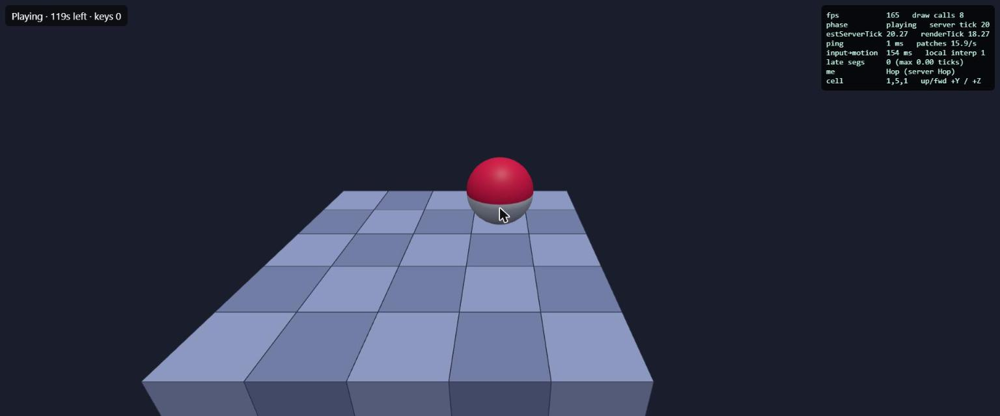
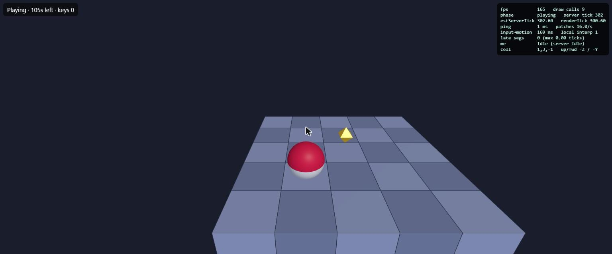

# Phase 04b report: Hop + feel fixes

## Changes
- **Sim** (`shared/sim`)
  - `Action.Hop = 7` is appended; existing values are unchanged. `Cmd` gains `'hop'`.
  - `previewAction('hop')` returns `{ Hop, to: current pose, JUMP_TICKS }`. It returns null under a ceiling (`solid(C + U)`).
  - Jump selection lives in `commands()`: a jump pulse with fwd held → `['jump', 'hop', 'fwd']`, without fwd → `['hop']`. So a forward jump into a wall hops, and the pulse is spent once (`resolveMoves` already clears it on the first non-fwd cmd).
  - A hop reserves only its own cell (`occupiedCells`). Finishing a hop runs `onLand` like any other landing.
- **Pose**: Hop is a parabola along U with peak `HOP_HEIGHT = 1.0`, no lateral movement and no spin. `RenderPose.lift` exposes the jump/hop height.
- **Camera** follows `position − up·lift`, so jumps and hops no longer lift the camera with the ball. The ball visibly leaves the tile.
- **Ball contact**: already correct since phase 04 (`BALL_RADIUS − 0.5 = −0.1` along the pose's `up`, which also follows flips). Verified on a side face, see below.
- **Local interp** (`client/main.ts`): the local ball renders at `estServerTick − 1`; others stay at −2. Override with `?localInterp=2`.
- **Snap metric** (F3 "late segs"): counts moving segments that arrive after the render clock has already passed their start, meaning the ball has to jump into them. It also shows the worst lateness in ticks.
- **Bots**: wander now sends 10% hops (jump with fwd released for that message, fwd resumed after 600 ms), 30% left, 30% right, 20% forward jump, 10% plain roll. The summary line counts hops sent.
- **Client fix**: `room.leave()` on `pagehide`. Found during testing: a page kept in the back/forward cache held its seat, so the next join became a spectator.

## Tests: 151 passed, typecheck clean
New tests:
- **Hop in `sim.test.ts`**:
  - jump pulse without fwd → Hop, same cell, JUMP_TICKS, then Idle;
  - forward jump into a wall → Hop;
  - hop under a ceiling → blocked, pulse spent;
  - jump mid-roll with W held → forward jump starts exactly at the roll's end tick;
  - jump mid-roll with W released → Hop at the roll's end;
  - no rolling into a hopping player's cell.
- **Existing tests**: the forward-jump tests now hold fwd for their first tick. Two pulse-priority cases (a jump without fwd) now expect Hop. The determinism test still passes.
- **Pose**: hop at 0, 0.5 and 1, including on a +X face, and `lift` at the peak.
- **Camera**: its target doesn't move during a hop.

## Browser checks (Claude in Chrome, test-cube, server-side action read from state)
| Check | Result |
|---|---|
| Space alone | **Hop** at (1,5,1) → (1,5,1), ticks 15–25 |
| W held, Space pressed 80 ms into a roll | Roll (1,5,1)→(1,5,2) ticks 28–33, then **Jump** (1,5,2)→(1,5,4) starting at tick **33**, exactly the roll's end |
| Turn around, W+Space together | **Jump** (1,5,4)→(1,5,2) |
| Hop at its peak |  |
| Ball resting on a side face (−Z face, up −Z) |  |

## Latency experiment
Method: 6 single-tile W taps, averaging the F3 input→motion value (key press → local ball's rendered action changes). Then 8 s of W held (chained rolls and flips around the cube) with the late-segment counter.

| | LATENCY_MS=0 | LATENCY_MS=150 (ping ≈ 166 ms) |
|---|---|---|
| local −2 (before) | 196 ms (162–218), 0 late segs | 354 ms (339–369), 0 late segs |
| local −1 (after) | **139 ms** (130–151), 0 late segs | **290 ms** (270–316), 0 late segs |

**Decision:** keep −1. It saves about 60 ms at both settings, with no snaps measured and none seen.

**Caveat:** `simulateLatency` adds a constant delay with no jitter. On a real network, a patch arriving more than about 1 tick late would produce a late segment (a small forward snap). The F3 counter will show whether that happens in real playtests; if it does, switch back with `?localInterp=2`.

## Bot run (4 wander bots, 300 s, test-cube, MIN_PLAYERS=2)
- **No server errors or warnings.** 2 rounds completed, both timeout draws (2-2-1-0 and 2-2-1-0 keys), plus a third cut off by the end of the run.
- **149 hop messages** were sent (31–42 per bot).
- Deaths fell from 105 (phase 03) to 78, since hops don't move the ball.

## Deviations (also in DECISIONS.md)
- **`RenderPose.lift`** plus a camera that ignores jump height. Not in the prompt, but without it the hop barely reads on screen.
- **`pagehide` → `room.leave()`**: a bug found while testing.
- **Late-segment counter in F3**, added so the latency decision rests on a number rather than on eyeballing.

## Open questions / risks
- **Real-network jitter** can still produce small snaps at local −1. Watch the F3 "late segs" counter in the first remote playtest.
- **The local ball runs 1 tick ahead of the others.** Two balls rolling tile-to-tile next to each other look 50 ms apart, and a ball following another can appear to briefly touch it. This is cosmetic; the sim is unaffected.
- **Hop height is hard to judge from behind** without shadows. A blob shadow under each ball (placeholder art, one quad) would make hops and jumps much easier to read. It's worth adding in phase 05.
