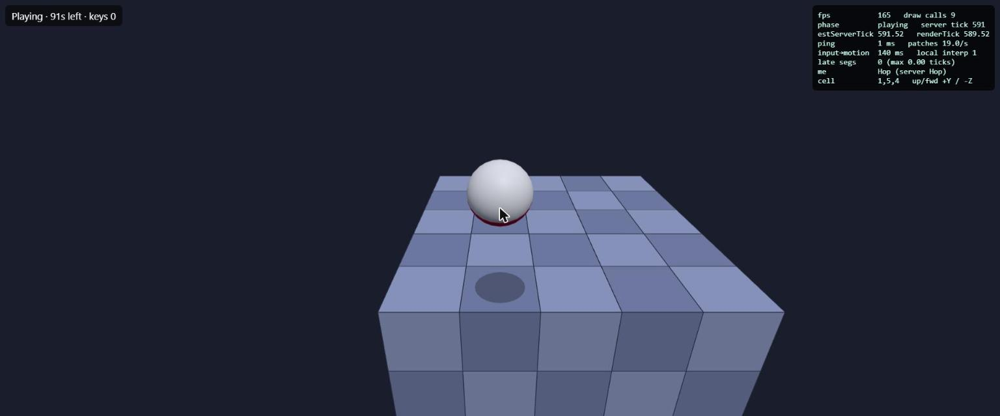
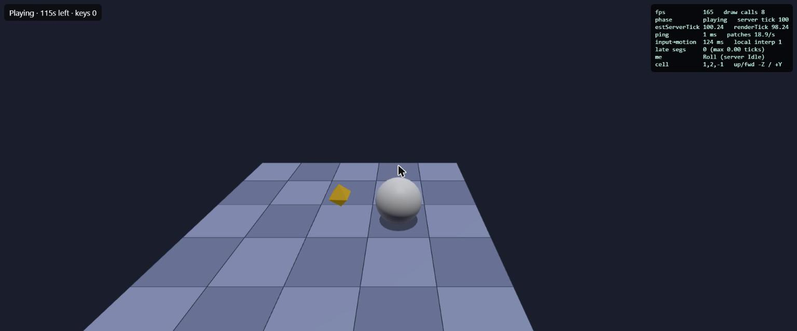

# Phase 04c report: Held jump + forward latch

## Priority rules as implemented (`shared/src/sim/tick.ts` `commands()`)
When a player is free to act on a tick (including the tick its previous action ended), it tries these in order. The first one that isn't blocked starts.

1. **Buffered jump pulse, or the forward latch** → forward jump if `fwdHeld || fwdLatch`, else hop. A blocked forward jump falls back to a hop.
2. **Buffered turn** (left/right pulse).
3. **`jumpHeld`** → forward jump if `fwdHeld`, else hop (same fallback).
4. **`fwdHeld`** → roll or flip.

Two further rules:
- **The forward latch** is set in `setInput` on a `fwdHeld` false→true edge while the player's action is Hop. It is cleared at every decision, whether or not it was used. Forward pressed during a forward Jump doesn't latch.
- **Pulses** are still spent once: `resolveMoves` clears the pulse on the first non-roll command it tries.

Chaining is free: `step` finishes actions and then resolves new ones in the same tick, so hop → hop and jump → jump have no idle tick.

**Input:**
- `Input` gains `jumpHeld: boolean`. The server's `parseInput` requires it, the bots always send `false`, and the client sends it.
- Client: Space keydown (key repeat ignored) sends `jump: true, jumpHeld: true`, and keyup sends `jumpHeld: false`. Focus loss or a hidden tab releases both W and Space.

## Tests: 158 passed, typecheck clean
New tests in `packages/shared/test/heldJump.test.ts`:
- jumpHeld without fwd for 3×JUMP_TICKS → hops start at ticks 1, 11, 21 on the same cell, and the action is Hop on every one of the 30 ticks;
- jumpHeld + fwdHeld → forward jumps at ticks 1 (to x=2) and 11 (to x=4);
- tap (jumpHeld false by the next input) → exactly one hop;
- fwd pressed then released during a hop → forward jump on landing, then idle;
- fwd pressed and held while jump is released → forward jump on landing, then rolls;
- fwd pressed during a *forward* Jump doesn't latch: idle on landing if W was released, roll if it's still held;
- jumpHeld with a turn tap mid-hop → turn on landing, then hopping resumes.

**Changed tests:**
- **None of the existing sim tests needed changing.** With `jumpHeld: false`, which the `input()` helper now defaults to, the old pulse-only behaviour is unchanged.
- **Determinism test:** its random inputs now also set `jumpHeld` (5%), so it covers held jumps.
- **Server test:** its inputs now include `jumpHeld`, and a message without it counts as malformed.

## Browser checks (Claude in Chrome, test-cube, server action log recorded from `onStateChange`)
| Scenario | Server log (tick:action) | Result |
|---|---|---|
| Single Space tap (90 ms) | `18:Hop` then idle | ✓ one hop |
| Space held 1.4 s | `35:Hop 45:Hop 55:Hop` | ✓ continuous bounce |
| Hop, release Space, tap W mid-air | `67:Hop 77:Jump (1,5,1→1,5,3)` | ✓ forward jump exactly at landing |
| W held, Space tapped mid-roll | `99:Roll 104:Jump (1,5,2→1,5,0)` | ✓ jump at the tile end, as in 04b |
| Space+W held | `126:Jump (→1,5,2) 136:Jump (→1,5,4)` | ✓ chained forward jumps |

**Render continuity:** I held Space for 2 s and sampled the local ball's `lift` every frame. That gave 316 frames, of which only **3 were at ground level, each a single isolated frame** (the landing instant), with a peak of 1.00. So chained hops read as one continuous bounce. The segment history treats each hop as a new segment, since its `startTick` changes even though the cells are the same.

**Shadow:**
- Hop peak: the shadow stays on the ball's tile while the ball is a full cell above it. 
- Resting on the −Z face: the contact shadow sits under the ball. 
- Flip continuity: the first version blinked off for about 150 ms per flip. After the fix, **0 hidden frames out of 661** while holding W through 3 flips.

## Bot run (4 wander bots, 300 s, test-cube, MIN_PLAYERS=2)
- **0 server errors or warnings.**
- 2 rounds completed, both won by bot-2 on timeout (3 keys each time), plus a third cut off by the end of the run.
- 127 hop messages sent.

## Deviations (also in DECISIONS.md)
- **The shadow holds its last placement during a Flip.** The dominant up axis points into air mid-flip, so a strict "hide if no block within 3 cells" rule makes it blink.
- **Nothing else deviates from the prompt.**

## Open questions (feel vs Kula World)
- **Turn taps early in a hop are dropped.** The input buffer is 6 ticks and a hop lasts 10, so a turn pressed in the first 4 ticks of a hop expires before landing. In Kula World you can queue a turn at any time during a jump. Options: make INPUT_BUFFER_TICKS ≥ JUMP_TICKS, or never expire pulses during an airborne action. Recommend the second.
- **The forward latch only applies to hops.** Forward pressed mid forward-Jump rolls on landing only if still held, per spec. If playtests expect "W during a forward jump = jump again", that would be a second latch.
- **Hop and jump both last 10 ticks (500 ms)**, so rhythmic bouncing feels a bit slow. Kula World's bounce is closer to 400 ms. Worth trying JUMP_TICKS = 8 in a playtest; the shadow makes it easy to judge.
- **PvP immunity.** Held bouncing makes a player permanently non-Idle, so it can't be pushed. ARCHITECTURE §14 already flags this for the PvP phase.
