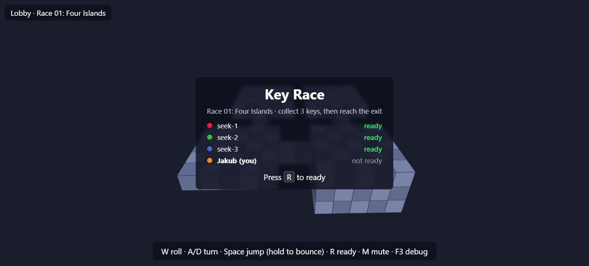
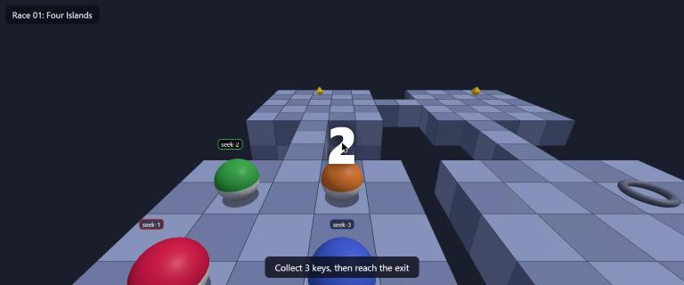
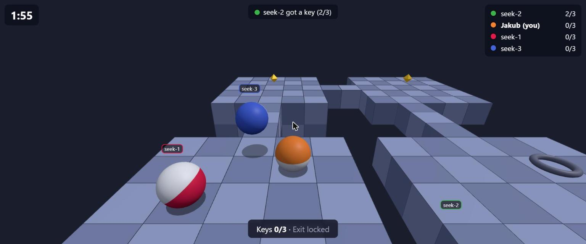
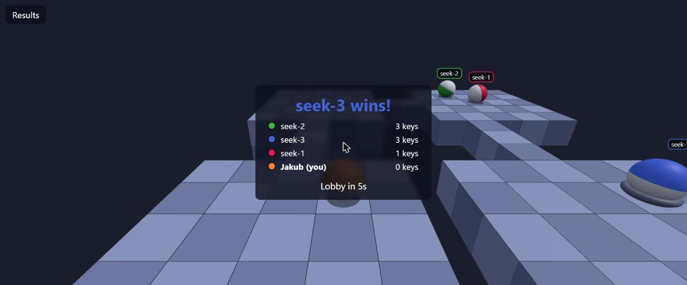

# Phase 05 report: Key Race MVP + seek bots

## What was built
- **Sim**: buffered pulses no longer expire while the player is airborne (Hop/Jump/Fall). A turn pressed in the first tick of a hop or jump applies on landing, and pulses still expire after 6 grounded ticks. The details are in DECISIONS.md.
- **Pathfinding** (`shared/sim/path.ts`): `findPath(world, pose, goalCells)` is a BFS over (cell, up, fwd) using `previewAction`, and it ignores other players. `resultPose` follows a jump's fall to the landing cell and rejects fatal moves.
- **Seek bots** (`--behaviour seek`; mix with `seek,wander`, assigned round-robin; bots are named `seek-N` / `wander-N`):
  - The target is the nearest remaining key, or the exit once the bot has enough keys.
  - They execute one step at a time: fwd = press, then release once the Roll/Flip has started; jump = pulse + fwd, then release once the Jump has started; turns are pulses. The next step may be pressed in the last tick of a roll, turn or flip.
  - They replan when the target key is gone, the pose drifts from the plan, or a step is blocked twice (every third failed plan also adds a random turn).
  - They wait while a player sits on A1/A2 of a planned jump.
  - A 10 s watchdog logs `STUCK …` with the full state and shakes the bot loose. It never fired in any run (0 of about 30 rounds).
- **Level** `race-01` ("Four Islands"):
  - Structures: a start plate, a thick 5×3×5 block, an east plate and an exit plate, joined by three 1-wide beams, plus a 1-wide gap between the start and exit plates (the jump shortcut).
  - Keys: 7, of which 5 are on undersides or side faces and need flips. keysRequired 3, 120 s.
  - A test checks that every key and the exit are reachable from every spawn, for all levels.
- **`LEVEL` comma list**: rotates each round. Verified with `race-01,test-cube` over 4 rounds (race-01, test-cube, race-01, test-cube).
- **HUD**, per phase:
  - Lobby: panel with the level name, the rule, a player list (colour dot, name, ready state) and "Press R to ready". Controls line at the bottom.
  - Countdown: big 3-2-1.
  - Playing: timer (red under 10 s), scoreboard sorted by keys (x/required), bottom status "Keys x/3 · Exit locked / Exit OPEN". "Spectating" is shown where relevant.
  - Results: "X wins!" in the winner's colour, or "Draw", with final key counts and "Lobby in Ns".
  - Toasts for key pickups ("seek-2 got a key (2/3)", "You got a key…").
- **Feedback**:
  - A collected key pops (scales up and fades over 0.35 s).
  - A death fades out where the ball was last seen.
  - The winner's ball glows during results.
  - WebAudio beeps for countdown ticks, go, key (a different pitch for your own), death and win/loss. **M** mutes, and the setting is remembered. The HUD shows "muted".
- **Exit**: green only when the *local* player has enough keys (unchanged from phase 04, re-checked).

## Tests: 179 passed, typecheck clean, build OK
New tests:
- **Pulse buffer**: a turn pressed in the first tick of a hop, and of a forward jump, applies on landing. The grounded-expiry boundary (6 → used, 7 → expired) now uses a Dead wait.
- **BFS on test-cube**:
  - two cells straight ahead is a single `jump`;
  - already on the goal gives `[]`, and a goal inside the cube gives `null`;
  - for every key and the exit, a path exists **and replaying it through the real sim with bot-style inputs ends on the target**;
  - every path is **optimal**, i.e. matches an iterative-deepening brute force;
  - with several goals, the nearest one wins.
- **Reachability**: every key and the exit are reachable from every spawn, in every level.

## 10-round bot stats (race-01, 3 seek + 1 wander, MIN_PLAYERS=4, unattended)
| Round | Winner | Duration | Keys (seek-1 / seek-2 / seek-3 / wander-4) |
|---|---|---|---|
| 1 | seek-3 (exit) | 14.5 s | 1 / 2 / 3 / 0 |
| 2 | seek-3 (exit) | 16.1 s | 1 / 3 / 3 / 0 |
| 3 | seek-3 (exit) | 11.5 s | 3 / 1 / 3 / 0 |
| 4 | seek-3 (exit) | 11.6 s | 3 / 1 / 3 / 0 |
| 5 | seek-3 (exit) | 11.5 s | 3 / 1 / 3 / 0 |
| 6 | seek-3 (exit) | 11.4 s | 3 / 1 / 3 / 0 |
| 7 | seek-3 (exit) | 12.5 s | 3 / 1 / 3 / 0 |
| 8 | seek-3 (exit) | 11.7 s | 2 / 2 / 3 / 0 |
| 9 | seek-3 (exit) | 11.8 s | 2 / 1 / 3 / 0 |
| 10 | seek-3 (exit) | 11.5 s | 3 / 1 / 3 / 0 |

- The run went on to 12 rounds in its 600 s window; `seek-1` won round 11.
- Totals over 12 rounds:
  - seek-1: 1 win, 29 keys, 0 deaths.
  - seek-2: 0 wins, 16 keys, 0 deaths.
  - seek-3: 11 wins, 36 keys, 0 deaths.
  - wander-4: 0 wins, 0 keys, 12 deaths.
- **0 stuck**, 0 server errors or warnings. Every round ended with an exit win; none timed out.
- **Why seek-3 nearly always wins:** the bots are deterministic BFS with identical routes, so spawn order decides. seek-3 spawns on (1,1,3), which is nearest to the shortcut toward the key/exit side. A human breaks this symmetry. For bot-only balance, spawns could be shuffled per round (not done; it's a sim change).
- An earlier trial showed a bot dying when its planned jump was shortened by a player on the landing cell. This is fixed by the A1/A2 wait, and there were no seek-bot deaths since.

## Screenshots (1536×695 viewport)
| Lobby | Countdown | Playing | Results |
|---|---|---|---|
|  |  |  |  |

**HUD sizing**: text uses `clamp(13px, 0.95vw + 4px, 20px)`, which gives about 16 px at 1280 wide and 20 px (the cap) at 1920. The countdown digit uses `clamp(90px, 18vh, 220px)`. Panels are capped at 90 vw, and the controls line is a single row, about 60% of the width at 1280.

I couldn't capture exact 1280×720 / 1920×1080 frames: the Chrome window is maximized on a 125%-scaled display, and `resize_window` had no effect. The screenshots are at 1536×695, which sits between the two. Please check both sizes (manual step 3).

## Playtest notes (mine)
I drove the game through scripted input in the browser rather than by hand, so these notes are about what I measured and saw, not about feel:
- **Movement speed**: a roll takes 250 ms and a flip 300 ms. Seek bots clear race-01 in 11–16 s with perfect routes, so a human round will probably take 30–60 s, well inside the 120 s limit.
- **Camera**: stable through all flips. On race-01 the underside keys are easy to lose track of, because the camera inverts under a plate; the shadow helps.
- **Jump**: the shortcut gap reads well. Held-jump bouncing (04c) and the new buffer mean turns queued mid-jump now "take".
- **HUD**: the toasts and "Exit OPEN" status are clear. The winner glow is subtle next to the big banner.

The acceptance item "you can win some rounds" needs Jakub's hand-play against 3 seek bots (manual step 1).

## Suggested constant tweaks (not applied)
| Constant | Now | Suggest | Why |
|---|---|---|---|
| JUMP_TICKS | 10 | 8 | Bouncing and jumping feel slow next to 250 ms rolls (from 04c) |
| race-01 `timeLimitSec` | 120 | 90 | Bots finish in 12–16 s; 90 s still leaves room for humans and keeps timeouts meaningful |
| RESPAWN_TICKS | 40 | 30 | A 2 s wait plus the walk back from spawn is harsh in a 90 s race |
| INPUT_BUFFER_TICKS | 6 | keep | With the airborne rule it no longer drops mid-jump inputs |

## Recommendations
- **Client prediction: not yet.** Input→motion is about 140 ms locally (−1 local interp) and about 290 ms at 150 ms RTT. Get real remote-playtest numbers first; F3 shows them live. If it's needed, start by predicting only the local ball's action *start*, using `previewAction`.
- **Bump/knockback next: yes.** In every bot run the losers queued behind the leader on the same beams, and blocking is the dominant interaction. Push (ARCHITECTURE §14) turns that into play. Settle the held-hop immunity question at the same time (§14 note).

## Manual test steps for Jakub
1. Set `LEVEL=race-01` and `MIN_PLAYERS=4` in `.env`, then run `npm run dev`. In a second terminal run `npm run bots -- --count 3 --behaviour seek`. Open http://localhost:5173, press R and play several rounds: bots should win some and you others.
2. Watch the bot terminal for `STUCK` lines (there should be none), and check that toasts, beeps (M mutes), the key pop and the death fade all appear.
3. Resize the browser to 1280×720 and 1920×1080 (for example with DevTools device mode) and check that the HUD is readable in the lobby, playing and results phases.
4. For unattended rounds, set `LEVEL=race-01,test-cube` and run `npm run bots -- --count 4 --behaviour seek,seek,seek,wander`. It should cycle through lobby, countdown, playing and results indefinitely.
