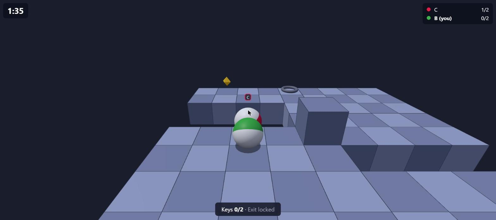
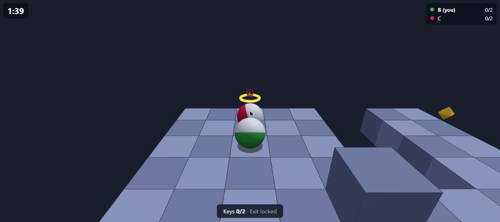
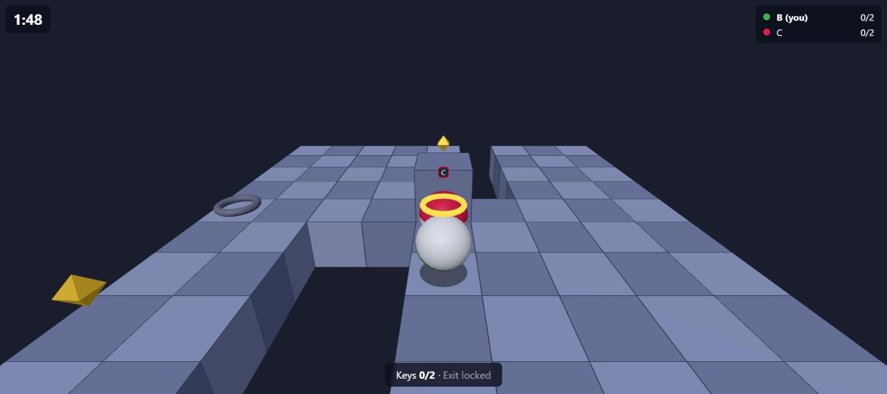

# Phase 06 report: Push (PvP)

## Summary
- Rolling into a player on the same face pushes it one cell. If there's no ground there, it falls, and off the map it dies. A death drops the player's most recent key back to its spot.
- Everything is in `resolveMoves` (`packages/shared/src/sim/tick.ts`), plus `isPushable` (`sim/world.ts`) and `onDeath` (`sim/keyRace.ts`).
- `PUSH=off` restores the MVP rules exactly. The whole pre-push suite passes both ways.
- **Checks:** `npm run typecheck` is clean, and `npm test` passes: 300 tests, up from 187.
  - New: `push.test.ts` (36 tests), `pushOff.test.ts` (76: the old sim suites re-run with push off), and a pose test.

## Precedence rules as implemented
Each tick, after actions finish, every Idle player gets an **intent**: its first command (§6 priority) that would start, checked against the start-of-tick reservations. The intent is a **push** when that command is `fwd` and a non-Dead player on the same face stands in `A = C + F`. Then, each stage in fair order:

1. **Escape.** A targeted victim whose intent is a Roll, Flip, Jump or Hop starts it. The push aimed at it is then blocked with no stun: the victim is no longer pushable, and a hop on its start tick isn't pushable either. A victim whose intent is a Turn doesn't escape.
2. **Mutual push.** P targets Q and Q targets P, so both are Stunned with `bounce`, and a `bounce` event is sent for each.
3. **Other pushes.** The target isn't pushable (`isPushable`): P is blocked, stays Idle and retries next tick. `A + F` solid or reserved: P is Stunned with bounce. Otherwise V is Knocked `A → A + F` over 4 ticks, P rolls into A, and a `push` event is sent. A knocked victim can't be knocked again in the same tick, because it's no longer pushable.
4. **Everything else**, with the existing claim-in-fair-order rule.

A knocked victim skips its own intent, so its buffered pulse (e.g. the same-tick Turn) survives. Pulses don't age while Knocked or Stunned, so the turn applies when the stun ends (tested).

**Hop window:** pushable on ticks 1–2 after the start tick and the last 2 before the end, so 4 of every 10 ticks. Holding W against a bouncing ball pushes it on the tick the hop enters its last 2 ticks (tested).

**Edge cases found / decided** (all logged in DECISIONS.md):
- **Chains.** For P→V→W in one line, fair order decides. If V goes first, V knocks W and P is blocked, because V is rolling. If P goes first, P bounces off V because W is behind it.
- **The target cell.** A forward *jump* into a player never pushes. It falls back to a hop, as in the MVP. Only rolling pushes.
- **Landing on items.** A knock that ends on a key collects it, and one that ends on the unlocked exit wins (`onLand` runs).
- **Dropped keys.** No key drops once the round has a result. A dropped key can reappear under a standing ball, which collects it on its next landing there.
- **Repeat bounces.** A bounced pusher still holding W bounces again every 8 ticks.
- **Knockout credit** is cleared on death, so it can't carry across a respawn.

## Bot stats (race-01, `seek,seek,bully,wander`, 400 s unattended)
**14 rounds. 0 STUCK, 0 server errors or warnings.** Every round ended at the exit.

| Round | Winner | Pushes | Knockouts | Key drops | Deaths |
|---|---|---|---|---|---|
| 1 | seek-1 | 17 | 4 | 1 | 7 |
| 2 | seek-1 | 4 | 1 | 1 | 3 |
| 3 | seek-1 | 7 | 2 | 1 | 4 |
| 4 | seek-2 | 3 | 1 | 0 | 3 |
| 5 | seek-2 | 4 | 1 | 0 | 1 |
| 6 | seek-2 | 9 | 4 | 2 | 8 |
| 7 | seek-1 | 5 | 2 | 0 | 5 |
| 8 | seek-2 | 4 | 1 | 1 | 2 |
| 9 | seek-2 | 12 | 1 | 0 | 1 |
| 10 | seek-1 | 11 | 3 | 0 | 4 |
| 11 | seek-1 | 14 | 2 | 1 | 5 |
| 12 | seek-1 | 21 | 4 | 1 | 6 |
| 13 | seek-1 | 10 | 3 | 1 | 8 |
| 14 | seek-2 | 6 | 2 | 0 | 5 |

| Bot | Wins | Pushes | Knockouts | Bounces | Deaths | Keys lost |
|---|---|---|---|---|---|---|
| seek-1 | 8 | 10 | 3 | 0 | 10 | 4 |
| seek-2 | 6 | 11 | 4 | 0 | 12 | 5 |
| bully-3 | 0 | 75 | 17 | 0 | 7 | 0 |
| wander-4 | 0 | 31 | 7 | 0 | 33 | 0 |

**The first run found bot bugs (fixed, see DECISIONS).** It had 11 rounds, 7 STUCK, and 127/139 bounces for seek-2/bully.
- A bounced step just replanned the same path and bounced again.
- The bully targeted its victim's own cell, so it ended up across a gap from a seek bot, and each waited forever for the other to clear the jump cells.

After the fixes the second run above had 0 STUCK and 0 bounces. Wander pushes a lot by accident, so its "knockouts" are real but unintentional.

## Browser checks (test-flat)
**Setup change: one browser tab plus a scripted headless player.** Chrome throttles a hidden tab's timers to about 1/s and pauses its rendering, so the second tab over-rolled off an edge. The opponent "C" was therefore a temporary Node script (deleted afterwards), and the visible tab "B" was the browser player.

| Check | Result |
|---|---|
| Push the other ball off the 2-gap edge | ✓ C (1 key) at (6,1,4), B pushes +Z from (6,1,3). Events: `push` t507, then `death`, `keyDrop` key 0 and `knockout` B→C at t527. Key 0 is back at (1,1,4), and the HUD board shows C 0/2. |
| Push into a wall bounces you | ✓ C at (5,1,4), wall at (4,1,4), B pushes −X. `bounce` event, B Stunned with `bounce: true`, C unchanged. |
| Holding Space dodges some pushes but not all | ✓ C holds jump. B tapped W for 1 tick at random times: `.P...P....P` = 3 of 11 landed, close to the designed 4 in 10. |
| LATENCY_MS=150: knock doesn't start before the pusher reaches it | ✓ after a render fix (below). 0 late segments. |

**Latency fix.** I measured the distance between ball centres when the victim starts sliding on screen; the balls touch at 0.8.
- **Before:** local pusher, 0.58 (the balls overlap by 0.22). The local ball renders 1 tick ahead of the others, and the victim also held 1 tick. With a local victim it's the reverse: it would slide 1 tick before the pusher arrives.
- **Fix:** the client now adjusts the knock hold by the local render lead.
- **After:** local victim 0.774–0.790 (5 knocks), remote victim 0.776–0.780 (7 knocks).

| Knock mid-slide (C sliding off the 2-gap behind B) | Stunned (flashing ring + wobble) | Bounce (B lunges into C, wall behind) |
|---|---|---|
|  |  |  |

The knock shot is taken from the pusher's follow cam, so the victim is partly hidden behind the pusher.

## Feel notes and suggested constants (not applied)
These come from watching scripted play and bots, not a human playtest.
- **Stun is longer than a roll, so pushes chain.**
  - After a push the pusher's roll ends 5 ticks later. The victim is still Stunned (4 + 8 = 12 ticks), so holding W pushes again, and again.
  - In the browser, B pushed C from x=5 to x=8 and then off the map without C ever getting control back. `push.test.ts` "Stunned victim is pushable (combo)" shows the same.
  - On any straight edge, one push is a kill.
  - Suggest `STUN_TICKS` 4 (the victim recovers as the pusher's second roll ends). Alternatively, only a bounce stun could be pushable, not a post-knock stun.
- **`KNOCK_TICKS` 4 with a 1-tick hold is a 3-tick (150 ms) slide.** It reads as a snap. Try 5 if it should feel weightier.
- **Hop cover (6 of 10 ticks) felt right in the tap test.** Holding W against a bouncer always wins within 10 ticks, which is the intended counter.
- **`KNOCKOUT_CREDIT_TICKS` 60 is fine** for falls off race-01 (knock to death is about 20 ticks).

## Open questions for Knockout (phase 07)
- **Stun combos (above).** In an arena this decides whether rounds are about positioning or about getting the first hit.
- **Crumbling tiles** need a per-world solid overlay. `level.solid` is shared and static today, and reservations, `isSolid` and the bots' BFS would all need to read the overlay.
- **Spawn protection.** A bully can camp a spawn. Should players be unpushable for N ticks after respawn?
- **Simultaneous last deaths.** If the last two balls die on the same tick, is it a draw, or does a knockout credit decide?
- **Rules object.** `Rules` is `{ push }` today. Knockout needs lives, no keys and crumble timing: extend `Rules`, or add a mode field?
- **Stale architecture text.** §5 Hop still says a hopping player "can't be pushed", and §5 Dead says keys are kept. Both are superseded by §14 when push is on. I left ARCHITECTURE.md unchanged; the architect may want to reword them.
