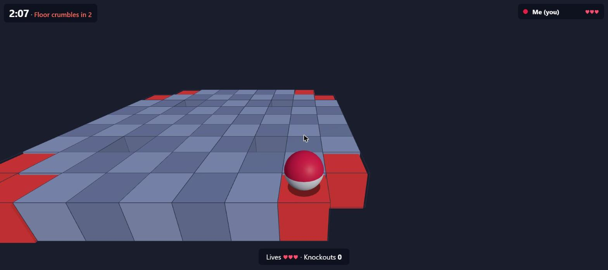
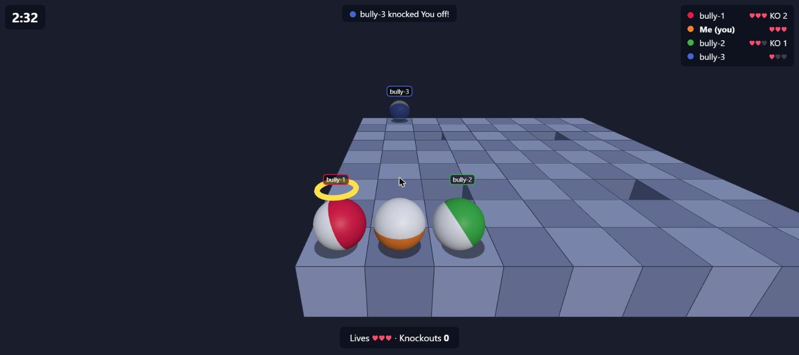
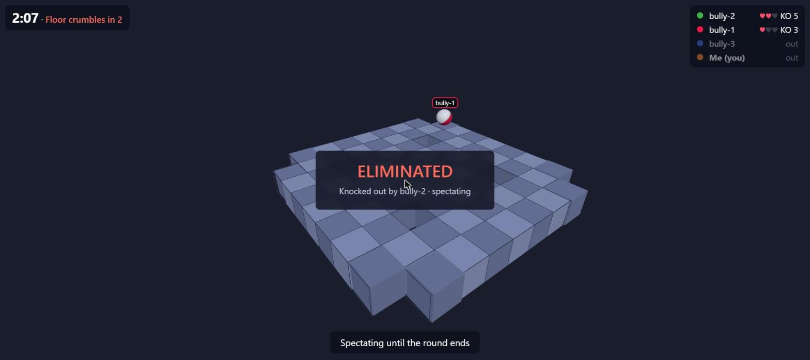
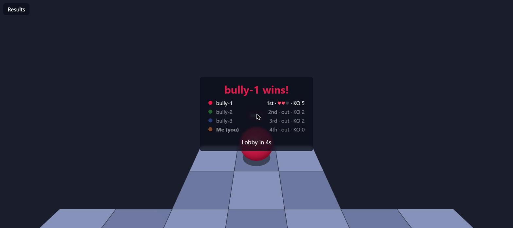

# Phase 07 report: Stagger fix + Knockout mode

## Summary
- **Housekeeping** (`2a1a987 chore: normalize line endings`).
  - Added `.gitattributes` (`* text=auto eol=lf`, jpg/png binary).
  - The 18 CRLF files were ones I had rewritten with Python in text mode during phase 06. They're LF again, and scripted edits now write LF.
  - `git status` was clean apart from your doc edits before feature work started.
- **Stagger.**
  - A victim Stunned after a knock can't be pushed; a pusher Stunned by a bounce can.
  - `STUN_TICKS` changed from 8 to 6. `KNOCK_TICKS` is unchanged.
- **Knockout mode (§15).**
  - Level `mode`/`lives`/`crumble` and the `isSolid(world, v)` overlay.
  - Lives, seeded-random respawn with 40-tick protection, elimination, and win/draw/timeout.
  - The crumble schedule (bands, warning, floor rule) and events.
  - Schema fields; client crumble rendering, HUD, translucent protection and spectator cam.
  - Bots that know about knockout, and the `arena-01`/`arena-02` levels.
- **Checks.** `npm run typecheck` is clean, and `npm test` passes: 333 tests, up from 300.
  - The race suites run with push on and again with push off (`pushOff.test.ts`).
  - New: `knockout.test.ts` (19), 5 stagger/protection cases in `push.test.ts`, and 7 knockout validation cases in `level.test.ts`.

## Stagger as implemented
- `isPushable`: Stunned → `v.bounce`, and never while `tick < protectedUntil`.
- **Timeline** (push at tick 1): the knock runs ticks 1–5, and the stagger runs 5–11. The pusher's roll ends at 6. If it still holds W, it's blocked (no stun) on ticks 6–10.
- **Tick 11:** the victim goes Idle, and its own move comes first through the existing escape stage. If it does nothing, the waiting pusher pushes it again.
- **Tests:** "the victim recovers first: its escape precedence beats the held W"; "a victim that stays put after recovering can be pushed again"; "a bounce-stunned player is still pushable". The old combo test was replaced by these.

## Knockout stats
**Final run:** `LEVEL=race-01,arena-01,arena-02`, `seek,bully,bully,wander`, 960 s unattended.
- **22 rounds**, cycling race → arena-01 → arena-02.
- 0 STUCK and 0 server errors. **0 of 14 knockout rounds hit the timeout.**

| Level | Rounds | Duration avg (min–max) | Deaths per round | Bands crumbled |
|---|---|---|---|---|
| race-01 | 8 | 18.4 s (11.9–30.3) | 2–6 | – |
| arena-01 | 7 | 49.9 s (42.1–58.0) | 10–11 | 0–2 |
| arena-02 | 7 | 41.2 s (25.4–56.4) | 9–12 | 0–2 |

Per round

| # | Level | Duration | Result | Deaths | Bands |
|---|---|---|---|---|---|
| 1 | race-01 | 30.3 s | seek-1 (exit) | 3 | – |
| 2 | arena-01 | 55.7 s | bully-2 (last alive) | 11 | 2 |
| 3 | arena-02 | 41.1 s | seek-1 (last alive) | 11 | 0 |
| 4 | race-01 | 18.1 s | seek-1 (exit) | 3 | – |
| 5 | arena-01 | 44.2 s | bully-3 (last alive) | 11 | 0 |
| 6 | arena-02 | 46.5 s | bully-3 (last alive) | 10 | 1 |
| 7 | race-01 | 14.5 s | seek-1 (exit) | 2 | – |
| 8 | arena-01 | 46.0 s | seek-1 (last alive) | 10 | 1 |
| 9 | arena-02 | 56.4 s | **draw** (last two out on the same tick) | 12 | 2 |
| 10 | race-01 | 25.6 s | seek-1 (exit) | 5 | – |
| 11 | arena-01 | 53.1 s | bully-2 (last alive) | 11 | 1 |
| 12 | arena-02 | 47.2 s | bully-3 (last alive) | 9 | 1 |
| 13 | race-01 | 11.9 s | seek-1 (exit) | 2 | – |
| 14 | arena-01 | 58.0 s | bully-2 (last alive) | 11 | 2 |
| 15 | arena-02 | 41.5 s | bully-3 (last alive) | 11 | 0 |
| 16 | race-01 | 17.6 s | seek-1 (exit) | 6 | – |
| 17 | arena-01 | 49.9 s | bully-3 (last alive) | 11 | 1 |
| 18 | arena-02 | 25.4 s | bully-2 (last alive) | 10 | 0 |
| 19 | race-01 | 12.3 s | seek-1 (exit) | 4 | – |
| 20 | arena-01 | 42.1 s | bully-2 (last alive) | 11 | 0 |
| 21 | arena-02 | 30.1 s | bully-2 (last alive) | 10 | 0 |
| 22 | race-01 | 16.7 s | seek-1 (exit) | 2 | – |

| Bot | Wins | Pushes | Bounces | Knockouts | Lives lost | Eliminated |
|---|---|---|---|---|---|---|
| seek-1 | 10 (8 race, 2 knockout) | 45 | 65 | 24 | 39 | 12 |
| bully-2 | 6 | 178 | 266 | 51 | 34 | 8 |
| bully-3 | 5 | 192 | 281 | 50 | 34 | 9 |
| wander-4 | 0 | 34 | 14 | 4 | 42 | 14 |

**Bugs the soak found and fixed before the final run**
1. **Stalled knockout (sim).** Once the edge bands crumbled, no spawn had ground left. A dead player with lives left waited forever, still counted as alive, so the round could only end by timeout.
   - The first arena-01 round ran the full 180 s with 5 bands crumbled.
   - **Fix:** if no spawn has ground, a knockout respawn uses a random free cell on any remaining block. There's a test for it.
2. **Lockstep bounce (bots).** The last two bullies on a 3×3 island faced each other and pushed on the same tick. That is a mutual push, so both bounced and recovered together, forever (seen in the browser run, and that round timed out).
   - **Fix:** after a bounce, a bot waits a random 0–500 ms.
   - An intermediate run with fix 1 but not fix 2 also had 0 timeouts in 10 rounds, but one arena-01 round took 126 s.

## Browser checks (arena-01, 3 bully bots + me)
| Check | Result |
|---|---|
| Lives drop | ✓ The board hearts go ♥♥♥ → ♥♥♥ (one dim) per `lifeLost`, and the status line shows my own lives. |
| Respawn protection visible | ✓ Protected balls render at 40% opacity (bully-3 at the back of the screenshot, just respawned). |
| Crumble warnings readable before tiles vanish | ✓ The HUD shows "Floor crumbles in N" for the last 5 s. The warned band shakes and blinks red for 2 s, then disappears (zero-scale instances, collapsed edges). A ball on a warned tile falls on the next tick after removal. |
| Elimination → spectate → results | ✓ An "ELIMINATED · Knocked out by bully-2 · spectating" panel, the board marks players "out", and the camera follows the killer while it's on screen, else orbits. Results are ranked 1st–4th with hearts and KO counts. |

| Crumble warning (band 1, the ball stands on a warned tile) | Lives HUD + protected ball | Eliminated spectator | Results by placement |
|---|---|---|---|
|  |  |  |  |

- **Lives HUD shot:** F8 freezes only the canvas and HUD. The "bully-3 knocked You off!" toast is for a death that happened after the freeze, so the toast and the hearts disagree in that picture.
- **Crumble shot:** it was taken solo (MIN_PLAYERS=1), because rounds with bullies usually end before the first crumble at 45 s.

## Feel notes (bots and scripted play only; no human playtest yet)
- **Stagger vs chain pushes.** One push now moves a victim exactly one cell. Pushing someone off a straight edge takes a push right at the edge, not a chain from across the platform. In knockout the bots still get about 10 deaths a round, so the stagger doesn't make kills rare.
- **Bounce counts are high** (bullies around 270 each over 22 rounds). They come mostly from two bots facing each other (mutual pushes) and from pushing into a player with another behind it. Humans don't act on the same tick the way bots do, so expect far fewer.
- **Crumble pace.** Bot rounds end at 42–58 s, around the first crumble (45 s): 0–2 bands. With aggressive bots the floor barely matters. With humans, who are likely more careful, it should matter more.
- **arena-02 crumbles in lumps:** bands of 44/62/18/1. The second band (62 blocks) removes nearly the entire outer surface at once, leaving a 19-block core.
- **Suggested constants (not applied):**
  - arena-02: `startSec` 40, and band by squared distance instead of rounded distance for finer steps (see open questions).
  - arena-01: keep 45/10/2 until humans have played it; try `startSec` 30 if rounds drag.
  - `STUN_TICKS` 6 and `SPAWN_PROTECT_TICKS` 40 look fine.

## Open questions
1. **Band granularity on cubes.** Rounded Euclidean distance lumps a whole cube face into one band. Should bands group by exact squared distance (more, smaller bands), or should the cube's `intervalSec` be shorter?
2. **Fallback respawn.** It can place a ball on any remaining face, including the underside of arena-01's plate. Is that OK, or should it prefer the spawns' own up direction?
3. **Lobby shows the previous level.** The level rotates at countdown, so the lobby panel shows the previous level's mode and name. Should rotation move to results → lobby, so the lobby shows what's next?
4. **ELIMINATED panel placement.** It sits in the centre of the screen while spectating. Should it be a smaller top banner?
5. **Solo knockout.** It ends as a draw when the solo player is eliminated. Keep that?
6. **Wander bots.** They don't plan, so they don't step off warned tiles. They die a lot (42 lives lost), which is fine for a random bot.
7. **Race with two bullies.** seek-1 still won every race round, because bullies don't collect keys. Is a "rival" bot (seek, but pushes the leader) wanted for race testing?
