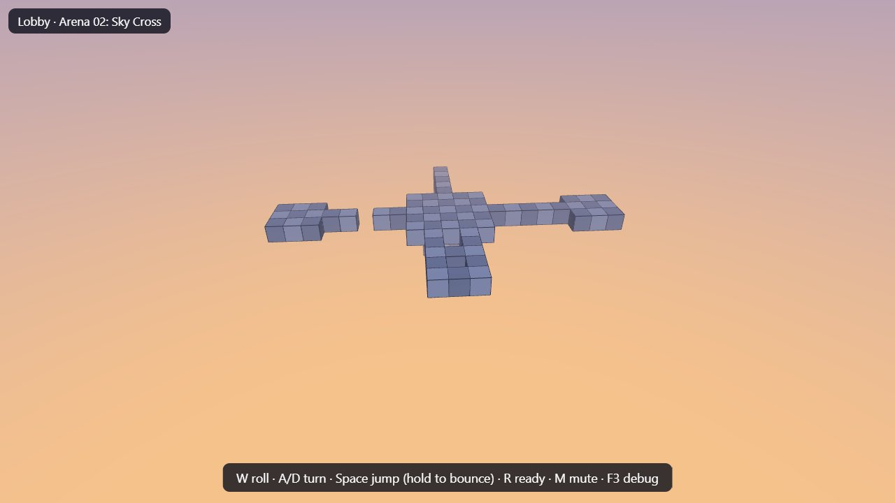
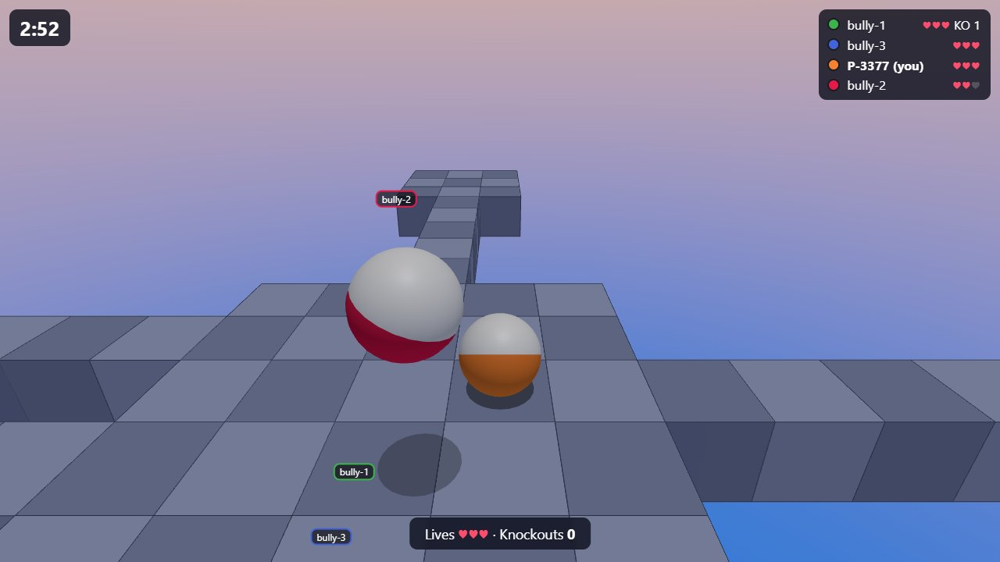
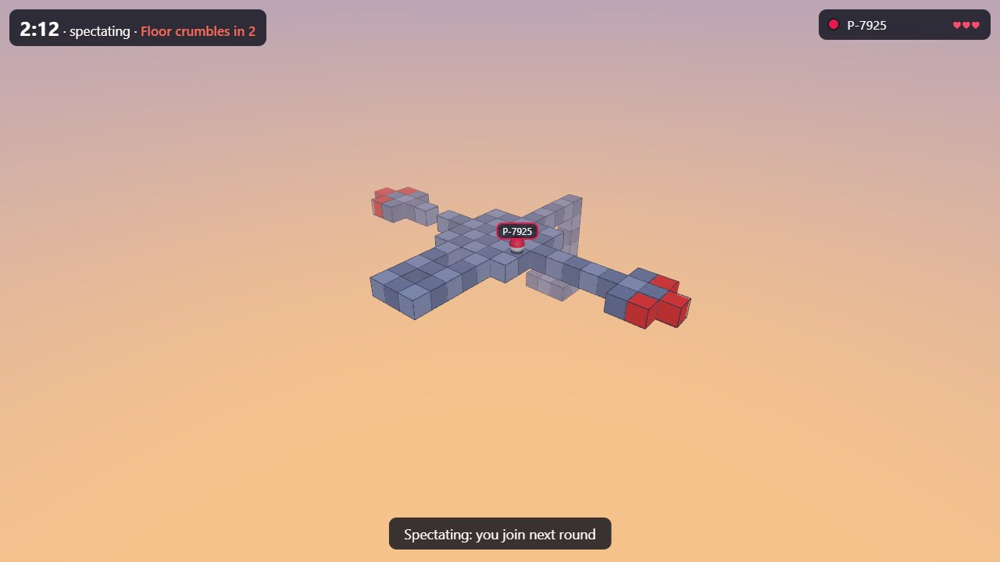

# Phase 07b report: Kula-style arena + finer crumble + sky

## Summary
- **`arena-02` is now "Sky Cross"** (82 blocks, 21×6×15). The old cube moved to `levels/arena-cube.json` (id `arena-cube`), which stays out of the default rotation and is used by the band tests. `.env.example` is unchanged, since the id `arena-02` was kept.
- **Crumble bands** now group by exact squared distance, then merge outside in until each band has ≥ 4 blocks (`MIN_BAND_BLOCKS`). They are still integer-only and deterministic.
- **Sky:** an optional level `"sky": ["#top", "#bottom"]`. The client draws a shader gradient on an inverted sphere that follows the camera, with no textures, and tints the fog to match.
  - race-01 is a daytime blue, arena-01 a purple dusk, and arena-02 blue into peach.
  - Levels without a sky keep the old dark background.
- **Bots:** a hunter with nobody left to reach now roams instead of idling. This fixes the one timeout the first soak found; details below.
- **Checks:** `npm run typecheck` is clean, and `npm test` passes all 343 tests. New tests:
  - knockout reachability for arena-01, arena-02 and arena-cube
  - band tests: cube shells, the merge rule and Sky Cross order
  - the sky validation case
  - a floor-rule test rewritten for the new bands
- Deviations are logged in `docs/DECISIONS.md`, and ARCHITECTURE §9/§15 are updated (bands, arenas, `sky`).

## arena-02 "Sky Cross": ASCII map
`#` = block, `.` = air. The central plate is x 0..4, z 0..4, y 0. The AABB is x −8..12, y −5..0, z −5..9.

```
y = 0 (top layer), x from -8 (left) to 12 (right)
x (last digit): 234567890123456789012
z= -5 ..........#..........     arm 4: beam x=2, z -5..-1
z= -4 ..........#..........
z= -3 ..........#..........
z= -2 ..........#..........
z= -1 ..........#..........
z=  0 ........#####........     central 5×5 plate
z=  1 ###.....#####.....###
z=  2 #####.###############     arm 2 (−X): beam with a gap at x=−3, then a 3×3 pad
z=  3 ###.....#####.....###     arm 1 (+X): beam x 5..9, then a 3×3 pad x 10..12
z=  4 ........#####........
z=  5 .........#.#.........     arm 3 (+Z): ladder, rails x=1 and x=3
z=  6 .........#.#.........
z=  7 .........###.........     rung
z=  8 .........#.#.........
z=  9 .........###.........     end rung

y = −1 .. −4: one column block at (2, y, −5), hanging under the end of arm 4's beam

y = −5 (lower pad, 3×3):
z= -5 .........###.........
z= -4 .........###.........
z= -3 .........###.........
```

Side view through x = 2 (z runs from −6 on the left to 10 on the right):
```
z:     -6  ^-5    ^0   ^4   ^9
y=  1  .................
y=  0  .##########..#.#.   beam z -5..-1, plate z 0..4, rungs at z 7 and 9
y= -1  .#...............   column (2, -1..-4, -5)
y= -2  .#...............
y= -3  .#...............
y= -4  .#...............
y= -5  .###.............   lower pad z -5..-3, under the beam
y= -6  .................
```

**Spawns** (8: 2 per plate side, one on top and one underneath, all facing inward):

| Side | Top (+Y) | Underside (−Y) |
|---|---|---|
| −X edge | (0,1,1) → +X | (0,−1,3) → +X |
| +X edge | (4,1,3) → −X | (4,−1,1) → −X |
| −Z edge | (3,1,0) → +Z | (1,−1,0) → +Z |
| +Z edge | (1,1,4) → −Z | (3,−1,4) → −Z |

**The four arms**
1. **+X:** a 1-wide beam (5 long) to a 3×3 pad.
2. **−X:** beam, a 1-cell gap at x = −3, beam, then a 3×3 pad.
   - The forward jump clears the gap. A short jump (a player on A2) lands over the gap and falls out.
   - Rolling into the gap flips into its side slot instead.
3. **+Z ladder:** rails x = 1 and 3, a rung at z = 7 and an end rung at z = 9.
   - From a rail top, roll sideways over the inner edge. That flips you into the gap, onto the rail's inner side face. Roll forward again and you flip onto the rail's underside.
   - The gap cells are 1 wide, so a ball in them has the other rail as its ceiling (no hop).
4. **−Z, down:** the beam's end wraps down a hanging column to a lower pad (below).

## How arm 4 is traversed
This is verified in the sim with `resultPose`, holding forward the whole way from the beam's end.

| # | From | Move | To (cell, up) | Edge |
|---|---|---|---|---|
| 1 | beam top (2,1,−5), up +Y, fwd −Z | fwd | (2,0,−6), up −Z | **flip** over the beam end's top edge onto its −Z end face |
| 2–5 | end face | fwd ×4 | (2,−1..−4,−6), up −Z | roll down the column's −Z face, flush with the beam end |
| 6 | (2,−4,−6) | fwd | (2,−5,−6), up −Z | roll onto the lower pad's −Z side face (flush with the column) |
| 7 | pad side | fwd | (2,−6,−5), up −Y | **flip** over the pad's bottom edge onto its underside |
| 8–9 | pad underside | fwd ×2 | (2,−6,−3), up −Y | roll along the underside toward +Z |
| 10 | (2,−6,−3) | fwd | (2,−5,−2), up +Z | **flip** onto the pad's +Z side face |
| 11 | pad side | fwd | (2,−4,−3), up +Y | **flip** over the top edge onto the pad top |
| 12 | pad top | fwd | (2,−4,−4), up +Y | roll; the next step is blocked by the column (a concave wall, as §5 says) |

- Every edge on the route is convex, and no step rolls into a concave corner.
- The way back is the same loop in reverse.
- The column's ±X faces link its −Z face to its +Z face.
- **Shortcut BFS found:** from the plate's +Z side face (between the ladder rails), a forward jump along −Y leaves the face. The ball then "falls" horizontally along −Z under the plate and lands on the column's +Z face. That's per-player gravity at work, and it's a nice Kula moment.

**Reachability test** (`path.test.ts`, "every knockout level"):
- From every spawn, `findPath` reaches every other spawn.
- An exhaustive run of the same BFS reaches ≥ 90 % of all standable (cell, up) surfaces. That holds for arena-01, arena-02 and arena-cube.

## Crumble bands: before and after
The sizes are listed furthest band first.

| Level | Blocks | Before (rounded distance) | After (exact d², merged to ≥ 4) |
|---|---|---|---|
| arena-01 | 77 | 4/8/32/12/12/8/1 (7 bands) | 4/8/8/4/8/4/8/8/4/8/4/4/5 (13) |
| arena-02 (Sky Cross) | 82 | 6/6/10/17/8/5/9/21 (8) | 4/6/6/6/5/4/4/4/4/4/5/5/4/8/4/4/5 (17) |
| arena-cube | 125 | 44/62/18/1 (4) | 8/24/12/24/24/6/8/12/7 (9) |

**Sky Cross crumble order (after)**
- **Bands 0–4:** the two far pads, from the outer corners inward, together with the ladder's end rung and the lower pad's −Z row.
- **Band 5:** the column, which cuts off arm 4's descent.
- **Bands 6–11:** the lower pad, the ladder, and all four beams, working inward.
- **Bands 12–14:** the plate rim.
- **Bands 15–16:** the core (the 1-block centre shell was merged into band 16).

The AABB centre is (2, −2.5, 2). It sits below the plate because of the lower pad, so the lower pad and the ladder interleave with the beams instead of strictly "pads, then arms".

## Bot round stats
**Final run:** a server on `:2568` with `LEVEL=arena-02 MIN_PLAYERS=4`, bots `seek,bully,bully,wander`, 660 s unattended. The run was on `:2568` because your dev server was on 2567.
- **10 rounds, all won by last alive.**
- 0 timeouts, 0 STUCK, 0 server errors.

| # | Duration | Winner | Deaths | Bands crumbled |
|---|---|---|---|---|
| 1 | 42.8 s | bully-2 | 10 | 1 |
| 2 | 61.5 s | bully-2 | 11 | 3 |
| 3 | 30.4 s | bully-2 | 10 | 0 |
| 4 | 43.1 s | bully-2 | 10 | 1 |
| 5 | 47.4 s | bully-2 | 11 | 1 |
| 6 | 61.5 s | bully-2 | 11 | 3 |
| 7 | 87.2 s | bully-2 | 11 | 5 |
| 8 | 23.0 s | bully-3 | 9 | 0 |
| 9 | 35.1 s | seek-1 | 11 | 0 |
| 10 | 31.1 s | bully-2 | 10 | 0 |

Average 46.3 s (23.0–87.2).

| Bot | Wins | Pushes | Bounces | Knockouts | Lives lost | Eliminated |
|---|---|---|---|---|---|---|
| seek-1 | 1 | 39 | 108 | 17 | 32 | 10 |
| bully-2 | 8 | 144 | 217 | 39 | 19 | 2 |
| bully-3 | 1 | 132 | 177 | 25 | 28 | 9 |
| wander-4 | 0 | 17 | 13 | 0 | 33 | 11 |

**The first soak found a stall, fixed before the final run.**
- In that run (7 rounds, same setup), round 3 hit the 180 s timeout with 15 bands crumbled and 3 bots alive. Between ~40 s and ~170 s there were no deaths.
- A spectator watcher over CDP caught the same pattern in a later round. bully-2 and seek-1 sat side by side on arm 4's beam underside (at (2,−1,−3) and (2,−1,−4)) for 30+ s:
  - seek-1 was tucked against the column, so bully's push would bounce.
  - seek only pushes into the void.
  - Both waited, ignored each other for 3 s, re-targeted each other, and waited again, until the crumble took the column.
- **Fix (bots only):** a hunter with no reachable, un-ignored opponent makes a random roll or turn instead of idling.
- Sky Cross has several of these one-push-safe pockets, as does any Kula-style level: beams can only be pushed along their length, and the ladder slots and the column corner bounce pushes. Humans can camp there too. See open question 1.

## Screenshots
| Overview (lobby orbit cam) | Fight on the plate's underside | Crumble mid-round |
|---|---|---|
|  |  |  |

- **Underside:** the camera is upside down with the ball, so world "up" (the blue top colour) is at the bottom of the screen. bully-2 is hopping in to push. You can see the ladder rails and the hanging column beyond the plate.
- **Crumble:** spectator orbit at 2:12. Band 0 (the far pad corners) is gone, and band 1 blinks red with "Floor crumbles in 2".
- **How they were taken:** the Chrome extension wasn't connected, so I used headless Chrome driven over CDP from a scratchpad script (Node's built-in WebSocket, no new dependencies). It ran against your running Vite (`?server=ws://localhost:2569`) and a throwaway server on 2569.
- **Sky colour fix:** the first sky shots were too saturated. The shader was missing `#include <colorspace_fragment>`, so the colours were written out in linear space. That's fixed.

## Open questions
1. **Camping pockets.** On Sky Cross you can't be knocked out in one push in several places: the ladder gap slots, next to the hanging column, and mid-beam, where pushes only go along the beam.
   - The crumble clears them eventually. But at `intervalSec` 10 the 17 bands reach the core only at ~200 s, after the 180 s limit.
   - Options: `intervalSec` 8, or `MIN_BAND_BLOCKS` 6 (fewer, bigger bands). Neither is applied, since the prompt fixed 40/10/2 and ≥ 4.
2. **AABB-centred bands.** The lower pad pulls the centre down 2.5 cells, so the order isn't strictly "pads → arms → rim → core". Should a level be able to set its crumble centre (e.g. `"crumbleCentre": [2,0,2]`)?
3. **Sky on falling/underside views.** The gradient follows world Y, so on the underside the peach "bottom" colour is overhead. I think that reads well, as the sky shows which way is world-down. Keep it, or tie the gradient to the local player's up?
4. **Lower pad reach.** The only ways to the lower pad are arm 4's descent and the sideways fall shortcut. Is a second route wanted (e.g. a jump from the −X pad's underside)?
5. **Level size in orbit.** The orbit frames all of Sky Cross, but it looks small at 1280×720 (see the overview). Should the orbit radius be tightened for flatter levels?
