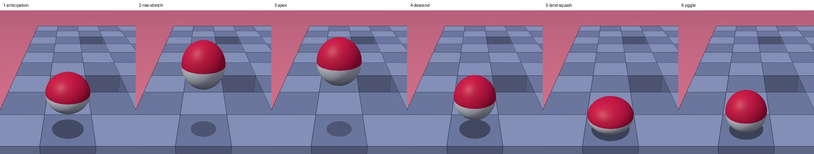
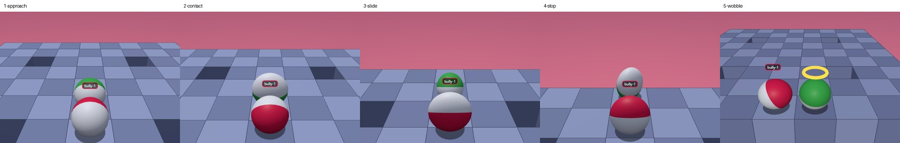

# Phase 08 report: Rubber ball feel (audio + squash & stretch)

## Summary
- **Client only.** No sim, server or shared changes. `npm run typecheck` is clean and `npm test` passes: 347 tests, up from 343.
  - The 4 new tests in `client/src/render/squash.test.ts` cover: the spring is frame-rate independent and overshoots, squash preserves volume, and the voice cap drops the quietest voice.
- **Sound engine** in `client/src/audio/`:
  - `engine.ts`: master ← sfx/ui buses, a 24-voice cap, positional `PannerNode`s with the listener on the camera, per-ball roll loops, and lazy sample override from `public/sfx/<name>.ogg|wav`.
  - `synth.ts`: the procedural recipes.
  - The old `ui/sfx.ts` beeps are gone.
- **Controls:** M mutes, `[` / `]` step the master volume by 10 % with a toast, and the audio context resumes on the first key press.
- **Squash & stretch** in `render/players.ts` + `render/squash.ts`:
  - Each ball is an outer group (position + an axis-aligned squash) and an inner body (spin), with a damped spring per ball.
  - Kicks come from rendered segment transitions, the same ones that trigger the sounds, so audio lines up with what's on screen.
  - Push contact adds a hit-stop.
- **F4 tuning panel** (dev builds only):
  - master volume, squash amount, spring stiffness/damping and hit-stop ms;
  - a gain slider plus a ▶ audition button per sound;
  - "copy as JSON" and "reset".
  - Values persist in `localStorage` (`kula.tuning`, wrapped in try/catch).
- Deviations and implementation choices are logged in `docs/DECISIONS.md`. ARCHITECTURE §11 lists the new controls and a feel paragraph.

## Sounds as implemented
Every play gets a random pitch of ±6 % and a random volume of ±10 %. The ball sounds (the first nine rows) are positional for other players and not for your own ball. The UI sounds go to the `ui` bus.

| name | trigger (render time unless noted) | synth recipe |
|---|---|---|
| `bounce` | a Hop/Jump/Fall ends on screen and the ball doesn't keep falling. Intensity: hop 0.35, jump 0.55, fall 0.5 + 0.1 per cell fallen | sine at 180 Hz·(1.15 − 0.35·i), gliding from ×2 down to ×1 in 60 ms, gain 0.35–0.7, decay 160 ms · band-pass noise slap at 1.4 kHz, Q 1.5, 25 ms · low thud sine 70 → 50 Hz, 120 ms. A harder landing is deeper and louder |
| `takeoff` | a Hop/Jump starts | white noise through a low-pass rising 400 → 1600 Hz over 120 ms; the gain swells to 0.07 at 70 ms and is gone by 160 ms |
| `roll` (loop) | while a ball rolls or flips on screen | looping brown noise → low-pass 300 Hz → gain following roll speed (0.35 while rolling, 40 ms smoothing); one loop per ball |
| `roll` (tick) | each Roll start | a faint 35 ms squeak tick: sine 1.5 → 1.8 kHz, gain 0.03 |
| `squeak` | a Flip starts | sine 700 → 1100 Hz over 120 ms, 32 Hz vibrato at ±25 Hz, gain 0.1 |
| `hit` | push contact: the victim's knock leaves its hold and starts sliding | high-pass (1.5 kHz) noise slap, 30 ms · body sine 220 → 110 Hz in 80 ms, decay 250 ms · boing tail at 240 Hz with 14 Hz vibrato, from 40 ms. ×1.5 gain when you're the victim |
| `boing` | a bounce (failed push) at the peak of its lunge | sine 250 → 300 Hz over 300 ms, 12 Hz vibrato at ±40 Hz fading out, gain 0.28 |
| `bump` | your W is held but nothing starts (Idle on the server and on screen) for 150 ms; at most once per 300 ms | sine 95 → 60 Hz, 90 ms, gain 0.18, plus a 30 ms low-passed noise tap |
| `fall` | a Fall starts with no block below, down past the kill margin | sine whistle 900 → 200 Hz over 1 s, gain 0.07 |
| `pop` | a ball vanishes (death) | band-pass noise burst at 900 Hz, Q 2, 60 ms, plus sine 420 → 150 Hz in 80 ms |
| `key` | `key` event | marimba plucks (sine + a 3.93× overtone): 659/988/1319 Hz for you, 659/880 for others |
| `exit` | your exit unlocks (keys ≥ required) | plucks 523/659/784/1047/1319 |
| `countdown` / `go` | each countdown second / play starts | a 440 Hz pluck / an 880 + 1320 Hz double pluck |
| `win` / `lose` | `win` event, you / not you | a rising 5-note pluck arpeggio / a falling 4-note one |
| `eliminated` | `eliminated` event | slow falling plucks: 392/294/196/131 for you, 262/196 for others |
| `crumbleWarn` | `crumbleWarn` event | low wooden knocks (plucks at half pitch) over a 300 Hz rumble |
| `crumble` | `crumble` event | a 600 ms low-passed noise rumble plus 10 random gritty band-passed grains |

The server `push`/`bounce` events no longer play sounds. `hit` and `boing` come from what's on screen instead.

## Frame strips
Both were taken in headless Chrome at about 22 fps, freezing (F8) on chosen frames. The numbers are the ball's scale along the squash axis, read from the scene at that frame.

**Hop in place**: anticipation 0.85–0.95 (it depends on which frame lands in the first tick), rise stretch 1.09–1.15, near 1 at the apex, descending stretch 1.05, landing squash 0.75–0.82, then an overshoot jiggle of 1.07–1.08:



A per-frame trace of one hop at 22 fps (action : ticks into the segment : scale along the axis):

```
7:0.2:0.85  7:1.1:0.92  7:1.9:1.03  7:2.8:1.13  7:3.5:1.15  7:4.3:1.11  7:5.2:1.05  7:6.0:1.00  7:6.9:0.98
7:7.8:0.99  7:8.8:1.03  7:9.5:1.06  0:10.3:0.75 0:11.4:0.84 0:12.1:0.94 0:13.0:1.03 0:13.9:1.08 0:14.9:1.07 ...
```

**Push contact** (a bully bot, red, pushes me, green, away from the camera):
- approach
- contact: I squash to 0.75 along the knock and the pusher squashes too; hit-stop
- slide: stretch 1.20 along the knock
- stop: squash 0.80
- stun: the two-axis wobble and ring



## Checklist results
| Item | Result |
|---|---|
| No sim/server changes; tests; typecheck | ✓ Only `packages/client` and docs changed. 347 tests pass and typecheck is clean. |
| Hop: swoosh, stretch, squash with a jiggle, bonk | ✓ Every hop logs `takeoff` then `bounce:0.35`, and the scale trace above shows the shape. **Not listened to by me**: headless Chrome has no speakers, and in your Chrome I kept the master volume at 0. |
| Hold W: rumble + tile ticks, squeak on flips | ✓ `roll` ticks on each tile, the loop runs while rolling (62 rolling frames in the test), and `squeak` plays on each edge flip. |
| Push: THWACK, both squash, victim stretches; failed push → boing + hard squash | ✓ `hit` fires at contact, with the scales above. Bounces log `boing` (32 in 20 s with 8 players) and kick the pusher to 0.7. |
| Positional | ✓ By construction: every non-local ball sound goes through its own `PannerNode` (equalpower, linear falloff from 2 to 30 cells), and the listener follows the camera each frame. Logs show `@` on all bot sounds and none on mine. I haven't verified the left/right pan by ear. |
| Drop `public/sfx/hit.ogg` → replaces the synth | ✓ Tested with a generated `hit.wav`: after the first play, `audio.sampled()` returned `["hit"]` and `boing` stayed on the synth. Vite answers missing files with `index.html` (200), so the loader also rejects `text/html`. I removed the test file afterwards. |
| 8 players ~60 fps, no crackle, voice cap | ✓ In your Chrome with 8 players (me + 3 bully, 2 seek, 2 wander on arena-01) over 20 s: **165 fps** (your display's refresh rate), worst frame 12.2 ms, and at most **8 concurrent voices** (cap 24). **Crackling needs an ear check.** |

**One unexplained `bump`.** In the 8-player run a `bump` played once although I never pressed W. I couldn't reproduce it: after instrumenting it (`fwdHeld` plus both actions), a further full round with bots gave no bumps. The heuristic is in open question 3.

## Default tuning values
```json
{
  "master": 0.8,
  "squash": 1,
  "stiffness": 300,
  "damping": 12,
  "hitStopMs": 35,
  "gains": { "bounce": 1, "takeoff": 1, "roll": 1, "squeak": 1, "hit": 1, "boing": 1, "bump": 1, "fall": 1, "pop": 1,
             "key": 1, "exit": 1, "countdown": 1, "go": 1, "win": 1, "lose": 1, "crumbleWarn": 1, "crumble": 1, "eliminated": 1 }
}
```

Squash amounts (`SQUASH` in `players.ts`, all multiplied by `squash`):

| Amount | Value | Resulting scale |
|---|---|---|
| anticipation | −0.15 | 0.85 |
| rise | +0.15 | up to 1.15 |
| descend | +0.08 | |
| fall | +0.1 | |
| landing | −0.2 to −0.35 | 0.8 (hop) to 0.65 (long fall) |
| contact | −0.25 | 0.75 |
| slide | +0.2 | 1.2 |
| stop | −0.2 | 0.8 |
| bounce | −0.3 | 0.7 |
| stun wobble | 0.12 | |
| roll pulse | −0.03 | 0.97 |

The spring (stiffness 300, damping 12) has a damping ratio of about 0.35, which gives one visible overshoot.

## How the parts fit
- **Feel events:** `PlayersView.onFeel` raises `takeoff`, `land`, `roll`, `flip`, `fall`, `hit`, `boing` and `pop` when a ball's on-screen segment changes.
- **Hit-stop:** a `hit` also finds the pusher (a Roll starting on the knock's tick into the victim's cell, the same test `knockHold` uses), squashes it along the knock axis, and freezes both balls' render tick for `hitStopMs`.
- **Frame-rate safety:**
  - A kick holds for the frame it happens in.
  - The victim's slide stretch is driven from the knock's progress instead of the spring (the slide is only ~2 ticks).
  - A contact or boing that a slow frame skips still fires at the next transition.
- **Ground contact:** the squashed ball keeps its bottom on the tile.
- **Shadow:** it widens with the squash footprint and shrinks with height (down to half).

## Open questions
1. **Ear check.** I can't hear, so please listen, and send the F4 "copy as JSON" if you retune.
   - Things to listen for: crackling with 8 players, the relative loudness of `hit` vs `bounce`, and whether the rumble is too present.
   - The synth mix levels are my best guesses.
2. **Hit-stop snap.** After the 35 ms freeze, the two balls jump back to real time (about 0.7 ticks). A gradual catch-up would hide it but add lag. Worth it, or set it to 0?
3. **`bump` heuristic.** It plays when W is held and both the server and the screen show Idle for 150 ms, which also covers "blocked by an unpushable player". It could be limited to real walls (a solid cell ahead) with one level lookup. Want that?
4. **Roll pulse (3 %).** It's on, but barely visible at 0.97. Keep it, raise it, or drop it?
5. **Bounce victim.** The spec squashes only the pusher on a failed push. Should the victim get a small squash too, so the collision reads from both sides?
6. **UI sounds on the `ui` bus** share the master volume, and there's no separate music/UI slider. Is one needed?
