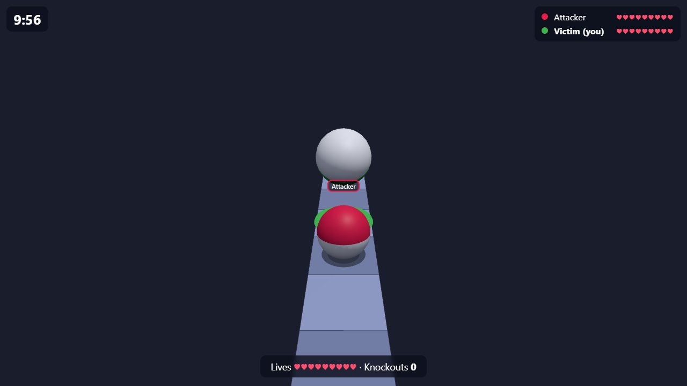
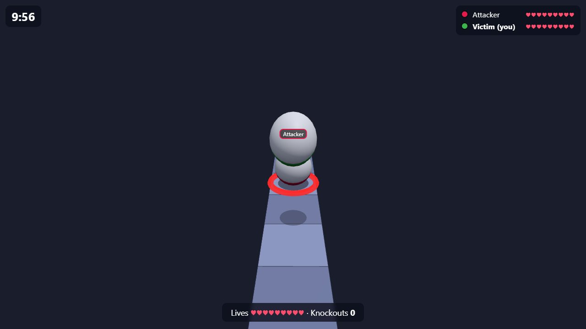
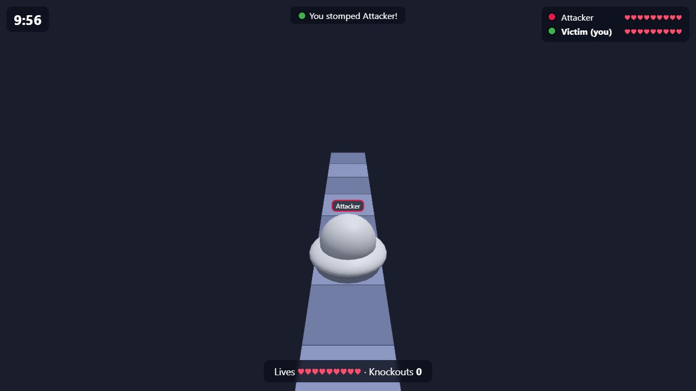
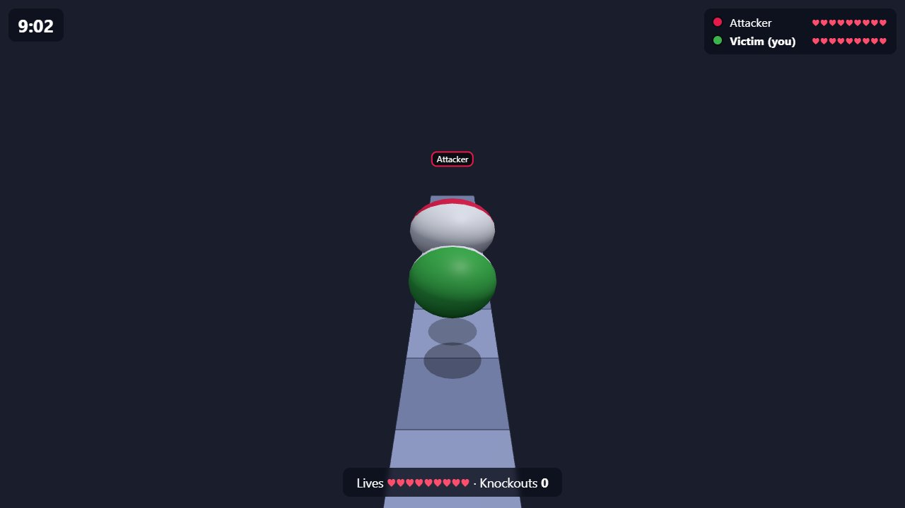
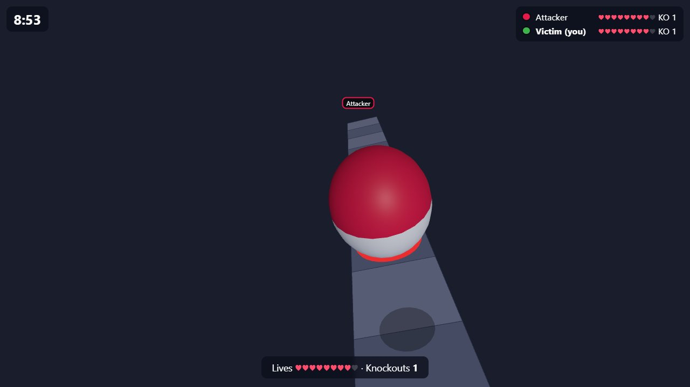

# Phase 10 report: Jump-over + stomp

## Summary
- **Sim (shared), per §16.** Players carry `jumpOver`/`stompBump`, which drive the jump's reservations: C, [A1], L, [B].
  - A player on A1 no longer blocks a forward jump.
  - Stomp targeting happens at jump start, in `previewAction('jump')`.
  - Landing resolution is stomp / clash / escaped / empty. The new `Action.Rebound` (10) and `REBOUND_TICKS` = 6 handle the clash.
  - Fall stomps bump in the order fwd → left → right → back.
  - The stagger after a stomp reuses the push stagger. Events `stomp` and `clash` are new, and knockout credit works as for pushes.
  - Stomp eligibility is `isPushable`: one helper for both.
- **`stompPreview(world, pose, selfId)`** returns `{ victimId, bumpCell, lethal }` for bots. BFS still ignores players.
- **Client:**
  - A landing marker ring on L, in the jumper's colour, or red over a ball.
  - A stomped victim squashes flat (0.5), then shoots out stretched along F.
  - A new `stomp` sound (heavy thump plus a deep boing; louder for the victim), with hit-stop.
  - A clash squashes both balls, the attacker arcs back (`Rebound` pose, tested), and a `boing` plays.
  - A toast: "A stomped B!".
- **Prediction:** jumps with a player on A1 or L are deferred to the server (tested), and `Rebound` is server-only.
- **Bots:**
  - bully prefers a lethal or ledge-setting stomp.
  - seek jumps over a player blocking its roll.
  - All bots hold jump when an enemy's jump is landing on their cell.
- **Checks.** `npm run typecheck` is clean, and `npm test` passes 379 tests, up from 356.
  - `stomp.test.ts` has 18 tests.
  - There's also a `Rebound` pose test and a prediction test.
  - Two older tests were updated to §16: "A2 taken by a player" is now a stomp with push on, and the prediction unknown-blocker case now uses a player on L with push off.
- **New level:** `levels/test-stomp.json`, a straight 10-block beam with 4 spawns, for manual and scripted stomp tests. It isn't in any rotation.

## Resolution order as implemented
1. **Jump start** (`previewAction('jump')`, inside the usual intent resolution, so pushes and escapes keep their precedence):
   1. A1 solid → no jump; fall back to a hop.
   2. A1 held by a player → jump over it. A1 isn't reserved by the jumper.
   3. Try L = A2, then L = A1 (short jump), skipping a solid L:
      - L free → a normal jump.
      - A live player *standing* in L on the same face, and the bump cell B = L + F free (push rules on) → a **stomp jump**. It reserves C, L and B.
      - Otherwise → try the next L, then hop.
2. **Landing of a stomp jump** (`finishAction`, in the tick's fair order):
   1. Nobody in L → a normal landing.
   2. V in L but its action is taking it elsewhere (roll, flip, jump, knock, rebound, fall) → it **escaped**: a normal landing.
   3. V in L and stompable (Idle, Turn, bounce-Stunned, or Hop within 2 ticks of its start or end; not spawn-protected) → **stomp**. V is knocked to B (push knock, then the stagger, or a fall if B has no ground), and the attacker lands in L.
   4. V in L but not stompable (high hop, staggered, spawn-protected) → **clash**. The attacker's pose becomes L and it rebounds to C over `REBOUND_TICKS`. V is unaffected, and nobody is stunned.
3. **Fall landing** (push rules on): a stompable player standing in the landing cell is knocked in the first free direction of the faller's fwd, left, right or back. The bump cell must not be solid or reserved; it needs no ground. If none is free, the MVP overlap rule applies.

**Where §16 was ambiguous** (all logged in DECISIONS, and §16 now has a clarification list):
- **"Stunned" was listed as stompable,** but a stomp also staggers and "can't be stomped again".
  - Stompable is now exactly `isPushable`: a bounce stun counts, a stagger doesn't.
  - A grounded victim in L that isn't stompable makes the attacker **clash**, not land on top. That includes staggered and spawn-protected victims, not only a high hop.
- **"Holds a player" for A1 vs L:**
  - A1 held by anyone, standing or moving in, is flown over.
  - L is a stomp target only when a player *stands* there. If L is merely reserved, the jump falls back.
- **Fall-stomp "free" bump cell:** not solid and not reserved, but it needs no ground (the victim then falls). §16 didn't say whether ground was required.
- **Push rules off:** jump-over stays; stomps and fall stomps are off (the old fallback / MVP overlap).
- **Rebound details:** it keeps any mid-air-turned facing, and it's airborne (air turns allowed). For prediction it's a server-only state.

**Edge cases found while testing:**
- **Two balls on a 1-wide beam can't pass each other** except by jumping over. That's exactly what the jump-over is for, and seek now uses it.
- **Two jump events on different ticks.** A scripted W then Space in separate events can land on different ticks: the ball rolls first, then only hops. The standing jump needs both inputs in the same tick. For humans, holding W and tapping Space rolls first, then jumps at the end of the roll, so the stomp lands a cell later than you'd aim from a standstill. That's worth knowing in playtests.
- **Vite's eager `levels/*.json` glob doesn't see a level added while the dev server runs.** I used my own Vite on :5174, since yours was running. Restart yours to get `test-stomp`.

## Browser checks (2 headless windows, test-stomp beam, prediction on)
I used `test-stomp` rather than arena-01: arena-01 has no beam, and a straight beam lets a script walk both balls into exact positions.

| Check | Result |
|---|---|
| Jump over the other ball on a beam | ✓ The attacker went from x=2 to 4 over the ball on 3, which was unaffected. Also done on the beam's underside. |
| Stomp it off the edge (it dies) | ✓ Victim at x=9, the beam's end. Events: `stomp`, `death`, `knockout`, `lifeLost`, `respawn`. |
| Stomp it on the beam (bumped one tile, can't be pushed right away) | ✓ The victim is bumped to L+1 and staggered. A push held from the moment of landing only went through after the stagger (the push event came later). The sim tests cover this exactly: unpushable for `STUN_TICKS`, then pushable. |
| Holding Space → clash, the attacker bounces back | ✓ The first try with the victim holding Space gave `clash`. One earlier try landed in the hop's low window and was a `stomp` (as designed). |
| Marker readable from both cameras, including the underside | ✓ The red marker is clear from the attacker's camera. The victim's camera on the beam's underside shows the ring facing the right way (screenshot below). I widened the ring from radius 0.34 to 0.46 (wider than a ball) after the first shots, where a ball hid it. The underside shot is from before that change. |

| Landing marker, normal (jumping over the red ball) | Landing marker, red (stomp incoming) | Victim squashed mid-stomp |
|---|---|---|
|  |  |  |

| Clash (the attacker rebounding off a high hop) | Underside, victim camera (ring 0.34, before widening) |
|---|---|
|  |  |

The tab names "Attacker" and "Victim" are just labels. The script picked roles by position, so in these shots the "Victim (you)" tab is the attacker.

## Bot rounds: `arena-01,arena-02`, `seek,bully,bully,wander`, 780 s unattended
**11 rounds, 0 STUCK, 0 server errors,** all won by last alive.

| # | Level | Duration | Winner | Pushes | Stomps | Clashes | Knockouts | Deaths |
|---|---|---|---|---|---|---|---|---|
| 1 | arena-01 | 40.3 s | bully-2 | 31 | 0 | 0 | 7 | 10 |
| 2 | arena-02 | 80.0 s | bully-3 | 39 | 1 | 16 | 8 | 11 |
| 3 | arena-01 | 32.2 s | seek-1 | 25 | 0 | 0 | 7 | 10 |
| 4 | arena-02 | 152.2 s | seek-1 | 25 | 0 | 0 | 8 | 11 |
| 5 | arena-01 | 63.9 s | bully-3 | 36 | 2 | 5 | 8 | 11 |
| 6 | arena-02 | 43.4 s | bully-2 | 23 | 1 | 5 | 8 | 11 |
| 7 | arena-01 | 43.3 s | bully-3 | 19 | 0 | 0 | 7 | 10 |
| 8 | arena-02 | 31.0 s | seek-1 | 22 | 0 | 0 | 6 | 9 |
| 9 | arena-01 | 30.6 s | bully-3 | 26 | 0 | 0 | 8 | 11 |
| 10 | arena-02 | 73.4 s | bully-3 | 32 | 2 | 0 | 9 | 11 |
| 11 | arena-01 | 49.1 s | seek-1 | 30 | 0 | 0 | 6 | 9 |
| **total** | | | | **308** | **6** | **26** | **82** | |

Per bot:

| Bot | Stomps made | Stomped | Clashes caused by its hop | Defensive hops | Pushes |
|---|---|---|---|---|---|
| seek-1 | 0 | 3 | 7 | 13 | 23 |
| bully-2 | 2 | 2 | 16 | 25 | 162 |
| bully-3 | 4 | 0 | 5 | 10 | 146 |
| wander-4 | 0 | 1 | 0 | 2 | 6 |

## Feel notes
- **Stomp isn't too strong against bots.** It's the opposite: 6 stomps against 308 pushes.
  - Bullies only stomp when it's lethal or sets up a ledge.
  - Bots react to a landing marker within one 20 ms bot tick and hold jump. A high hop clashes, so most stomp attempts become clashes: 26 clashes vs 6 stomps. Round 2 had 16 clashes from two bullies repeatedly trying on arena-02's beams.
- **Humans won't react that fast.** A jump is 500 ms of warning with the marker visible.
  - The hop is high for 6 of its 10 ticks, so holding jump is a strong but imperfect defence (about a 60 % chance of clashing if you just hold it).
  - I expect stomps to feel strong in human play. Every stomp moves the victim a tile, like a push, but from 2 cells away, and it's aimable.
- **Stomp vs push.**
  - Push: point-blank, instant, and stagger-limited.
  - Stomp: a 2-cell reach, telegraphed by the marker, and counterable by a hop. That reads as a fair trade.
- **Suggested constants (not applied), for after human playtests:**
  - If stomps dominate: shorten the victim's escape window. A marker visible for the whole jump is generous; show it only for the last ~6 ticks.
  - If clashes feel random: widen the hop's low window for stomps only, `HOP_PUSH_WINDOW` 2 → 3, so a late hop is still stompable.
  - `REBOUND_TICKS` 6 feels right on screen. `STOMP_HOLD` 0.4 (the flat squash) could go to 0.5 for more impact.

## Open questions
1. **Clash rule for staggered or protected victims:** I chose "the attacker rebounds" (you can't land on a ball you can't stomp). The alternative is "land on top and overlap". OK?
2. **Marker visibility:** always visible, or only for the last part of the jump (see feel notes)?
3. **Bot dodge is near-perfect.** Should bots get a reaction delay (100–250 ms) and a miss chance, so stomps show up in soaks the way they will with humans?
4. **Rolling-then-jump timing:** holding W then tapping Space rolls a cell first. Should a jump pulse during a roll's first tick cancel the roll into a standing jump, to make stomps easier to aim?
5. **`test-stomp` level:** keep it in the repo as a practice beam (not in the rotation)?
