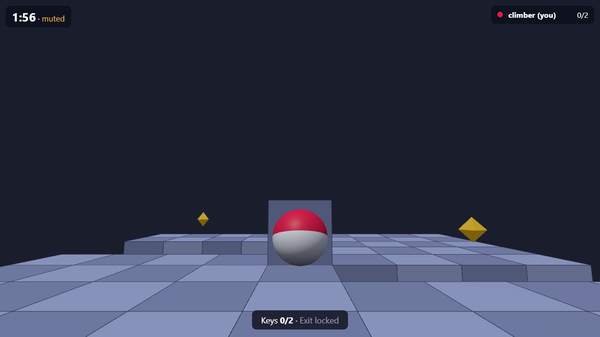
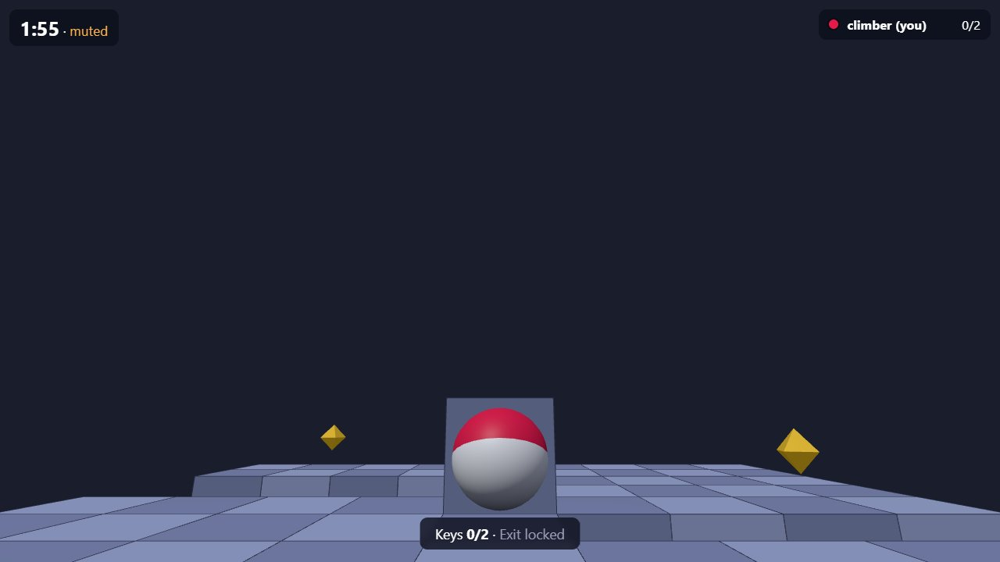

# Phase 11 report: Wall climb (Kula gravity) + input latency audit

## Summary
- **Climb.** Rolling into a wall makes the wall the new floor (§5, per Jakub).
  - The sim has the new `Action.Climb` (11) and `CLIMB_TICKS` = 5. The ball stays in its cell with `up` = −F and `fwd` = U. It reserves only its own cell and isn't pushable. Held W chains into a roll up the wall.
  - Pose: the frame pitches 90° about `cross(U, F)`. The contact offset follows `up`, so the ball rolls into the corner.
  - Feel: the old wall bump is replaced by a rubber squeak plus a small squash into the corner.
  - BFS and bots use climbs automatically.
- **Camera occlusion (new, needed by the climb).** On a wall, "behind the ball" is inside the old floor, which filled the screen with block. The rig now tries progressively higher follow offsets and takes the first with a clear line to the ball; the last resort pulls the camera in. On a climbed wall it now looks down onto the wall face, like Kula.
- **Latency audit.** Measured in a real headed Chrome at 165 fps. Only one suspect was real: **tick quantisation** (0–50 ms). The fix is a **sub-tick start**.
  - Keydown → first visible motion is now **2.8–6.0 ms median, max 6.8 ms**: within one frame at 165 fps, and well inside the ~17 ms target. Before, it was 17–49 ms median, max 54 ms.
  - Also applied: no takeoff anticipation squash on your own ball, and precise deferral.
- **Checks.** `npm run typecheck` is clean, and `npm test` passes: **398 tests**, up from 386. New and changed tests are listed below.
- **Soak:** 14 rounds (race-01, arena-01, arena-02; seek, bully, bully, wander), **0 STUCK, 0 server errors.** 5 race rounds ended by exit and 9 knockout rounds by last alive.

## Part A: Climb
**Sequence in the browser** (headless, test-flat, prediction on). This is the server's view of the ball rolling into the 1-high wall block at (4,1,4) and holding W:

```
Roll → (4,1,3)  |  Climb at (4,1,3), up −Z  |  Flip onto the top (4,2,4), up +Y  |  Flip down the far side (4,1,5), up +Z  |  Climb onto the floor, up +Y
```

The ball goes up and over the wall with W alone.

| Mid-climb (the camera clear of the floor) | On the wall (looking down onto the new floor) |
|---|---|
|  |  |

**race-01 wasn't driven in the browser.** Its climbs are covered in the sim instead: the determinism test runs 4 random players on race-01 for 2000 ticks with climbs, and the level analysis is below.

**Shortcuts climbing opens** (BFS from the first spawn, with and without climbs):

| Level | Reachable surfaces | Surfaces reached in fewer moves | Key/exit distances |
|---|---|---|---|
| race-01 | 346 → 346 | 27 | unchanged (6, 8, 11, 8, 12, 9, 15, 7 moves) |
| arena-01 | 206 → 206 | 4 | – |
| arena-02 | 272 → 272 | 39 | – |
| test-flat | 189 → 194 (the wall block's faces) | 0 | unchanged |

- Climbing opens **no new areas** on the real levels. It shortens routes where a beam or plate side meets another block's side, the concave corners that used to be dead ends.
- On arena-02 (Sky Cross) that's mostly where beams join the plate, and the column face meeting the beam underside. The "camping pocket" by the column (07b report) can now be left by climbing.

**Changed tests**
- `sim.test.ts`: "a wall blocks: state unchanged, no action" became "a wall is climbed". It runs twice, once with push on and once via `pushOff.test.ts`.
- **No path, optimality or reachability test needed changes.** They use `resultPose`/`previewAction`, so climbs appear automatically, and the brute-force optimality check stays consistent.

**New tests**
- `climb.test.ts` (8):
  - 1-high wall: climb, flip up, flip down, climb onto the floor
  - 2-high wall: climb, roll up, flip over
  - held W chains the climb into a roll
  - under a ceiling
  - turning on the wall
  - a climb reserves only its cell and isn't pushable
  - a jump into a wall hops; a push into a wall bounces
  - determinism on race-01 (with climbs)
- `pose.test.ts`: climb start, mid and end for all 24 frames.
- `predict.test.ts`:
  - a climb up and over a wall is predicted with 0 mispredictions
  - a move near another player that doesn't involve it is predicted, not deferred
- `camera.test.ts`: `clampToOpen`.

## Part B: Latency audit
**Setup.** `LATENCY_MS` 0, arena-01, prediction on by default, headed Chrome at **165 fps** (the display's rate).
- Jakub's own dev server stayed untouched: I used a throwaway server and my own Vite.
- The Chrome-extension tab turned out to be a *background* tab, where `requestAnimationFrame` doesn't run. So I used a separate, visible Chrome window with a throwaway profile, driven over CDP.
- Key events were dispatched in the page; the zero point is the keydown event's `timeStamp`.
- Each run was 3 cycles of W, D, D, W, D, D, Space, W+Space, D, D, W+Space, D, D, A, D, every press from rest.

**What was measured, in ms after keydown:**
- **(a) sent:** the input message is sent.
- **(b) stamp ahead:** how far ahead, on the predicted clock, the tick the input is stamped for was.
- **(c) predicted start:** the predicted local action starts.
- **(d) visible:** the first frame where the ball's position or rotation changed by more than 0.01.

**Before (phase 10b code), solo** (typical rows):

| key | (a) sent | (b) stamp ahead | (c) predicted start | (d) visible |
|---|---|---|---|---|
| W | 0.4 | 9 | 11.9 | 11.3 |
| D | 0.1 | 36 | 42.2 | 41.9 |
| Space | 0.1 | 48 | 54.0 | 53.7 |
| W+Space | 0.1 | 42 | 42.1 | 48.0 |
| A | 0.1 | 41 | 42.0 | 41.9 |

**(d) visible, before vs after** (median / max in ms; n is the number of presses):

| key | before, solo | after, solo | before, 3 bully bots | after, 3 bully bots |
|---|---|---|---|---|
| W | 35.7 / 41.9 (n 6) | **5.3 / 5.4** | 212.5 (n 2, 1 deferred) | **6.0 / 6.7** (n 4) |
| A / D | 29.8 / 54.5 (n 27) · A 17.5 / 41.9 | **5.3 / 6.7** · A 5.2 / 6.5 | D 17.2 / 24.8 (n 4) | **D 2.9 / 6.8** (n 17) · A 5.0 |
| Space | 48.8 / 53.7 (n 3) | **2.8 / 5.0** | 47.7 (n 1) | **2.8 / 4.8** |
| W+Space | 34.4 / 48.0 (n 6) | **5.3 / 6.5** | 35.5 / 53.3 (n 3) | **5.3 / 6.3** (n 6) |

- The "before, bots" run is short: the probe was eliminated early in the round.
- The "after, bots" run had 2 deferrals and 1 misprediction. Both happened with bots right beside the ball.

**Suspects: which were real**

| Suspect | Real? | Evidence |
|---|---|---|
| Prediction not active | **No** (in this flow) | F3 `predicting` was on for the whole solo run, and on while alive with bots. 0 deferrals solo, 2 with bots, both next to a bot. Prediction resumes after respawn and round restart (pause/resume from phase 09). |
| **Tick quantisation** | **Yes: the whole delay** | (b) ≈ (c) ≈ (d) in every row. The input waited 1–50 ms for its tick, the predicted action started exactly then, and the ball moved on the next frame. |
| Stamping too far ahead | No | Inputs are stamped for the *next* predicted tick. The lead only shifts the local clock against the server's, not the press→motion time. |
| Visual start delay (easing, anticipation squash, hit-stop) | No (measured) | Roll, flip, turn and climb are linear, and the hop is a parabola: all visible on the first frame after the start. The anticipation squash changes only scale, not position (removed for the local ball anyway, below). Hit-stop only applies to push contact. |
| Action commitment (a turn blocks the next roll for 150 ms) | Design, not lag | A press *during* an action waits for it to end. That's inherent to tile actions; see the proposals below. |
| Keyboard handling | No | Listeners are on `window`, repeats are ignored, and a focused slider doesn't eat keys (phase 08). (a) was < 0.5 ms in every row. |

**Fixes applied**
1. **Sub-tick start** (client only, `predict/local.ts`):
   - A press while the predicted local player is at rest runs its stamped tick immediately in the predictor.
   - The local ball renders from that tick at once. The ≤ 1-tick render offset eases back to `predTick` over 150 ms.
   - Sim, stamps and reconciliation are unchanged. The mispredictions (0 solo) confirm the server agrees.
2. **No takeoff anticipation squash for the local ball.** A wind-up reads as input lag. Remote balls keep it.
3. **Precise deferral** (`shared/src/predict.ts`). The predictor now plans the first viable command with and without the other players, and defers only if the outcome differs: a push, a block, a jump over or onto someone, a shortened jump, a flip onto a taken cell. Before, "any player on A, A+F or the flip cell" deferred moves that didn't involve anyone (e.g. rolling toward a ball 2 cells away). There's a new test for this.
4. **Inputs are stamped at the key press,** extrapolating the predicted clock (from 10b). Needed for the sub-tick start to be exact.

**Not applied, because the measurements didn't justify them:**
- front-loaded easing (motion was already visible on the first frame);
- faster actions (proposed below).

## Proposed timing changes (not applied, Jakub's call)
| Constant | Now | Proposed | Measured effect |
|---|---|---|---|
| `TURN_TICKS` | 3 (150 ms) | 2 (100 ms) | A turn followed by W: the roll starts 150 ms → 100 ms after the turn press. The start of the turn itself is already one frame. |
| `ROLL_TICKS` | 5 (250 ms per tile) | 4 (200 ms) | Top speed goes from 4 to 5 tiles/s, and a W press during a roll waits at most 200 ms (from 250) for the tile to end. The push knock (4) and the climb (5, now tunable) would need re-checking for feel. |

Both only change how long actions *commit*, not how fast a press shows. The first-frame response is solved by the sub-tick start.

## Feel check (for Jakub)
1. `npm run dev` and open two windows side by side:
   - `http://localhost:5173/` (prediction on)
   - `http://localhost:5173/?predict=0` (the old path)
2. In each window, press **F3**. The bottom of the overlay shows the last 4 presses:

   ```
   press→ (ms)   key  mode    sent  stamp  start  visible
   ```

3. **Predicted window, at rest:** the mode reads `pred`, `sent` ≈ 0, `stamp` is 0–50 (the tick it's stamped for), `start` ≈ 0 (it starts at once), and `visible` is ≤ one frame (≤ 17 ms at 60 Hz, ≤ 7 ms at 144/165 Hz).
4. **`?predict=0` window:** `visible` is ~100–200 ms at LATENCY_MS 0 (it waits for the server), and ~300 ms at `LATENCY_MS=150`.
5. **Also check:**
   - `predict on` in F3 after a respawn and after a new round;
   - `deferred` only goes up when you roll or jump *into or onto* another ball;
   - `kula.latency.table()` in the dev console gives the full table to paste.

## Open questions
1. **Climb speed:** `CLIMB_TICKS` 5 (the same as a roll)?
2. **Timing proposals:** try `TURN_TICKS` 2 and `ROLL_TICKS` 4 (above)?
3. **Camera on a 1-high wall:** it looks down onto the wall face (top-down onto the new floor). Is that the Kula feel you want, or should it look along the wall (more side-on)?
4. **Latency on your machine:** if it still feels laggy after this, the F3 numbers will show which stage it is. Please send a `kula.latency.table()` paste.
