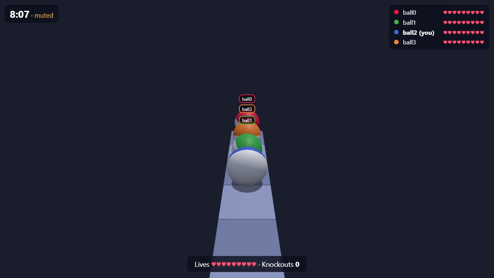
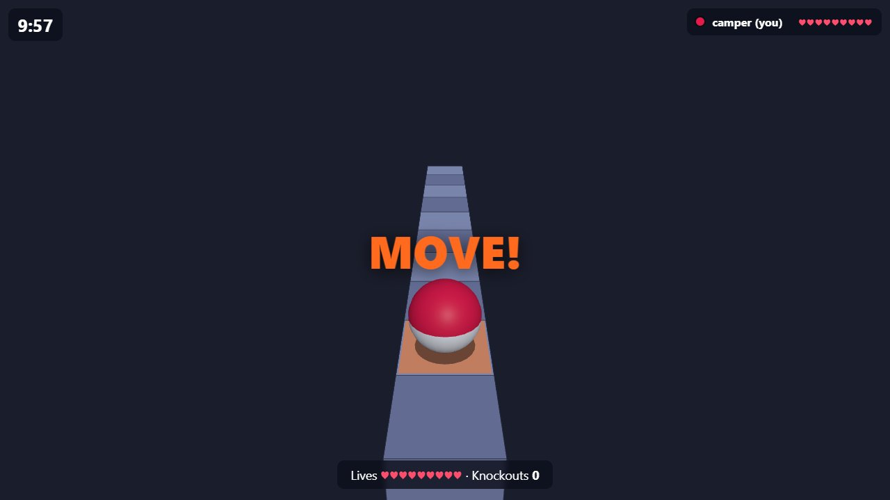
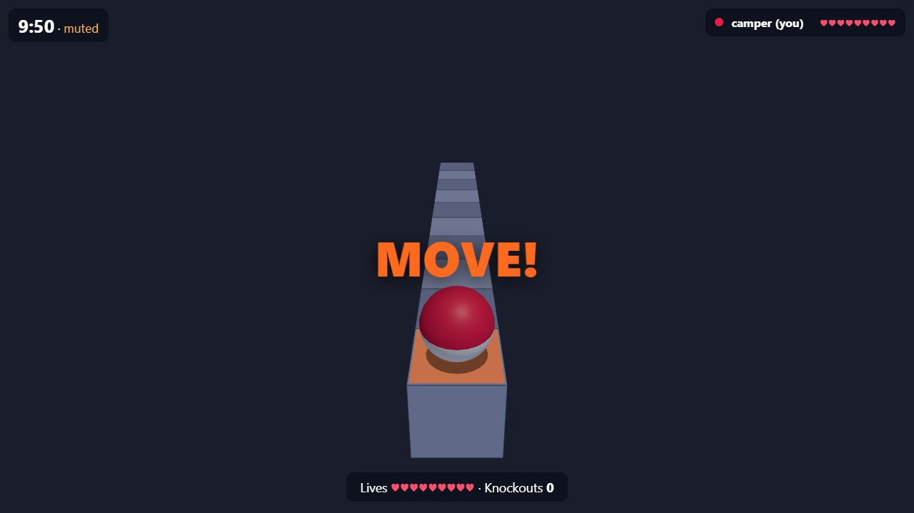
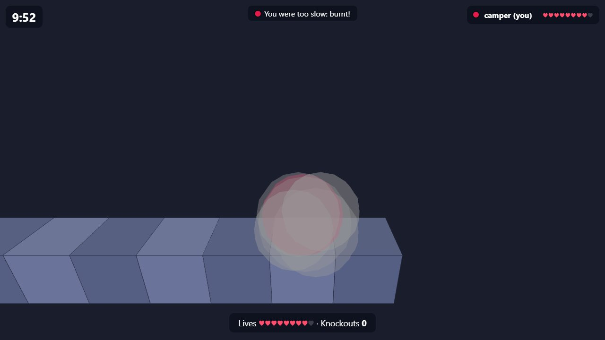

# Phase 12 report: Anti-stalemate

## Summary
- **A. Bots route around blockers.** `findPath(world, from, goals, res?)` treats other players' cells as obstacles: moves into them are blocked, jumps over them are allowed, and stomps are never path steps.
  - A bot switches to that for 3 s after being blocked by a player for 0.5 s or after one bounce, and falls back to the old path if there's no way round.
  - The bully keeps its target but flanks with the same BFS.
- **B. Chain push** (§14).
  - A line of up to 4 pushable balls with a free cell after it moves one cell together, and every ball credits the pusher.
  - A line of 5, a wall, or a staggered or escaping ball in the line → bounce.
- **C. Hot tiles.**
  - `heat` counts ticks on the same (cell, up) while Idle, Turning or Hopping. It glows at 2.5 s, and the ball pops at 4 s (a death, event `burn`).
  - Per-level `"heat": {warnSec, burnSec} | false`, on by default.
  - Client: the tile glows orange → flickering red on any face, a sizzle rises with it, "MOVE!" shows for the local player, and a pop plays with a puff.
  - Bots step off a warned tile.
- **D. Sudden death in race.** Race levels may crumble; race-01 crumbles over its last 30 s. The blocks under keys and the exit never crumble, in any mode.
- **E. Level lint.** `npm run level:check` lists 1-wide corridors with the length of their way round, and warns when there's none. **No level has a corridor without a way round.**
- **Soak tooling:**
  - The server logs "stalemate N s" per round.
  - `ANTI_STALEMATE=off` restores the phase 11 rules, for before/after comparisons.
- **Checks.** `npm run typecheck` is clean, and `npm test` passes **416 tests**, up from 398.
  - `chain.test.ts` (8), `heat.test.ts` (7), `lint.test.ts` (2), and a path test for obstacle routing.
  - Changed: 3 older tests, listed under Deviations.

## Stalemate metric
**Stalemate seconds** = ticks where at least 2 live players have both stayed on their (cell, up) for more than 3 s, within 2 cells of each other.

The soaks used `race-01,arena-01,arena-02` and `seek,bully,bully,wander` at skill 0.5, 900 s each. Every run had **14 rounds, 0 STUCK and 0 server errors**. (The only `npm error` lines in the logs come from my stopping each server afterwards.)

| Round | Level | Before (phase 11 rules + bots) | A alone (new bots, `ANTI_STALEMATE=off`) | All on |
|---|---|---|---|---|
| 1 | race-01 | 0.0 s | 0.0 s | 0.0 s |
| 2 | arena-01 | 0.0 | 0.0 | 0.0 |
| 3 | arena-02 | 0.5 | 0.0 | 3.6 |
| 4 | race-01 | 0.0 | 0.0 | 0.0 |
| 5 | arena-01 | 3.7 | 0.0 | 0.0 |
| 6 | arena-02 | 0.4 | 0.5 | 0.0 |
| 7 | race-01 | 0.0 | 0.0 | 0.0 |
| 8 | arena-01 | 0.0 | 3.0 | 0.0 |
| 9 | arena-02 | 0.0 | 0.0 | 0.0 |
| 10 | race-01 | 0.0 | 0.0 | 0.0 |
| 11 | arena-01 | 0.0 | 0.5 | 0.0 |
| 12 | arena-02 | 0.4 | 4.9 | 3.0 |
| 13 | race-01 | 0.0 | 0.0 | 0.0 |
| 14 | arena-01 | 0.0 | 0.8 | 0.0 |
| **total** | | **5.0 s** | **9.7 s** | **6.6 s** |

**Honest reading: the bots don't reproduce Jakub's stalemate.** With all four soaks near zero, the differences are noise. Our bots keep moving:
- they hunt;
- wander never stops;
- at skill 0.5 they react with delays, so they don't lock up in place.

What Jakub saw comes from humans holding position in corridors. The rule changes (hot tiles, chain push) are aimed at exactly that, and they show up in the soak as pressure:

| Phase 12 effects in the "all on" run | Total over 14 rounds |
|---|---|
| Bots stepping off a warned tile | 70 |
| Burns | 2 (bully-3) |
| Detour replans (bots routing around a blocker) | 112 (216 in "A alone") |

**Round lengths:** knockout rounds averaged ~45 s at baseline, ~74 s with A alone and ~80 s all on. Race rounds were ~13–15 s throughout, so they ended before race-01's 90 s sudden death.
- **Why:** bots that route around a blocker push less often than bots that wait and shove.
- **Is it a concern?** Not for human play, but the soak rounds are longer. If that matters, a bully could skip detours when its target is adjacent.

## Chain push and hot tiles in the browser
These ran in headless Chrome with prediction on, on test-stomp.

**Chain push.** I used a temporary heat-free copy of test-stomp (deleted afterwards), because balls waiting to be lined up would otherwise burn. The pusher at x=6 held W against balls on 7, 8 and 9 at the beam's end:
1. Tick 2274: `push` ×3. The whole line moves, and the ball on 9 falls.
2. Tick 2283: `push` ×2 after the stagger.
3. Tick 2294: `push` ×1.
4. All three died, each with `knockout` credited to the pusher.

**Hot tiles.** Solo on test-stomp:
- At 2.5 s the tile glows orange and "MOVE!" shows.
- Rolling away resets the heat (8 ticks later it read 8).
- Standing still again: `burn`, `death` and `lifeLost` all on tick 161, exactly 80 ticks after the move.
- On the beam's underside, the glow reads clearly from the follow cam.

| Chain push (3 balls moving together) | Hot tile + MOVE! | Hot tile on the underside | Burn pop (fade + puff) |
|---|---|---|---|
|  |  |  |  |

**Headless screenshot tip, found here:** only the most recently opened headless tab runs `requestAnimationFrame`. Bringing a tab to the front (`Page.bringToFront`) fixes captures from other tabs. It also explains the missed victim-cam shot in phase 10.

## Level lint (`npm run level:check`)
**No warnings: every 1-wide run has a way round.** Since the climb (phase 11), undersides, side faces and wall climbs always offer one, only 1–6 moves longer. Here are the corridors found (≥ 4 tiles; the way round vs going through):

| Level | Corridors | Way round / through |
|---|---|---|
| arena-01 | 4 (the plate's side faces, 9 long) | 9 / 8 |
| arena-02 | 14 (the arm beams' 4 faces, the column faces, the ladder rails' side faces) | 7 / 3–4 |
| race-01 | 8 (the islands' side faces and the connecting beams) | 7 / 4 |
| test-flat | 8 | 7–9 / 3–8 |
| test-stomp | 4 (the beam's 4 faces) | 10 / 9 |
| arena-cube, test-cube | none | – |

**For Jakub:**
- The corridors that matter in play are arena-02's arm beams and race-01's connecting beams.
- Their ways round go via the underside or the side faces, which humans may not think to use while someone blocks the top.
- Chain push and hot tiles are the answer in the rules. A level fix would be widening the connecting beams to 2 on race-01.

## Deviations (details in DECISIONS.md)
1. **Chain-push escape.** "Re-evaluated without it" is read as: an escaped ball is moving, so it isn't pushable, and its cell stays reserved. Either way P bounces (tested). The alternative, pushing the shortened line into the cell the escaping ball is leaving, would overlap two balls.
2. **Soak tooling:** the "stalemate N s" log line and the `ANTI_STALEMATE=off` switch (with a `rules.chain` flag in the sim). Both were needed for the "A alone" comparison.
3. **Level lint** reports every corridor with its way round (information), plus the requested warning for "no way round", which none of our levels triggers.
4. **Changed tests:**
   - `push.test.ts`: "another player behind the victim → bounce" is now covered by chain push. The wall case compares the victim with its heat counter excluded.
   - `knockout.test.ts`: "a race world never crumbles" is split into "without `crumble`, never" (test-flat) and "race-01 crumbles from 90 s".
   - The arena-01 crumble-timing test sets `heat: false`, since its 4 players stand still for 55 s.

## Suggested constants (not applied)
| Constant | Now | Suggestion | Why |
|---|---|---|---|
| `HEAT_WARN_TICKS` / `HEAT_BURN_TICKS` | 50 / 80 (2.5 s / 4 s) | 60 / 100 for race, keep for knockout | A race player who stops to think about a route shouldn't pop as fast as an arena camper. Per-level config already allows it. |
| Heat while hopping | counts | count at half rate | Holding jump is the stomp defence (§16), and a hop-dodger shouldn't burn as fast as a sitter. |
| `CHAIN_MAX` | 4 | keep | A line of 5 on the arenas is rare. |
| Bot `AVOID_MS` | 3 s | 1.5 s for bullies | Shorter detours for bullies next to their target would bring knockout round lengths back toward ~45 s. |
| race-01 sudden death | 90 s + 1.25 s bands | 75 s | Bot races end in ~15 s. Humans take longer, but 30 s of crumble is short for 26 bands. |

## Open questions
1. **Race heat:** should it burn at all in race, or only warn? A burn drops a key, which may feel harsh while you're deciding a route.
2. **Hopping and heat:** should hopping in place count fully toward heat (it's the stomp defence)?
3. **Bot realism:** should there be a bot type that deliberately holds a corridor ("blocker"), so soaks can measure stalemates the way humans cause them?
4. **Wider beams:** widen race-01's connecting beams to 2, or keep them 1-wide as the Kula feel?
