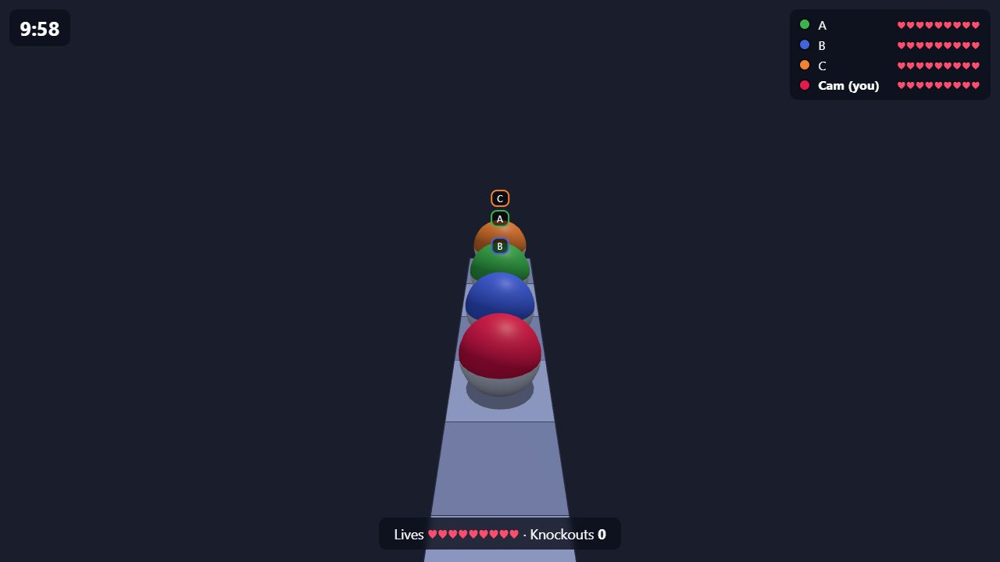
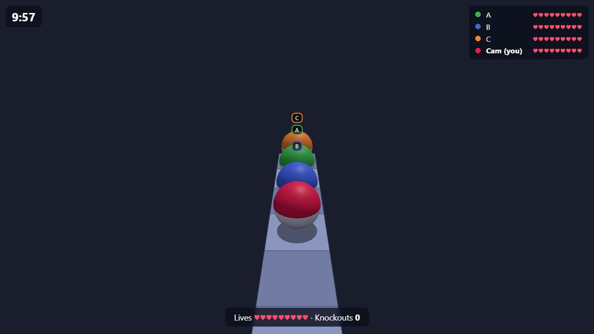
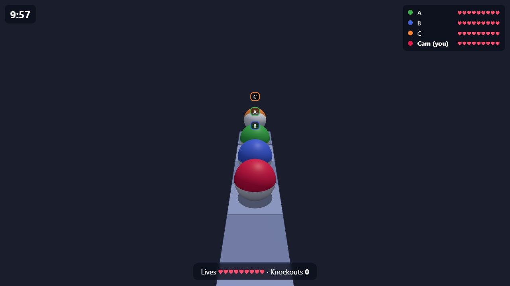
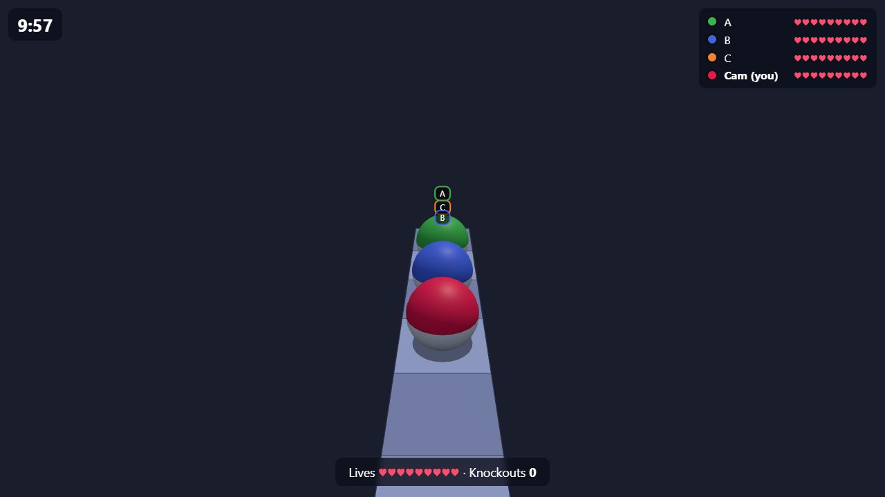

# Phase 12b report: Cradle push + heat tuning + blocker bot

## Summary
- **Cradle push** (§14) replaces the phase 12 whole-line chain push.
  - A line of 2 to `CHAIN_MAX` (now 6) balls in front of P: P gets `Strike` (appended action 12, `STRIKE_TICKS` 4) in place, the middle balls stay put, and only the last ball is knocked one cell.
  - The last ball staggers, or falls and dies, with knockout credit to P. Event: `cradle {pusherId, victimId, length}`.
  - P bounces when the last ball can't be pushed (high hop, stagger, spawn protection), when its next cell is blocked (a wall, a reserved cell, or a 7th ball), or when it escapes on the same tick.
  - P is blocked (no stun) when a middle ball is moving. Staggered and bounce-stunned middle balls still transmit.
  - A single victim is the normal push, unchanged. `rules.chain: false` bounces P off a ball with another behind it (phase 11).
- **Client.**
  - The striker lunges 0.2 cells, peaking at contact after 1 tick, then recoils. There's no stun ring.
  - At contact the middle balls shudder in turn (a squash along F, one frame apart), each with a new `clack` sound (a hard click whose pitch rises down the line).
  - The last ball's knock holds 2 of its 4 ticks, so it slides out with the normal `hit` after the clacks.
- **Prediction.** `Strike` is a server-only state (`UNPREDICTED`). A move into a line is deferred to the server, which a new test checks.
- **Tuning.**
  - race-01: `"heat": {"warnSec": 3, "burnSec": 5}`, and sudden death from 75 s. Knockout levels keep the defaults (2.5 s / 4 s). The beams stay 1-wide.
  - Hopping in place heats at half rate (even ticks only).
  - Bully detours last 1.5 s when its nearest opponent is within 2 cells, 3 s otherwise.
- **Blocker bot** (`--behaviour blocker`).
  - Every 2 s it picks a post: the nearest 1-wide corridor cell on an opponent's shortest route to the keys/exit (knockout: the arena centre), or else the nearest corridor cell.
  - It goes there, faces along the corridor toward the nearest opponent, and sits. The shared bot loop gives it heat escapes (step off, then it walks back) and defensive hops.
- **Checks.** `npm run typecheck` is clean, and `npm test` passes **424 tests** (416 before).
  - `chain.test.ts` (8) is replaced by `cradle.test.ts` (16).
  - Changed tests are listed under Deviations.

## Tests (`cradle.test.ts`)
| Case | Result |
|---|---|
| Lines of 2, 3 and 6 | Only the last ball moves. P and the middle balls stay. P is in Strike for 4 ticks, then Idle |
| Last ball off the edge | Death, `knockout` credited to P. The middle ball has no `lastKnockedBy` |
| Wall after the line; a line of 7 | Bounce, nobody moves |
| Cell after the last ball reserved by a rolling player | Bounce |
| Last ball high in a hop, or staggered | Bounce |
| Middle ball rolling | P blocked, no stun, no events |
| Middle ball escaping on the same tick | P blocked, the escaper rolls |
| Last ball escaping on the same tick | Bounce |
| Staggered or bounce-stunned middle ball (in both middle positions) | Still transmits |
| Single victim | Normal push, P rolls in |
| `rules.chain: false` | Bounce (phase 11) |
| Predictor | Defers the strike and keeps the local ball in its cell |
| Determinism | 5 players on a beam, random inputs, 2000 ticks, identical twice, with at least one cradle |

## Browser check (acceptance)
I ran headless Chrome with prediction on, a temporary heat-off copy of test-stomp (deleted afterwards), and 3 idle clients. The browser ball on x=6 pressed W into balls on 7, 8 and 9 at the beam's end.
- Server: one `cradle` (length 3) → the ball on 9 fell → `death` + `knockout` to the striker. Afterwards the striker was still on 6 (Idle), and the middle balls were still on 7 and 8.
- Render-time feel log: `clack` on the ball at x=7, `clack` at x=8 **11 ms later**, `hit` at x=9 90 ms after that, then `fall` and `pop`. The impulse travels down the line, then the last ball flies.

| Before | Strike (lunge) | Last ball flies | After |
|---|---|---|---|
|  |  |  |  |

The follow cam looks straight down the line, so the shudder squash is subtle in stills. The lunge and the orange ball leaving past the end show clearly.

## Soak: 12 rounds, `race-01,arena-01,arena-02`, `seek,bully,blocker,wander`, skill 0.5
Both runs used today's bots, side by side on ports 2568/2569. "Phase 11 rules" = `ANTI_STALEMATE=off`: no cradle, no hot tiles, no race sudden death. Neither run had any `STUCK` or server errors.

| # | Level | Phase 11 rules: stalemate s | Now: stalemate s | Now: cradles | Now: burns | Now: knockouts |
|---|---|---|---|---|---|---|
| 1 | race-01 | 0.0 | 0.0 | 0 | 0 | 0 |
| 2 | arena-01 | 6.0 | 0.0 | 13 | 0 | 6 |
| 3 | arena-02 | 9.1 | 0.3 | 91 | 0 | 7 |
| 4 | race-01 | 0.0 | 0.0 | 0 | 0 | 1 |
| 5 | arena-01 | 3.3 | 0.0 | 1 | 0 | 6 |
| 6 | arena-02 | 8.4 | 0.8 | 1 | 1 | 7 |
| 7 | race-01 | 0.0 | 0.0 | 0 | 0 | 1 |
| 8 | arena-01 | 4.7 | 0.0 | 0 | 1 | 4 |
| 9 | arena-02 | 0.1 | 0.1 | 1 | 0 | 8 |
| 10 | race-01 | 0.0 | 0.0 | 0 | 0 | 1 |
| 11 | arena-01 | 8.7 | 0.0 | 21 | 0 | 6 |
| 12 | arena-02 | 3.5 | 0.0 | 20 | 0 | 7 |
| **total** | | **43.8 s** | **1.2 s** | **148** | **2** | **54** |

The phase 11 run had 50 knockouts, and two of its arena-02 rounds went to the 180 s timeout. Now no round timed out.

**Reading it:**
- **The blocker reproduces the stalemate.** Phase 12's soak had 5 s in total across all its runs. With the blocker, the phase 11 rules give 43.8 s, 8 of 8 arena rounds with some, and up to 9 s per round. With the new rules that drops to 1.2 s, a 97 % cut.
- **The cradle shows up on the arenas.** Round 3 had 91 cradles: bots lined up on an arm beam, shoving into the line. All were lines of 2: by the bully 69, seek 40, the blocker 38, wander 2 (149 over the run, including one in the 13th round, which isn't in the table).
- **Burns are rare (2).** The heat escape moves balls before 4 s, so the heat mostly works as pressure, as in phase 12.
- **Race rounds end in 16–38 s.** They never reach the 75 s sudden death, and race stalemate was 0 in both runs. The blocker holds race-01's beams, but seek has other keys and routes (and jumps over a blocker, phase 10). I didn't measure how long the blocker actually held a beam.
- **Caveat: the blocker's pushes.** On its way to a post, the blocker pushes anyone in its path (it moves with plain `fwd`), which accounts for some of the cradles. A stricter version would wait instead.

## Deviations (details in DECISIONS.md)
1. **"No push immunity change"** is read as: a Striking ball is pushable and stompable like an Idle one, and it transmits as a middle ball. A cradle still ends P's own spawn protection, as any push does. A spawn-protected middle ball transmits, while a protected last ball bounces P.
2. **The strike sends only `cradle`, not `push`.** The last ball then gets the normal knock, stagger/fall, death and knockout events.
3. **`lintCorridors(level, min)`.** The minimum run length is now a parameter (default 4). The blocker uses 2, because race-01's connecting beams are only 3 tiles.
4. **Changed tests:**
   - `heat.test.ts`: 5 hop ticks now add 3 (ticks 16, 18, 20), not 5.
   - `knockout.test.ts`: the race-01 sudden-death timing reads `startSec` from the level (now 75).
   - `predict.test.ts`: the harness syncs crumbled blocks and collected keys each tick (`setWorld`), as the client does. With sudden death at 75 s, the 2000-tick race-01 determinism test otherwise predicted on ground that had already crumbled.

## Open questions
1. **Cradle hold:** the last ball waits 2 ticks (100 ms) before sliding, and the clacks start at 50 ms. With 5 middle balls at 60 fps, the clacks take ~83 ms, so the last one lands just after the hit. Is that fine, or should the hold scale with the line length?
2. **Knockout heat for camping blockers:** the blocker steps off at the warn and walks back, so at 4 s it never burns. Should standing back on the *same* tile within a few seconds keep the old heat?
3. **Blocker strictness:** should it avoid pushing on the way to its post (see the caveat above)?
