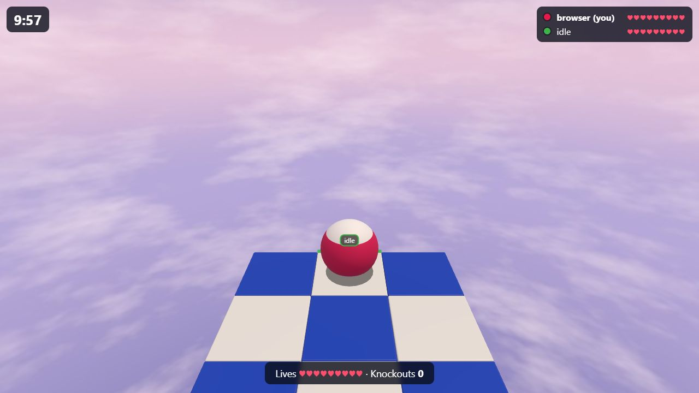
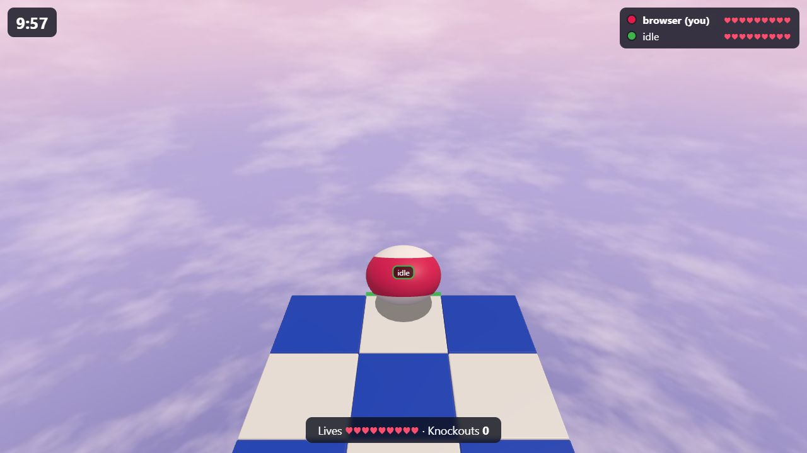
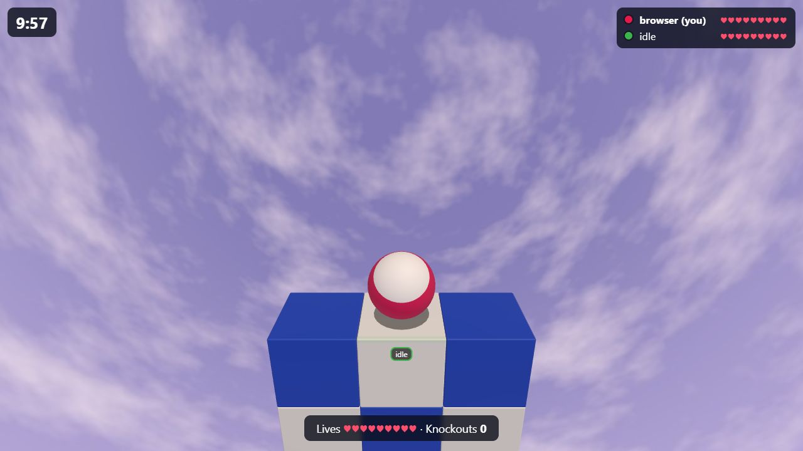
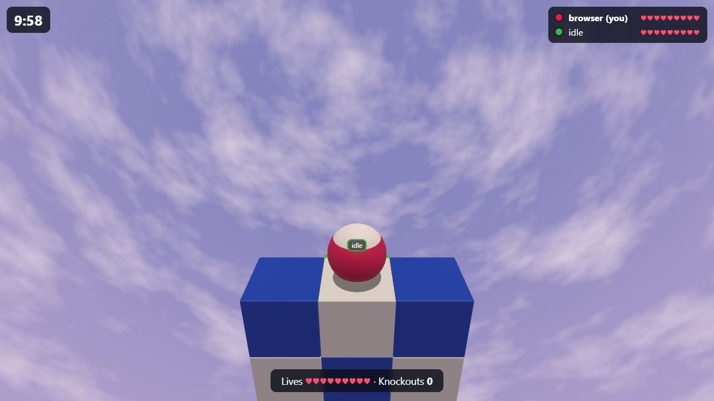
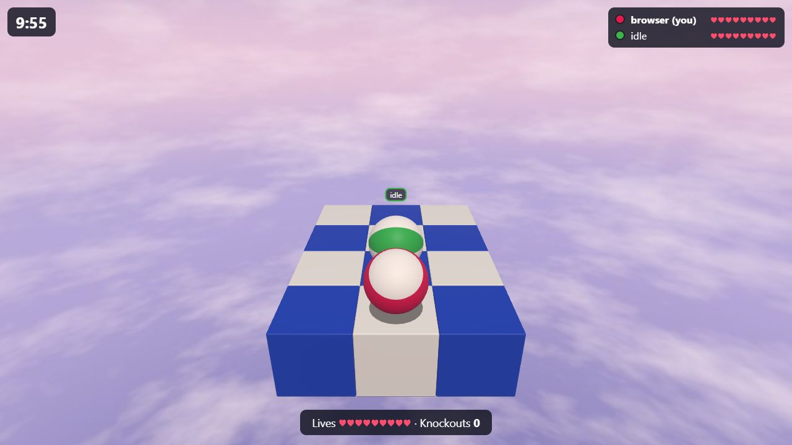
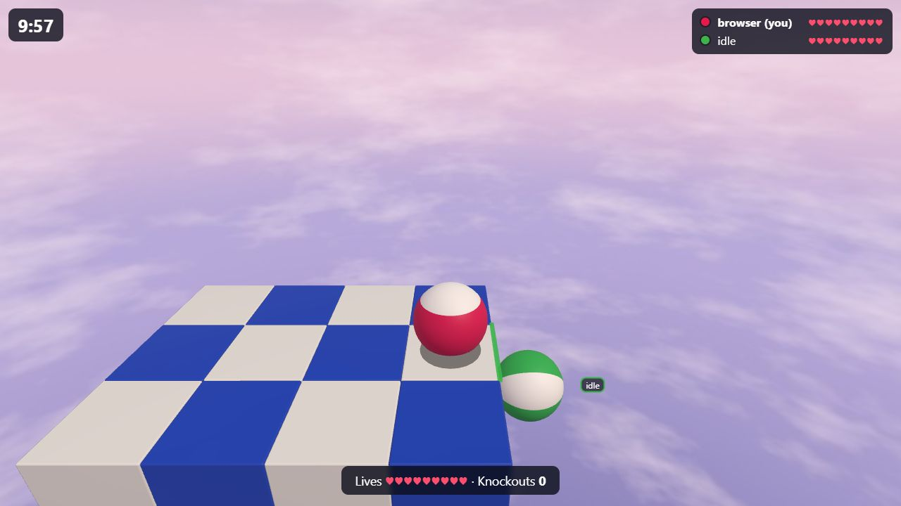

# Phase 12c report: Edge push + tile heat + 12b follow-ups

## Summary
- **Art commit first.** With the art pass in the tree, `npm test` (427) and `npm run build` passed, so it went in as `20b5179 art: ceramic kit + lavender sky`. `.gitattributes` had no rules for the new binaries, so I added `*.glb`, `*.blend`, `*.blend1`, `*.wav`, `*.mp3` and `*.zip` as `binary`. `AGENTS.md` (a copy of CLAUDE.md, named in the art DECISIONS entry) went in with it.
- **Edge push** (§14).
  - A `fwd` intent whose plan is a Flip, onto a ball in T standing on the face being flipped onto (`up === F`), is an edge-push intent.
  - The victim is knocked along `D = −U`: down the side face, or across the top away from the edge. The flipper completes its flip into T.
  - It uses the push stages: escape first, mutual bounce, fair order. It never forms a cradle line.
  - If `T + D` is blocked, the flipper bounces. If the victim isn't pushable (moving, staggered, high hop, protected), the flip is blocked with no stun.
  - Event: `push {pusherId, victimId, edge: true}`.
  - The predictor already defers it, because a flip onto a taken cell plans differently with and without the others. A test pins this.
- **Client.**
  - Edge glow: a thin line (a 1 × 0.05 × 0.05 box) on the shared edge, in the enemy's colour. It fades in when an enemy stands in T around one of the local ball's open edges. Local player only.
  - The push FX is reused: `pusherOf` now accepts a Flip into the victim's cell as well as a Roll, so the contact squash, hit-stop and `hit` play as for a push.
- **Tile heat.**
  - Heat belongs to the tile (`world.hot`, keyed `tileKey(cell, up)`). A tile heats at the old rates (hops at half rate) while a ball sits on it, and cools 1 per 2 ticks while it's empty. A burn resets the tile.
  - The room state syncs the `hot` map (only tiles with heat > 0) instead of per-player `heat`. The HUD, the renderer and the bots look up the tile under the ball. Rendering is as before: the glow under a heated ball.
- **12b follow-ups.**
  - Cradle clacks are time-spaced: `(hold − contact) / (n − 1)`, which is 50 ms / (n − 1). All n − 1 clacks land between contact and the last ball's slide, for any line length. The sim hold stays at 2 ticks.
  - The blocker waits instead of pushing on its way to its post. At its post it pushes when someone is right in front of it (on its face, or just around the edge).
- **Bots.**
  - New helper `pushSpot`: the cell a roll would push into, meaning A on the same face, or T around an open edge. `pushable` and `adjacentOpponent` use it, so every BFS bot turns to face an enemy just around its edge and pushes it, the same as an adjacent enemy.
  - `besideOpponents` adds the cell around the edge that a bully can flip from.
  - New stat: `edgePushes`.
- **Checks.** `npm run typecheck` and `npm run build` are clean. `npm test` passes **440 tests** (424 in 12b; 427 with the art pass's `art.test.ts`).
  - New: `edgePush.test.ts` (10) and 3 tile-heat tests.
  - Changed tests are listed under Deviations.

## Tests
`edgePush.test.ts`: the block's +X side face is at x=4 and its top at y=1.

| Case | Result |
|---|---|
| Top → side (2-high wall) | Victim Knocked from (4,0,0) to (4,−1,0) on face +X, `lastKnockedBy` set. Flipper Flip to (4,0,0), up +X, fwd −Y. Both settle there |
| Side → top | Flipper lands at (3,1,0), up +Y, fwd −X. Victim knocked to (2,1,0), away from the edge |
| Bottom of a 1-high face | Knocked into air, then falls toward −X (its own gravity) → death → `knockout` credited to the flipper |
| `T + D` blocked (a block) | `bounce`. Flipper Stunned (bounce), victim untouched |
| Victim staggered | No events. Flipper stays Idle |
| Ball on the underside | Normal flip, the underside ball is untouched |
| Mutual (top ↔ side around the same edge) | Both bounce |
| Escape (victim rolls away on the same tick) | No events. Flipper Idle, victim rolling |
| Predictor | Defers; the local ball stays in its cell |
| Determinism | 4 players on a 2×2×2 cube, random inputs, 3000 ticks, identical twice, with ≥ 1 edge push |

`heat.test.ts` (new):
- Stepping off at the warning and straight back (empty for < 1 s) resumes above warn − 10, and burns in under `burn − warn + 10` ticks. A fresh tile takes 80.
- An empty tile loses exactly 5 in 10 ticks, then is removed from the map.
- p1 rolling onto the tile p0 just left starts at > 25 heat.
- Determinism: the existing burn test now compares `world.hot` too (the serializer handles Maps).

## Browser check (acceptance)
Setup:
- Headless Chrome over CDP, with a throwaway server on :2568 and a throwaway Vite on :5174. Jakub's Vite had a cached level glob, and I left his servers alone.
- A temporary 4×1×3 plate level, 1 high. The seeded spawn order put the browser on top at the +X edge and an idle client on the side face right below it, then the other way round. The level was deleted afterwards.

**Top → side:** the server logged `push: browser → idle (edge)`, then `death: idle`, then `knockout: browser knocked idle off`.

| Before (glow peeks out beside the ball) | Contact | After: browser on the side, idle falling |
|---|---|---|
|  |  |  |

**Side → top:** `push: browser → idle (edge)`. The idle ball slides one cell inwards across the top, and the browser ball ends on top at the edge.

| Before (from the side face) | After |
|---|---|
|  |  |

**Edge glow:** after one turn to the left, the camera sees along the edge. The glow is the green line (the idle ball's colour) on the edge between the browser's tile and the ball on the side face.

## Soak: 12 rounds, `race-01,arena-01,arena-02`, `seek,bully,blocker,wander`, skill 0.5
There were no `STUCK` lines and no server errors. The 12b column is from the 12b report ("Now"), not a side-by-side rerun.

| # | Level | Stalemate s (12b) | Stalemate s | Edge pushes | Pushes (all) | Cradles (12b) | Cradles | Burns (12b) | Burns | Knockouts (12b) | Knockouts | End |
|---|---|---|---|---|---|---|---|---|---|---|---|---|
| 1 | race-01 | 0.0 | 0.0 | 1 | 3 | 0 | 0 | 0 | 0 | 0 | 1 | exit 21 s |
| 2 | arena-01 | 0.0 | 0.0 | 5 | 16 | 13 | 0 | 0 | 0 | 6 | 8 | lastAlive 42 s |
| 3 | arena-02 | 0.3 | 0.0 | 5 | 20 | 91 | 1 | 0 | 0 | 7 | 8 | lastAlive 57 s |
| 4 | race-01 | 0.0 | 0.0 | 2 | 3 | 0 | 0 | 0 | 0 | 1 | 3 | exit 17 s |
| 5 | arena-01 | 0.0 | 0.0 | 6 | 30 | 1 | 0 | 0 | 0 | 6 | 8 | lastAlive 56 s |
| 6 | arena-02 | 0.8 | 0.0 | 1 | 17 | 1 | 0 | 1 | 0 | 7 | 5 | lastAlive 42 s |
| 7 | race-01 | 0.0 | 0.0 | 2 | 6 | 0 | 0 | 0 | 0 | 1 | 1 | exit 21 s |
| 8 | arena-01 | 0.0 | 0.0 | 5 | 37 | 0 | 0 | 1 | 0 | 4 | 7 | lastAlive 70 s |
| 9 | arena-02 | 0.1 | 0.0 | 3 | 31 | 1 | 0 | 0 | 0 | 8 | 6 | lastAlive 50 s |
| 10 | race-01 | 0.0 | 0.0 | 1 | 5 | 0 | 0 | 0 | 0 | 1 | 1 | exit 18 s |
| 11 | arena-01 | 0.0 | 1.6 | 11 | 45 | 21 | 1 | 0 | 1 | 6 | 6 | lastAlive 94 s |
| 12 | arena-02 | 0.0 | 0.0 | 5 | 11 | 20 | 0 | 0 | 0 | 7 | 6 | lastAlive 50 s |
| **total** | | **1.2 s** | **1.6 s** | **47** | **224** | **148** | **2** | **2** | **1** | **54** | **60** | |

**Reading it:**
- **Edge pushes are common:** 47 of 224 pushes (21 %), in every round.
  - By pusher: bully 23, seek 16, blocker 5, wander 3.
  - By victim: the blocker 26 times. It sits on corridor beams, where an enemy can come round the side.
  - They're deadly: attributing each knockout to the victim's last knock gives 34 of the 60 knockouts from edge pushes, 24 from ordinary pushes and 2 from stomps. A ball knocked down a side face usually has no floor along its own gravity.
- **Stalemate stays near zero:** 1.6 s in total, against 1.2 s in 12b. All of it came in one arena-01 round, which was also the longest (94 s). Race rounds end in 17–21 s.
- **Cradles collapsed (148 → 2).** In 12b most cradles came from bots stacking on one arm beam behind the blocker. Now the blocker doesn't barge along the beams on its way, and bullies take edge pushes from around the sides instead of queuing behind each other.
- **Burns stay rare (1, the blocker).** With tile heat, the blocker's step-off-and-back resumes the old heat, but its heat escape (step off at warn) still gets it off in time almost always. The pressure is there: coming back soon means leaving again sooner.

## Deviations (details in DECISIONS.md)
1. **Edge glow:** local player only (the prompt), not "for everyone nearby" as §14 first said, so I updated §14. It covers T, the cell just past the edge on your block, and shows one enemy at a time.
2. **Tile heat, holding:** a ball that sits on a tile but isn't heating it (stunned, knocked, striking, or leaving) holds its heat, so the tile doesn't cool under it. A burn resets the tile to 0, so the next ball there doesn't pop at once. `PlayerState.heat` stays in the sim as a copy of the heat under the player. The per-player `heat` schema field is gone; the `hot` map replaces it.
3. **Clack spacing:** "hold / (n − 1)" is measured from contact (1 tick in) to the end of the 2-tick hold. The clacks can't start before contact, and with the full hold the last ones would land after the slide.
4. **`push` event:** gains `edge?: true`, used for server logs, bot stats and this soak.
5. **Changed tests:**
   - `sim.test.ts`: "can't flip into an occupied cell" now expects a Flip under push rules (it's an edge push) and Idle with push off (`pushOff.test.ts` reruns it).
   - `push.test.ts`: the untouched-victim check no longer masks the removed `heatKey`.
   - `util.ts serialize`: serializes Maps.

## Not in this phase's commit
While I worked, a separate audio pass changed `assets/audio/temporary-bounce/*`, `docs/ART-SOUND.md` and `packages/client/public/sfx/README.md`. Those changes aren't mine, so I left them out of the phase commit.

## Open questions
1. **Edge pushes are the main killer now:** 34 of 60 knockouts. A 1-high side face is a death drop. Is that the intended power level, or should victims knocked down a face get a chance, such as a knock-then-cling when the destination is a face cell with no floor?
2. **The edge glow is small:** a 0.05-thick line, and the follow cam puts your own ball in front of the edge you'd roll over. It's clearest when you're turned. Should it be thicker, or should it also tint the enemy's tile?
3. **Blocker as a victim:** it took 26 of the 47 edge pushes. Corridor camping now has a real counter. Should the blocker learn to face the open side edges too, or is being edge-pushable the point?
