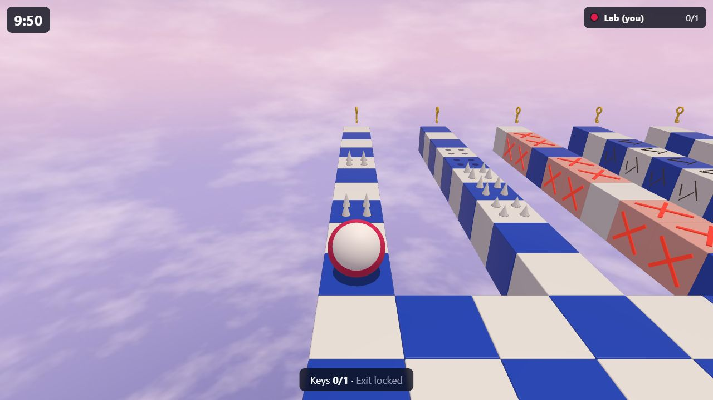
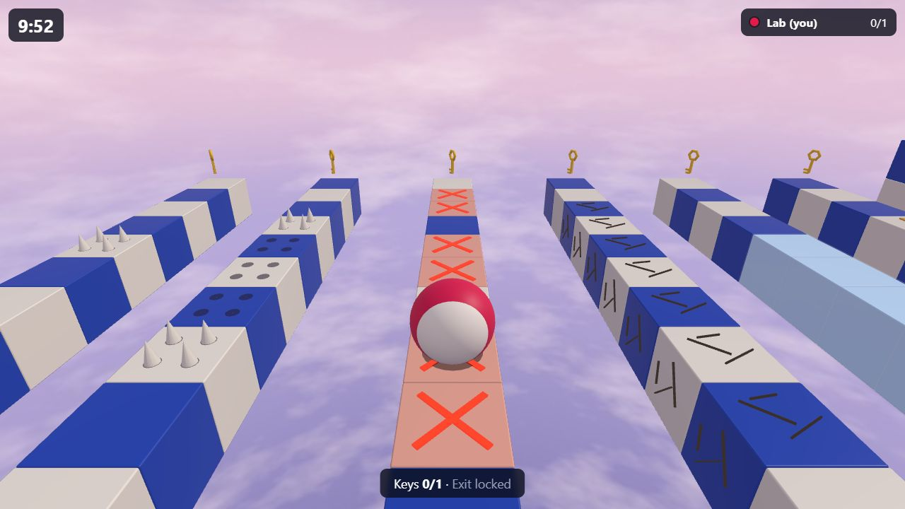
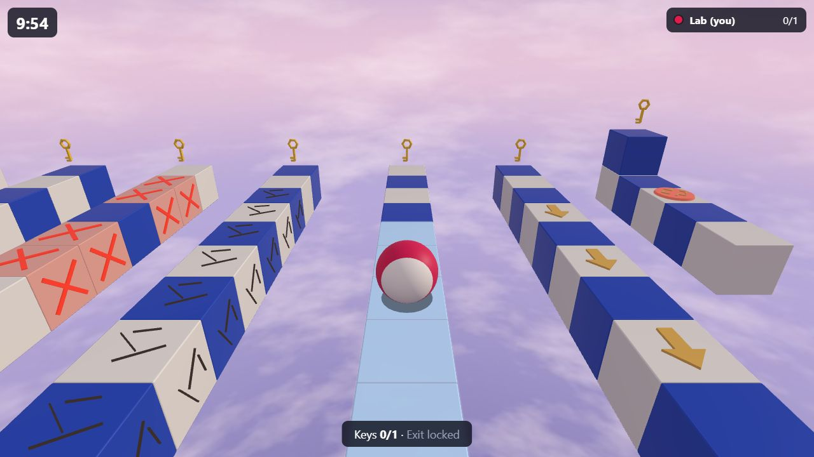
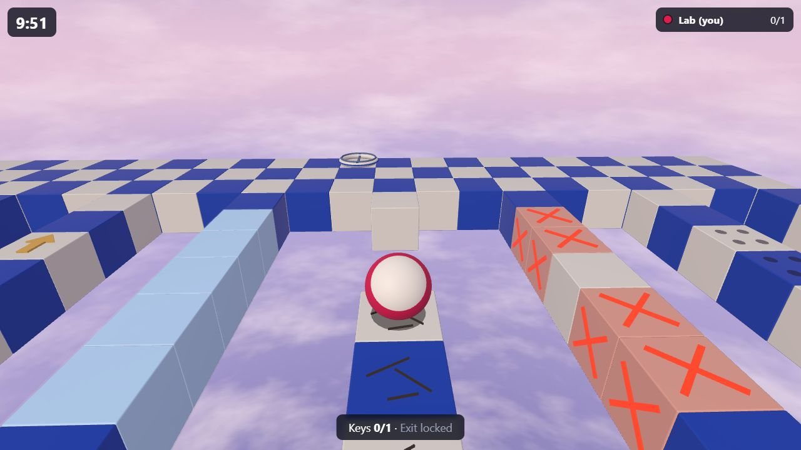
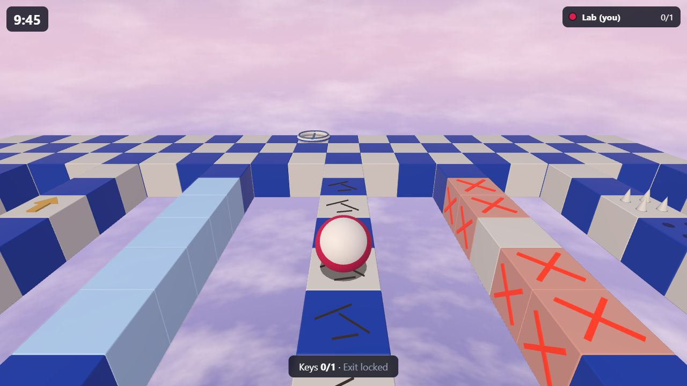
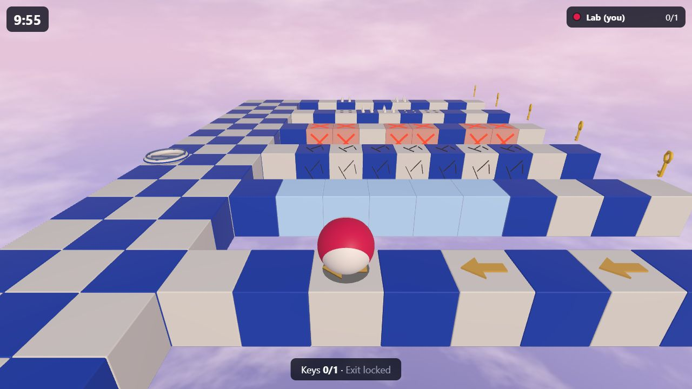
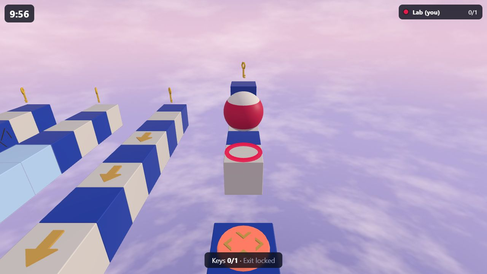
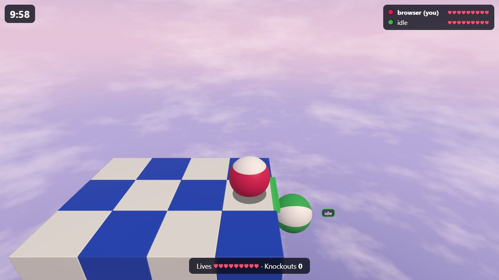
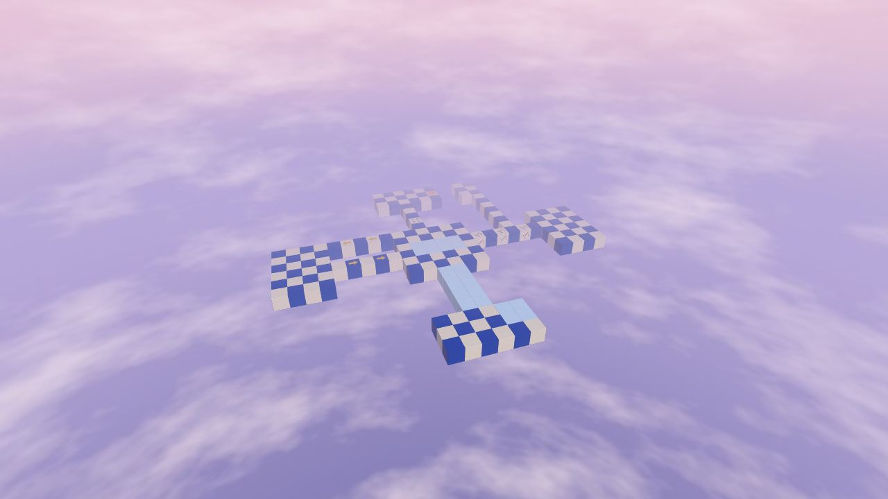
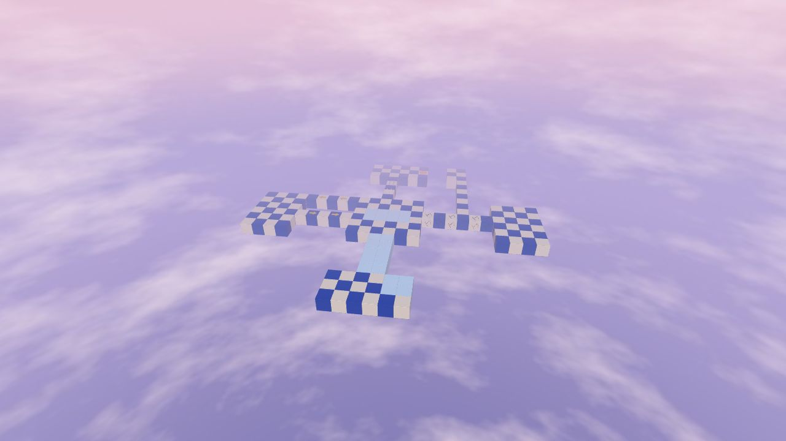

# Phase 13a report: Tiles & traps, part 1 (+ edge-glow readability)

## Summary
- **Audio pass committed first.** `npm test` (440) and `npm run build` passed with it, so it went in as `0496e86 audio: temporary bounce v01`.
- **Task 0, edge warning:**
  - The glow line is 0.12 thick with a soft pulse.
  - A ring (0.44–0.5) in the enemy's colour marks the enemy's tile.
  - A new synth sound, `edge` (a quiet creak and two ticks, sample-overridable like the others), plays once when an enemy first appears around your edge.
  - Edge pushes stay lethal, and the blocker is unchanged.
- **Level format:** `tiles` with the six 13a types. Loading builds `level.blockTiles` and `level.faceTiles`. Validation covers every rule in the prompt (see DECISIONS).
- **Sim** (`sim/tiles.ts`, `tick.ts`, `actions.ts`), all integer and tick-based:
  - **Spikes** (static and retracting): death on finishing onto raised spikes, or standing when they rise. Jumping over is safe.
  - **Fire:** 3 landings in a row pop the ball. A landing on a normal tile resets the count.
  - **Crumble:** the block vanishes 4 ticks after the ball leaves it, a ball still on it falls, and it regrows after `regrowSec` (default 8) once its cell is empty.
  - **Ice:** forced slides. Input pulses are dropped mid-slide. A slide climbs a wall, flips over an edge, and pushes like a roll. A jump on ice goes forward without W.
  - **Arrow:** fwd moves only along the arrow; turning and hopping are allowed.
  - **Boost:** far = 3 ahead, high = 2 ahead + 1 up, with the jump's stomp, landing and fall rules.
  - `death` events carry a `cause`: `fall`, `spikes`, `fire` or `burn`.
- **Planning:** `resultPose` follows ice slides and boosts to where they stop, and rejects spikes (retracting ones too), fire and fatal falls.
- **Predictor:** runs the same rules. It gets crumble tiles from the server (`setWorld(…, crumbling)`) and `fireCount` in its server state.
- **Server:** syncs a `crumbling` map (block → vanish tick) and per-player `fireCount`. Spike phase comes from the tick, so it isn't synced.
- **Client** (`render/traps.ts`, procedural and in the ceramic style):
  - **Spikes:** 4 ivory cones that animate up and down, with dark holes showing when they're down.
  - **Fire:** blocks get a terracotta glaze and flickering emissive red crosses on every open face. The ball swells 7 % per fire count.
  - **Crumble:** dark cracks. The block shakes while counting down, breaks into 8 falling chips, and scales back in on regrow.
  - **Ice:** a pale-blue glaze with a glossy shell. Sliding balls leave a streak and play `slide` ("ssss").
  - **Arrow:** a gold embossed arrow.
  - **Boost:** a coral pad with 4 chevrons that glows while a ball rolls onto it, and a `pwomp` sound on launch.
  - **Death toasts:** "X got spiked", "X popped on fire", "X fell off" (a fall toast is dropped when a knockout toast covers it).
- **Levels:**
  - `traps-lab.json`: race, not in the rotation. Seven lanes (static spikes, retracting spikes, fire, crumble, ice, arrow, boost), each with a key at the end.
  - `race-02.json` "Ice Garden": 7 keys, 3 required, lavender sky. It has an ice bridge and an ice strip, a retracting-spike beam, a crumble bridge, a one-way arrow loop, and a boost shortcut onto a key ledge.
  - `arena-01`: 2 retracting spikes on the middle bridges and 1 boost pad.
- **Bots:**
  - BFS avoids traps, and planning treats crumble blocks that are counting down as gone.
  - `seek` also pushes onto spikes or fire, not only into the void.
  - The bully detours up to 3 moves to push a victim onto a trap.
  - The blocker never posts on crumble or fire.
  - The heat escape turns instead of rolling onto a trap.
- **Checks:** `npm run typecheck` and `npm run build` are clean, and `npm test` passes **462 tests** (440 before).

## Tests
`traps.test.ts` (17) plus 1 predictor test:

| Rule | Cases |
|---|---|
| Format | Every validation rule, including a crumble block allowing spikes/boost on its faces |
| Spikes | Rolling onto static spikes → `death` (cause spikes); jumping over is safe. Retracting (period 20, up 10): a roll finishing on tick 15 is safe until they rise on tick 20 (death exactly on 20); finishing on tick 10 lives, on tick 9 dies |
| Fire | Fire, fire, normal, fire → count 1 and alive. 3 in a row → `death` (cause fire) |
| Crumble | Standing on it for 30 ticks: still there. Vanishes exactly `CRUMBLE_DELAY_TICKS` after leaving. Doesn't regrow while a ball is in its cell, then regrows. A ball on another face of the block falls |
| Ice | One press slides 3 ice tiles and stops on the first normal tile (a turn pressed mid-slide is ignored). Slide into a wall → climb; off an edge → flip; into a player → push. A jump without W on ice → forward jump |
| Arrow | Wrong fwd blocked; a forward jump becomes a hop; turning works; the right fwd rolls |
| Boost | far → lands 3 ahead (a Jump of BOOST_TICKS); high → 2 ahead + 1 up; onto a player → stomp; into the void → `fall` death |
| BFS | Across ice to a key in one `fwd`; around spikes; over a gap using a boost |
| Predictor | Solo ice slide into a boost, then over a crumble block that vanishes: 0 mispredictions (server harness with 1-tick input delay) |
| Determinism | 4 players, every tile type, random inputs, 2000 ticks, identical twice, with at least 2 death causes |

`path.test.ts`: traps-lab is left out of "every race level is reachable", because planning treats fire as lethal (see DECISIONS).

## Browser checks
Setup: headless Chrome over CDP, a throwaway server on :2568/:2569 and a throwaway Vite on :5174. Jakub's :2567/:5173 were left alone. A script walked the ball from the hub into each traps-lab lane on a fresh round.

| Lane | What happened | Toast |
|---|---|---|
| Static spikes | Rolled onto x=5 → `death (spikes)` | "You got spiked" |
| Retracting spikes | Held W down the lane, caught on x=7 as they rose | "You got spiked" |
| Fire | x=4, x=5 → `fireCount` 2 and the ball visibly swollen; turned round and back onto x=4 → pop | "You popped on fire" |
| Crumble | Crossed the bridge; the blocks behind vanished, then grew back after 6 s | – |
| Ice | One tap onto x=4 → slid to x=9 | – |
| Arrow | At x=5 facing −Z, W did nothing; turned to +X → rolled | – |
| Boost | Far pad x=5 → landed x=8; high pad x=10 → landed on the key block at y=2 (key collected) | – |
| Fall | Forward jump off the hub edge | "You fell off" |

| Spikes (static up, retracting down/up) | Fire (count 2: swollen ball) | Ice + arrow + boost lanes |
|---|---|---|
|  |  |  |

| Crumble bridge gone behind the ball | Regrown 6 s later | Arrow lane (blocked facing −Z) |
|---|---|---|
|  |  |  |

| Boost launch (landing marker at x=8, pad with chevrons) | Edge warning (0.12 line, pulsing) |
|---|---|
|  |  |

**race-02 overview** (lobby orbit):
- The 2-wide ice bridge runs north from the centre island, and the centre island has a pale-blue ice strip.
- West: the arrow beams (out along z=9, back along z=6) and the W island.
- East: the cracked crumble bridge to the E island, with the ledge path joining it from the boost ledge.
- South: the retracting-spike beam, and the S island with the boost pad at its east end.

**Prediction at LATENCY_MS 150 on race-02, solo:** 61.7 s of play (ticks 22 → 1256), with 17 ice slides (16 across the north bridge, 1 on the centre strip), two forward jumps over the spike beam, the boost onto the ledge (key collected), and the crumble bridge. The result was **0 mispredictions and 0 deferrals** (`kula.predict`).

## Soak: 12 rounds `race-02,arena-01,race-01`, `seek,bully,blocker,wander`, skill 0.5
There were no errors and no `STUCK` lines. Race rounds all went to seek via the exit (race-02 in 25–67 s, race-01 in 18–29 s). Arena-01 went to seek once and to bully three times.

**Deaths by cause:** 81 in total.

| Cause | Count | Where |
|---|---|---|
| fall | 76 | arena-01 39, race-02 24, race-01 13 |
| burn | 3 | race-02 |
| spikes | 2 | arena-01 |
| fire | 0 | (no fire in the rotation) |

**Bot deaths on traps:** 2, both wander (random inputs) rolling onto arena-01's middle spikes. The BFS bots (seek, bully, blocker) had **0** trap deaths.
- Falls by bot:
  - wander: 25 own, 2 pushed.
  - blocker: 21 pushed, 1 own.
  - seek: 13 pushed, 2 own.
  - bully: 6 pushed, 6 own.
- The 9 own falls of the BFS bots were off-map falls from side and under faces. None is at a boost landing or on a trap tile.
- 164 pushes, 29 of them edge pushes.
- The bully's trap-push detour produced no spike knockouts: arena-01's spikes are retracting and up only a third of the time, and they sit on 3-wide bridges that the bully rarely lines up on.

## Deviations (details in DECISIONS.md)
1. **Crumble sync:** a `crumbling` map (block → vanish tick) instead of literally reusing the band-based `removed` sync. Clients need the pending state for the shake, and the predictor applies vanishing on the same tick.
2. **Forced moves go through intents** (the next decision is the forced command), so slides push and reserve like any roll. Pulses pressed during a slide are dropped rather than buffered.
3. **Boost:** a new `Cmd` 'boost' (never input) with a 12-tick flight. The cells flown through must be open, with no shorter fallback.
4. **Planning** treats fire as lethal (BFS doesn't track the count), so traps-lab's fire lane is unplannable and left out of the reachability test.
5. **Fire counting:** landings from Roll/Flip/Climb/Jump/Fall/Knocked/Rebound count. Hops and turns in place don't.
6. **Art:** procedural geometry in the ceramic style. CLAUDE.md's "placeholder art only" predates the art direction.

## Open questions for 13b
1. **Teleporters:**
   - Should a teleport chain into ice or a boost on the partner tile? The forced-move hook allows it.
   - Does the 20-tick cooldown block the partner tile too, so you can't bounce straight back?
   - Should a pushed ball that finishes a knock on a teleporter teleport? The §18 wording ("finishing on one") says yes.
2. **Lasers and switches:**
   - Does "passes through a beam cell" include a jump arc's air cells, and a flip's corner cell?
   - Should bots learn to toggle switches, or only avoid active beams (like retracting spikes, treated as always on for planning)?
   - Does a laser group's state go in the schema as a small map like `crumbling`?
3. **Invisible and vanishing blocks:**
   - For invisible blocks, is "within 2 cells" Chebyshev or Manhattan, and do other balls standing on one reveal it?
   - Vanishing blocks share the `removed` overlay with crumble. Should a vanishing block that's also crumble be forbidden, as ice + fire is?
4. **Fire planning:** tracking `fireCount` in the BFS state (pose × 0..2) would make fire lanes plannable. Worth it for bots, or leave fire as a human-only hazard?
5. **Spikes placement:** arena-01's spikes killed only wander. Should knockout levels get static spikes at bridge ends, where pushes naturally land, to make the bully's trap pushes matter?
