# Phase 14 report: Level pack + lobby level vote

## Summary
- **Level pool.** Levels opt in with `"pool": true`. `LEVEL` is now an optional testing override: one id means always that level, and a comma list is voted on like the pool. With `LEVEL` unset, the pool is the 12 pool levels. test-*, arena-cube and traps-lab have `"pool": false`.
  - **Your `.env` still sets `LEVEL=race-02,arena-01,traps-lab,race-01,arena-02`.** Delete that line to vote over the full pool. `.env.example` is updated.
- **Lobby vote** (`shared/src/vote.ts`, pure and seeded; the server calls it):
  - The lobby offers 3 candidates: random, never the last played level, and at least one race and one knockout when the pool allows. Random is always option 4.
  - Players vote with 1–4 or a click, and can change their vote until the countdown.
  - At countdown the most votes wins. A tie is broken by the room's seeded RNG. No votes, or Random winning, picks a random pool level other than the last one played.
  - Votes are cleared on each new lobby. A player who leaves takes their vote with them.
  - Schema: `candidates`, `voteCounts` (3 candidate slots, then Random) and `PlayerS.vote`. Message: `vote`.
  - Bots vote randomly (one vote per lobby, before readying).
- **Client lobby panel:**
  - 3 level cards plus a Random card. Each card has a number key, the name, the mode, trap icons (▲ spikes, 🔥 fire, ▦ crumble, ❄ ice, ➜ arrows, ⏫ boost), a preview and live vote dots.
  - Your own vote is outlined in green.
  - Previews come from a small offscreen renderer (320×200, fixed 3/4 angle, keys in gold and the exit in mint), cached per level.
  - Ready (R) is unchanged. The results screen says "Next: vote in lobby (Ns)".
- **Levels:**
  - 8 new: race-03 to race-06 and arena-03 to arena-06.
  - Trap pass on the old ones:
    - race-01: a crumble bridge on the D→B beam, and a boost pad from island C onto D.
    - arena-02: static spikes on the pad's three outer side faces, and ice on both ladder rails.
- **`npm run level:stats`**: a markdown table per pool level (below).
- **Checks:** `npm run typecheck` and `npm run build` are clean. `npm test` passes **506 tests** (462 before).

## Tests added
| Suite | What |
|---|---|
| `vote.test.ts` (7) | Candidates: 3 distinct, never the last level, always race + knockout (200 seeds); every eligible level appears; small pools (1 level repeats, 2 levels, race-only). Tally: majority, Random → eligible level ≠ last, tie-break deterministic per seed and reaching every tied option, no votes → random, `voteCounts` ignores invalid votes |
| `race.test.ts` (1, real server) | Vote counts sync; a third client's vote disappears when it leaves; invalid and out-of-range votes are ignored; a changed vote moves; the voted level loads at countdown; votes outside the lobby are ignored; after the round, the new lobby has cleared votes and candidates without the last played level |
| `lint.test.ts` (12) | Every pool level: no 1-wide corridor without a way round |
| `path.test.ts` | Now also runs on the 8 new levels (race: every key + exit from every spawn; knockout: spawn↔spawn and ≥ 90 % of stoppable surfaces; see Deviations) |

## Level gallery
Lobby orbit, with the HUD hidden (keys aren't drawn in the lobby; the card previews show them).

| race-03 Pillar Garden | race-04 Sky Ladder | race-05 Underside |
|---|---|---|
| 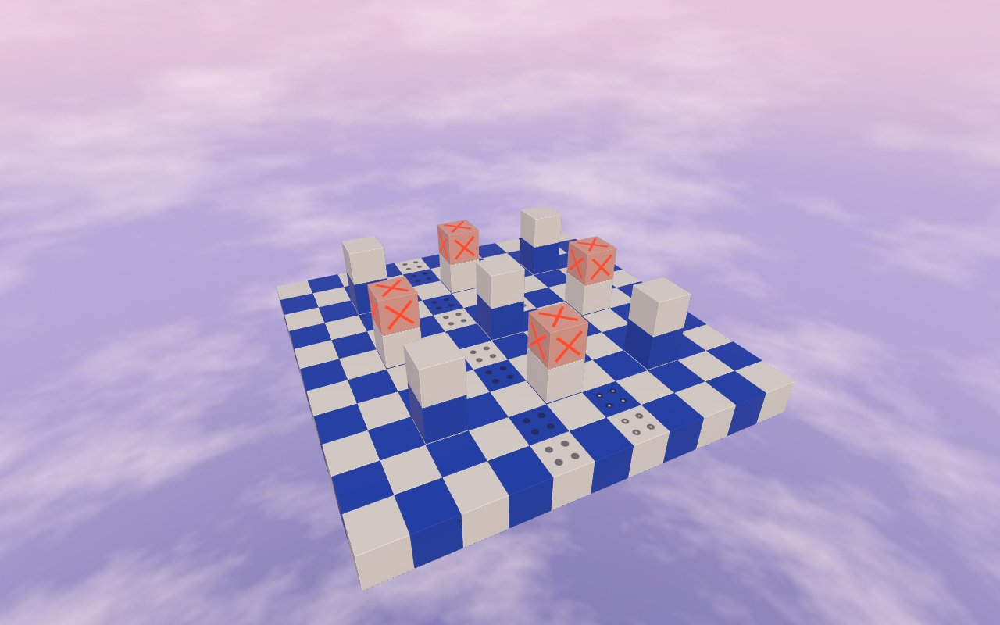 | 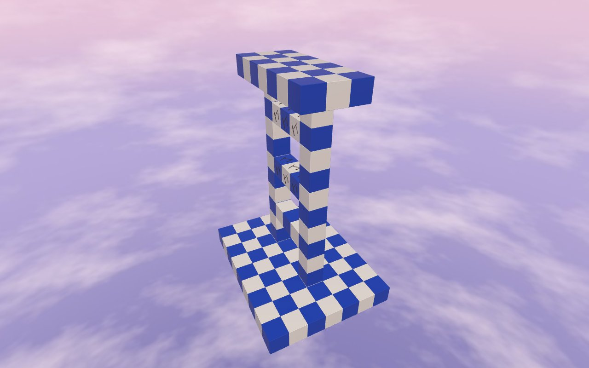 | 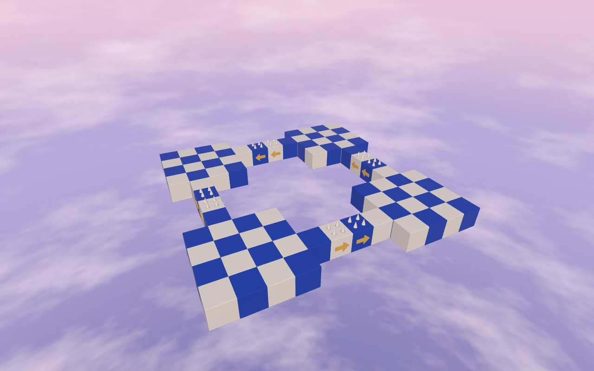 |
| 11×11 floor, 3×3 grid of 2-high pillars. Edge-middle pillars have fire tops. Retracting spikes along z=4 and z=6, crossable at the gaps in line with the pillars (phases 0/20). Keys on 4 pillar tops, 2 undersides and a pillar side; exit on the centre pillar. 100 s. | Base plate, two 10-high rails with rungs at y=3/6/9 (6 and 9 crumble), a 7×3 top plate. A far boost on the west rail's −Z face at y=7 throws you 3 up toward the top. Keys up the rail faces, the rung, the top and undersides; exit on top. 110 s. | Four plates in a ring of beams. Beam tops have static spikes in the middle, and arrows on the beams' undersides and sides make the ring one-way (clockwise from above). 6 keys on undersides, 1 on a side face; exit on a beam side face. 110 s. |

| race-06 Boost Relay | race-01 Four Islands (trap pass) | race-02 Ice Garden (unchanged, now pooled) |
|---|---|---|
| 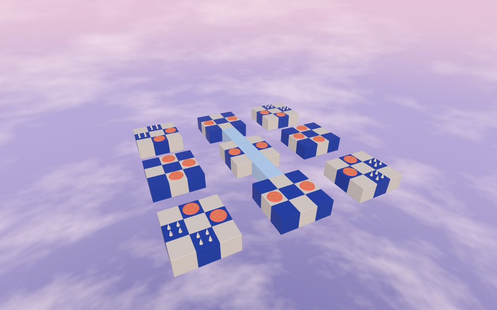 | 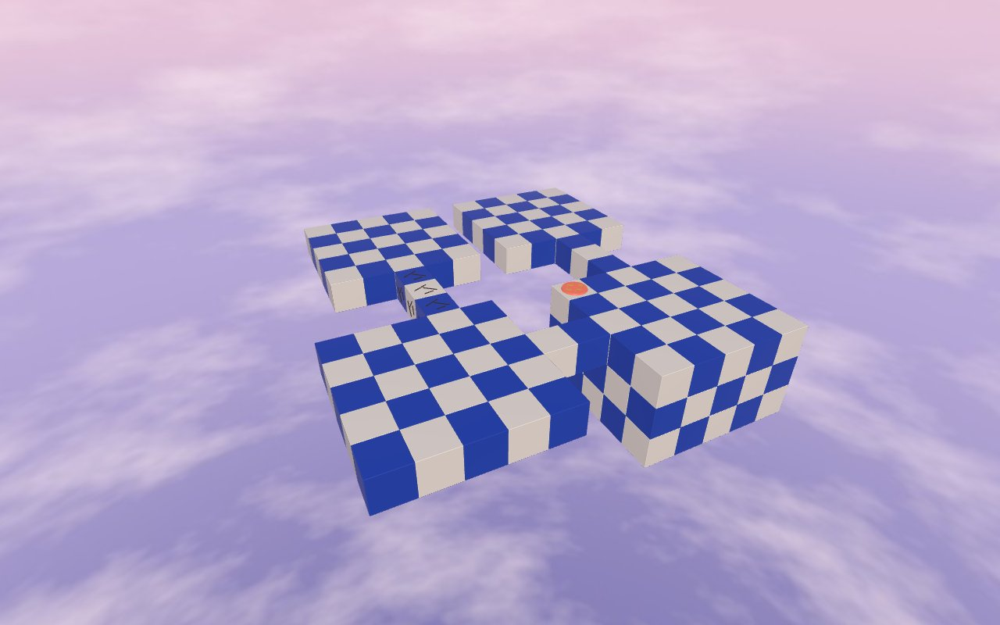 | 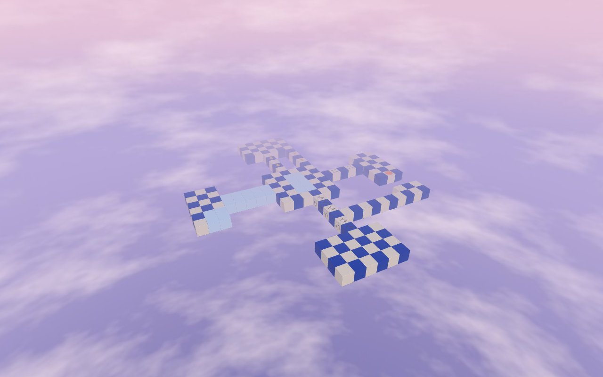 |
| 3×3 grid of 3×3 islands with 2-wide gaps. Paired far boosts on facing edges link neighbours both ways; the middle row is a 7-tile ice runway straight across. The 4 corner keys each sit behind 2 static spikes (jump in, or come up from below); exit under the centre island. 100 s. | Crumble bridge at z=8 (D→B), boost pad at (8,0,4) from C onto D. | |

| arena-03 Ice Rink | arena-04 Crumble Tower | arena-05 Fire Ring |
|---|---|---|
| 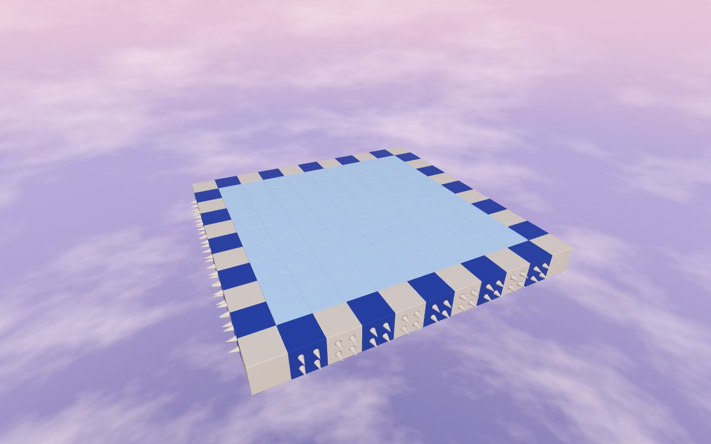 | 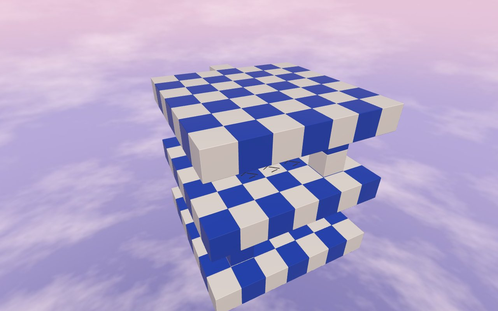 | 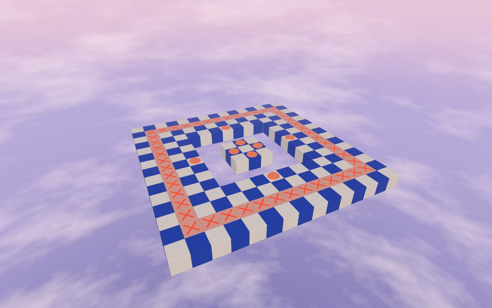 |
| 11×11 plate with a 9×9 ice centre. Static spikes on the rim's outer side faces, except the corners (the way to the underside). | 7×7 plates at y=0/3/6 linked by 2-high inner columns. The middle plate's 3×3 centre crumbles (regrow 8 s). A pole on the west side has a far boost past the middle plate. | 15×15 donut with a 7×7 hole; its second ring is fire. A safe 3×3 island in the hole. Boost pads cross the 2-wide gap both ways. |

| arena-06 Pillar Field | arena-02 Sky Cross (trap pass) | arena-01 (unchanged, now pooled) |
|---|---|---|
| 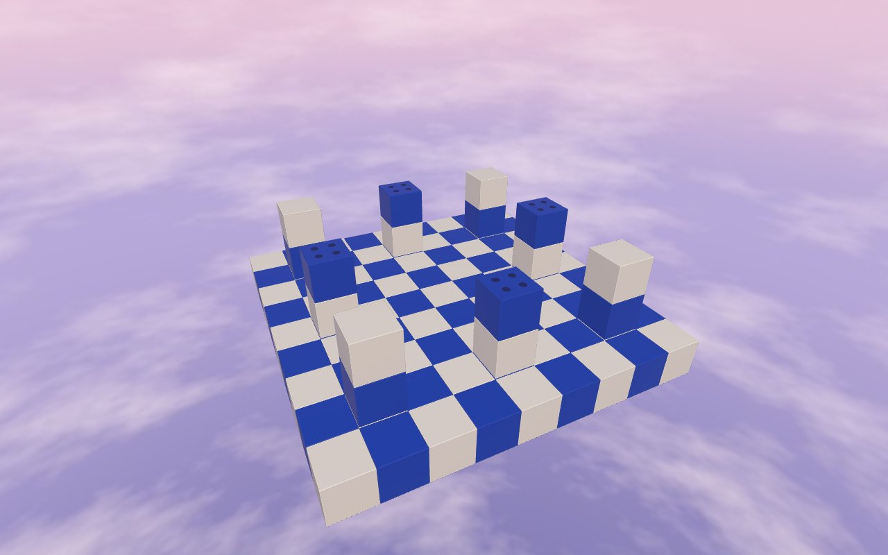 | 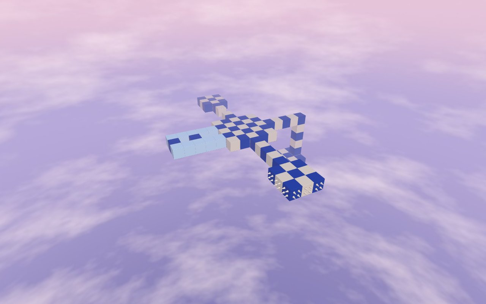 | 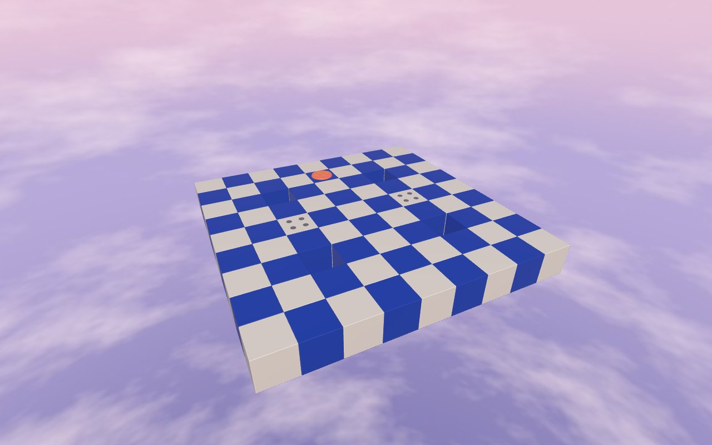 |
| 9×9 floor, 8 two-high pillars (open centre). Retracting spikes on the 4 edge-middle pillar tops (period 60, up 24, alternating phase). | Spikes on the pad's outer faces, ice ladder rails. | |

**Browser (headless Chrome over CDP, throwaway server :2568 + Vite :5174; your :2567/:5173 untouched):**
- The lobby showed 3 cards with previews: Pillar Field, Underside, Sky Cross, plus Random.
- Key **2** → `vote` 1, counts `0,1,0,0`, card 2 outlined.
- A click on card 3 → `vote` 2, counts `0,0,1,0`.
- **R** → countdown on `arena-02` = candidate 3 (the voted card).
- No console exceptions.

| Lobby after pressing 2 | The voted level loaded |
|---|---|
| 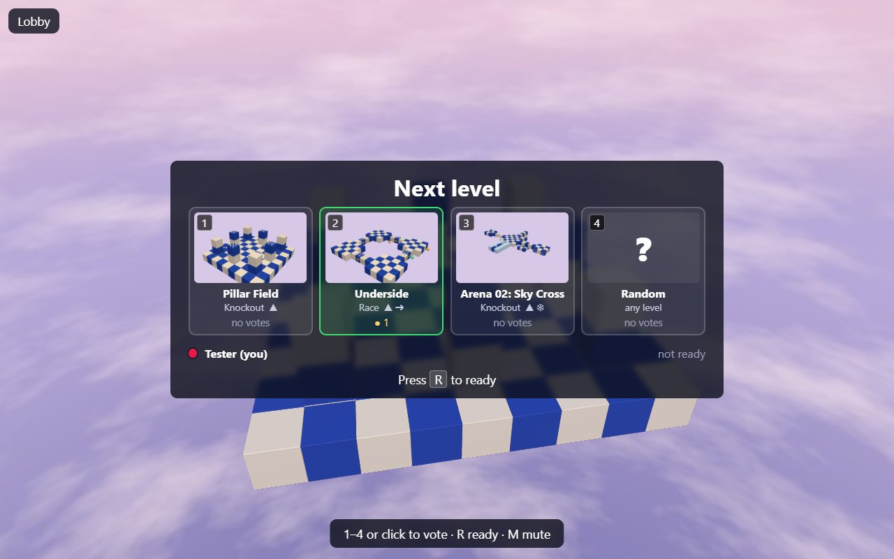 | 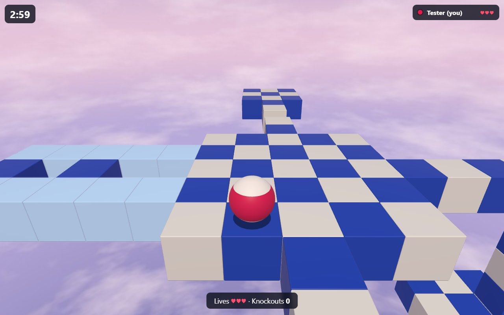 |

## `level:stats`
| level | mode | blocks | spikes | fire | crumble | ice | arrow | boost | keys | spawns |
| --- | --- | ---: | ---: | ---: | ---: | ---: | ---: | ---: | ---: | ---: |
| arena-01 Arena 01 | knockout | 77 | 2 | · | · | · | · | 1 | · | 8 |
| arena-02 Arena 02: Sky Cross | knockout | 82 | 9 | · | · | 10 | · | · | · | 8 |
| arena-03 Ice Rink | knockout | 121 | 36 | · | · | 81 | · | · | · | 8 |
| arena-04 Crumble Tower | knockout | 163 | · | · | 9 | · | · | 1 | · | 8 |
| arena-05 Fire Ring | knockout | 185 | · | 48 | · | · | · | 8 | · | 8 |
| arena-06 Pillar Field | knockout | 97 | 4 | · | · | · | · | · | · | 8 |
| race-01 Race 01: Four Islands | race | 158 | · | · | 3 | · | · | 1 | 7 (need 3) | 4 |
| race-02 Ice Garden | race | 164 | 2 | · | 5 | 22 | 4 | 1 | 7 (need 3) | 4 |
| race-03 Pillar Garden | race | 139 | 16 | 4 | · | · | · | · | 7 (need 3) | 4 |
| race-04 Sky Ladder | race | 113 | · | · | 6 | · | · | 1 | 7 (need 3) | 4 |
| race-05 Underside | race | 80 | 8 | · | · | · | 24 | · | 7 (need 3) | 4 |
| race-06 Boost Relay | race | 85 | 8 | · | · | 7 | · | 20 | 7 (need 3) | 4 |
| **levels using it** |  |  | 8 | 2 | 4 | 4 | 2 | 7 |  |  |

Every 13a trap type is in at least 2 pool levels (fire and arrows are exactly 2).

Race sudden death (start = time − 30, interval fits the bands): race-03 70/1.5, race-04 80/1.75, race-05 80/2.5, race-06 70/2.5 (warn 1). Knockout: lives 3, crumble 45/10/2, 180 s.

## Soaks
### Per level: 4 bots (`seek,bully,blocker,wander`, skill 0.5), `LEVEL=<id>`, 380 s race / 600 s knockout
The 10 servers ran in parallel.

| Level | Rounds | STUCK | Errors | Winners | Deaths by cause |
|---|---:|---:|---:|---|---|
| race-01 | 4 | 0 | 0 | seek 4 (exit) | fall 20 |
| race-03 | 14 | 0 | 0 | seek 14 | fall 33, fire 22, spikes 11, burn 2 |
| race-04 | 14 | 0 | 0 | seek 14 | fall 33 |
| race-05 | 10 | 0 | 0 | seek 10 | fall 31, spikes 17, burn 6 |
| race-06 | 6 | 0 | 0 | seek 5, 1 timeout draw | fall 62, spikes 6, burn 4 |
| arena-02 | 9 | 0 | 0 | bully 5, seek 3, blocker 1 | fall 90, spikes 3, burn 2 |
| arena-03 | 12 | 0 | 0 | bully 10, seek 2 | fall 71, spikes 48, burn 3 |
| arena-04 | 8 | 0 | 0 | bully 6, seek 1, blocker 1 | fall 78, burn 4 |
| arena-05 | 9 | 0 | 0 | bully 8, seek 1 | fall 72, fire 15, burn 3 |
| arena-06 | 10 | 0 | 0 | bully 8, blocker 2 | fall 98, spikes 7 |

Trap deaths are almost all `wander` (random input): race-03 fire 22 of 22 and spikes 9 of 11; race-05 spikes 17 of 17; arena-05 fire 15 of 15. The BFS bots' trap deaths are pushes, mostly on the Ice Rink rim: seek 6 and bully 7 spike deaths there.

### Pool: 16+ rounds, no `LEVEL` override, bots voting (4 bots `seek,bully,blocker,wander`, 1500 s, MIN_PLAYERS 4)
**36 rounds, 0 STUCK, 0 errors.** All 12 pool levels were played, and no level ran twice in a row.
- Vote ties were broken both ways, e.g. `2/0/2/0 → race-01`. 4 rounds went to Random, e.g. `1/1/1/1 → arena-02`, which wasn't a candidate.

Levels played:

| race-01 | race-02 | race-03 | race-04 | race-05 | race-06 | arena-01 | arena-02 | arena-03 | arena-04 | arena-05 | arena-06 |
|---:|---:|---:|---:|---:|---:|---:|---:|---:|---:|---:|---:|
| 5 | 4 | 4 | 2 | 5 | 4 | 1 | 2 | 1 | 3 | 4 | 1 |

In order: race-02 race-04 race-05 arena-04 race-02 arena-02 race-01 race-02 arena-03 race-01 arena-05 race-05 race-01 arena-05 race-06 race-01 arena-06 arena-05 race-06 race-02 race-03 arena-04 race-05 race-06 race-03 race-04 race-06 race-05 arena-02 race-03 race-05 arena-05 arena-04 arena-01 race-01 race-03 (the last round was cut off by the soak ending).

**Deaths by cause:** 205 in total.

| Cause | Count | Where |
|---|---:|---|
| fall | 172 | arena-04 30, arena-05 30, arena-02 22, race-02 15, race-06 15, race-01 13, race-05 13, arena-01 10, arena-06 9, arena-03 6, race-03 5, race-04 4 |
| spikes | 18 | race-05 7, arena-03 5, race-06 3, race-03 2, arena-01 1 (wander 16, seek 1, bully 1) |
| fire | 12 | arena-05 9, race-03 3 (wander 10, seek 1, bully 1) |
| burn | 3 | arena-05 2, race-05 1 |

- Wins: seek 26, bully 10.
- 409 pushes (74 of them edge pushes) and 111 knockouts.

## Deviations (details in DECISIONS.md)
1. **Vote logic lives in `shared/src/vote.ts`**, not `sim/`. It's a room rule, kept pure for tests. The room's vote RNG is seeded from the clock per room, which is outside the sim.
2. **`LEVEL` no longer rotates.** It's a pool override that's voted on too, and unset means the pool (the old default was `test-cube`).
3. **Knockout coverage test:** the ≥ 90 % counts only tiles planning can stop on. Spikes, fire and ice are left out; otherwise arena-03 (81 ice blocks) and arena-05 (fire ring) can't pass by construction.
4. **arena-05 is a 15×15 donut** (4 wide, not 3) so every boost pad has a normal tile in front. Planning won't roll across fire, so with the 3-wide ring the island was unreachable for bots.
5. **Previews use a second small WebGL context** rather than reading back a render target from the main one, which would skip the sRGB output conversion.
6. New lint test: no pool level may have a corridor without a way round.

## Open questions
1. **Ice Rink "pushes slide far":** under §18 only rolls, flips and climbs continue on ice, so a *knocked* ball stops after 1 cell. What does slide far is the attacker: one tap slides you across the rink, and the slide pushes whoever is in the way. Should a knock that finishes on ice keep sliding in the push direction? That would be a small sim change in `forcedAfter` plus the knock's facing.
2. **race-05 invisible routes (13b):**
   - The ring is one-way, and the empty centre (x 4–7, z 4–7) is left open on purpose.
   - Proposal: an invisible beam at z=5 from x=2 to x=9, joining the west and east beams, as a counter-direction shortcut.
   - Or invisible stepping blocks diagonally between plate corners, e.g. (3,0,3)→(8,0,8).
3. **Boost pads throw you sideways:** a ball rolling *along* an island edge onto a pad (race-06, arena-05's island) is launched along the edge, off the island. That's consistent with §18, but harsh. Keep it, or only launch when the roll is toward the pad's "front" (a pad `dir`)?
4. **Fire and bots:** planning treats fire as lethal, so bots never cross race-03's fire pillar tops or arena-05's fire ring on foot. They jump over the ring or go around underneath. Worth tracking `fireCount` in BFS (13a question 4) now that fire is in the pool?
5. **Race spawns:** the race levels have 4 spawns like race-01/02, while knockout levels have 8. Do you want 8 in race too, for 5–8 player lobbies?
6. **Lobby backdrop:** the scene behind the vote panel is the last played level (the first candidate before any round). Should it cycle through the candidates, or should the panel's previews be enough?
