# Phase 18b report: Remove x-ray + match follow-ups

## What changed
- **X-ray removed**, except for your own ball.
  - Enemy balls, keys, the exit, gems/coins/fruit, pills and the crown no longer get silhouettes.
  - The local ball keeps its silhouette, and only on your own screen (`PlayerView` adds it only when `local`). In single player that makes your ball the only silhouette.
  - `xray.ts` is now one small helper (the per-colour material cache is gone). Off-screen arrows are unchanged.
- **KO cap:** knockout +3 → **+2**, the same as race. The crowned-KO +1 stays outside the cap.
- **Match tie-break:** `matchOrder` / `matchPlaces` in `shared/src/match.ts` rank by points, then round wins, then knockouts, then keys. Players still tied share the place (1, 1, 3).
  - The in-match board uses the same order.
  - The stats card shows the shared place number ("1st", "1st").
  - The podium puts tied players side by side on one step, widened to fit. Each distinct place takes the next step down.
  - The title reads "🏆 A and B share the match!", in white.
  - The crown is unchanged: points only, so a tie gives nobody the crown.
- **Rematch:** passes with **at least half** of the connected players, so a 1–1 vote is a rematch.
- **Pad length vote:** RB/LB step the match-length vote forward/back in the lobby before round 1. The length heading shows "(🎮 LB/RB)", and the pad hint lists it.
- **Crown readability:**
  - The crowned player's world name label reads "👑 name".
  - The crown is bigger, 1.7× → 2.3×. At 1.7× it was a speck at ~8 cells ([before](img/18b-crown-8cells-before.jpg) had it hidden behind my ball; at 8 cells it was barely a few pixels).
- **Labels over HUD panels:** the HUD panels now sit above the CSS2D label layer (z-index), so world name labels pass *under* the results panel and the stats card.
- **Podium title:** it has a dark panel behind it and a dark text outline.

## Tests
- `npm test`: **1021 passed** (4 skipped by design). `npm run typecheck` and `npm run level:check` pass (0 errors).
- **shared `match.test.ts`:**
  - The knockout cap is now +2, and the crown test's breakdown is `KO ×2 +2` then `👑 KO +1`.
  - New test: a tie is broken by points, then wins, then knockouts, then keys; a full tie shares 1st, and the next player is 3rd.
- **server `match.test.ts`:** the rematch is now 1 yes / 1 no, and the match still restarts with the same length (3, not the default 5) and points reset.
- **client `art.test.ts`:**
  - The key-pop test no longer skips x-ray children.
  - New render test through the real `PlayersView`/`ItemsView`:
    - the local ball has a silhouette;
    - the enemy ball, the crown, a key and the exit have none;
    - the crowned enemy's label reads `👑 foe`.

## Browser checks
Headless Chrome on the GPU over CDP; a throwaway Vite on :5175; throwaway servers on :2568.

- [x] **arena-02, 3 bots, camera pitched under the floor.** From below the floor, my ball's lower half shows as a flat pink silhouette behind the block edge. bully-2's green ball is cut off cleanly by the same edge, with no silhouette. rival-3 behind the blocks shows only its name label. 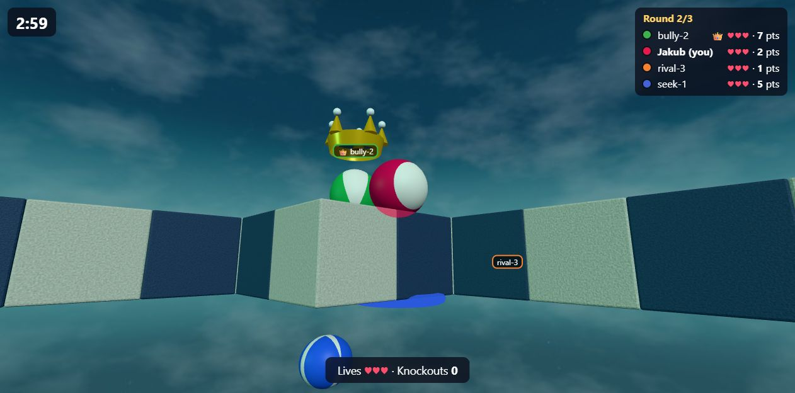
  - seek-1, bully-2 and the crown under the floor are hidden too (labels only): 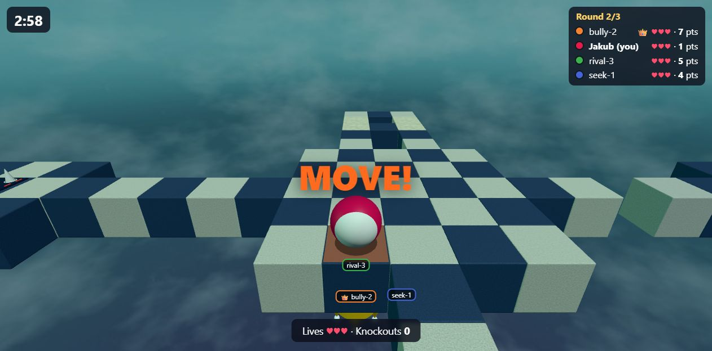
- [x] **race-01:** rival-1 is under the plank: no ball, only the label. The keys and the exit are drawn only where they're in line of sight. 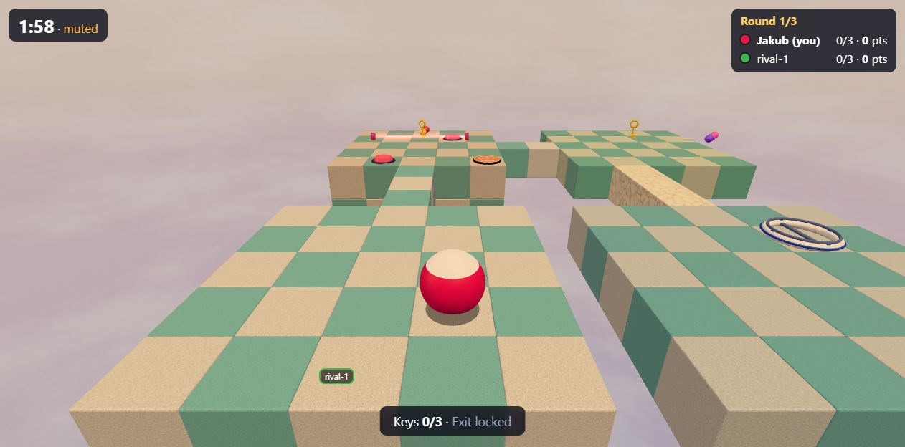
- [x] **sp-01 fly-over:** the underside coins no longer show through the plank. 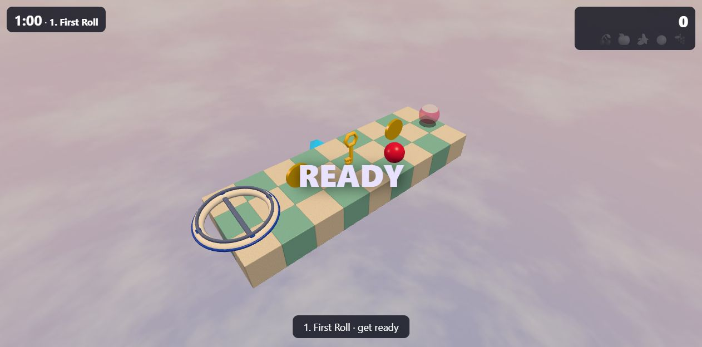 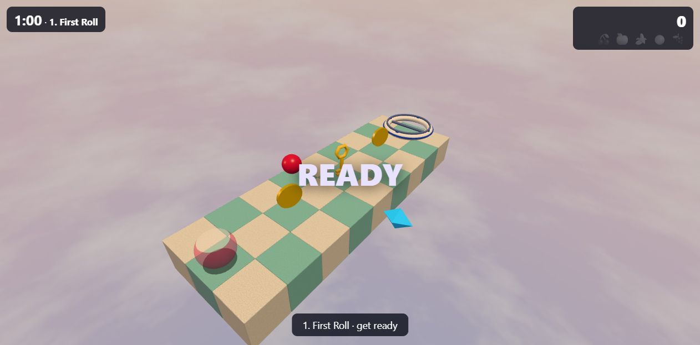
- [x] **Crown:**
  - The label reads `👑 rival-1` (read from the DOM every round).
  - The 2.3× crown at 7.3 cells reads clearly: 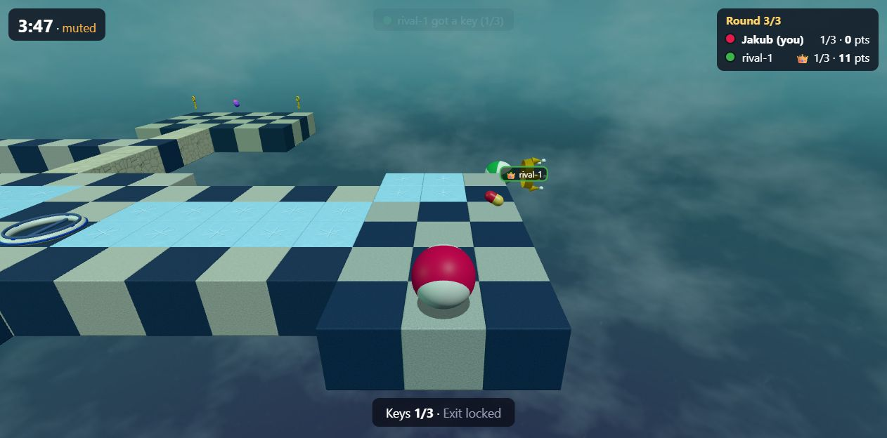. Also on the arena shot above.
- [x] **No labels over the results panel or the stats card:**
  - Each round, the script hit-tested every label under the results panel; the one there, "👑 rival-1", reported `under`.
  - 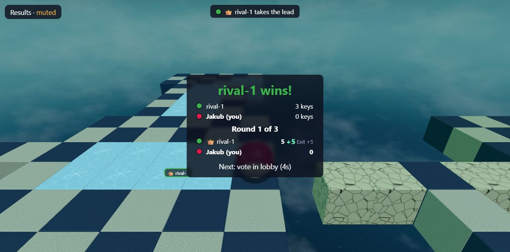
  - The stats card is below.
- [x] **Forced tie:**
  - At the last round's results (before `matchEnd` arrived), the browser copied the leader's points/wins/KOs/keys onto the other player locally. Both were at 16 / 3 wins / 1 KO / 10 keys.
  - Podium: "🏆 Jakub and rival-1 share the match!", with both balls on the one widened step, both labelled "1.". 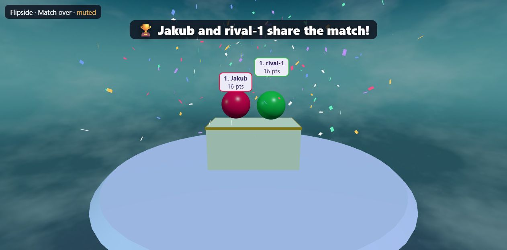
  - Stats card: "1st Jakub / 1st rival-1". 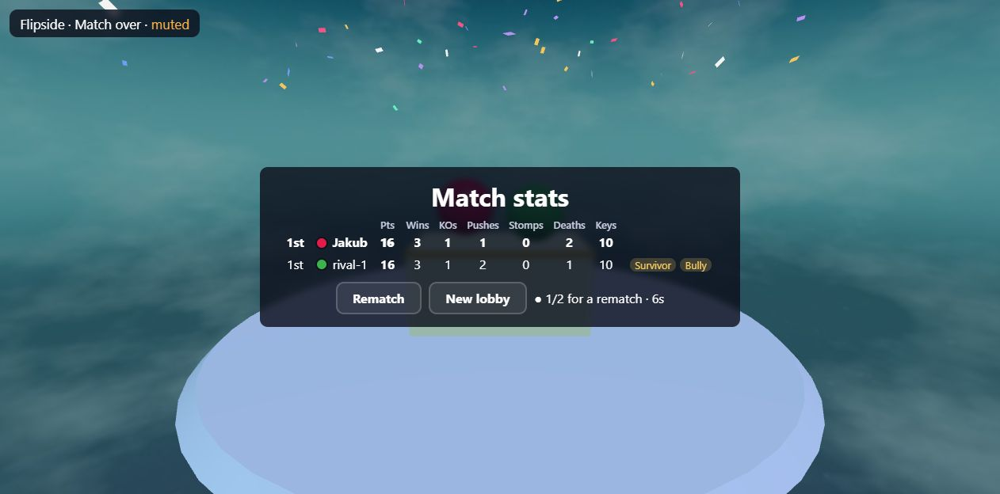
- [x] **2-player 1–1 rematch:** I clicked New lobby and the bot voted yes. Server: `match over: rematch 1/2 → rematch`. The lobby came back at round 0 of **3** (the server default is 5), with points reset. 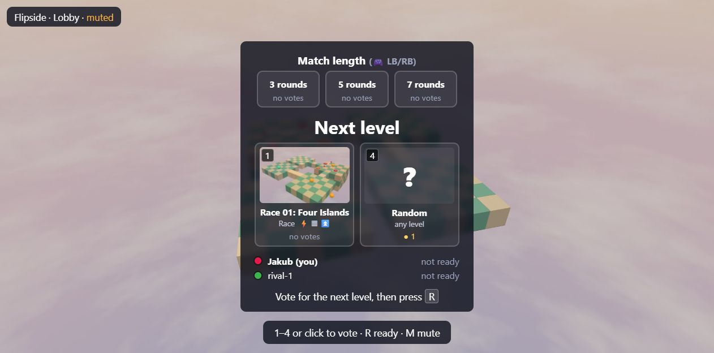
- [x] **Pad** (Gamepad API shim):
  - Start: no vote.
  - RB → 3 rounds, RB → 5, LB LB → 3 → wraps to 7.
  - The server's counts followed each press (`2/0/0`, `1/1/0`, `1/0/1` with the bot's vote for 3).
  - 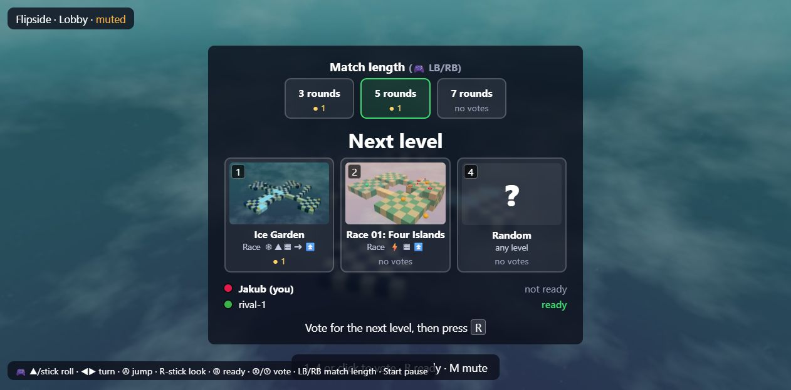
- No console errors and 0 STUCK in every run.

## Soak
Server on :2569 (the pool, `MIN_PLAYERS=4`, `MATCH_ROUNDS=5`); bots `--count 4 --behaviour seek,bully,rival,wander --skill 0.5 --length 5`. **1 full 5-round match, 0 STUCK, no errors.** The 4/4 rematch then started.

| Round | Level | Winner | Crown during the round | Board after the round |
|---:|---|---|---|---|
| 1 | race-05 | rival (exit) | — | rival 5, seek 0, bully 0, wander 0 |
| 2 | arena-06 | rival (lastAlive) | rival | rival 11, seek 6, bully 5, wander 1 |
| 3 | race-04 | seek (exit) | rival | seek 11, rival 11, bully 5, wander 1 (crown: nobody) |
| 4 | arena-04 | rival (lastAlive) | — | rival 18, seek 13, bully 10, wander 3 |
| 5 | race-05 | seek (exit) | rival | **rival 21**, seek 18, bully 10, wander 3 |

- **Do knockout rounds still dominate?** Less than before.
  - The two knockout rounds gave the top scorer +6 and +7 (they were up to +9 before).
  - The race rounds gave +5 to +6.
  - seek (a pure racer) came 2nd, 3 points behind rival. In phase 18's soak, bully-style bots topped the matches.
  - The KO cap is visibly biting. In the arena check, seek knocked out 6 players in one round and scored 3 + 2. bully knocked out 7 and scored 5 + 2.
  - One match is a small sample.

## Deviations (details in DECISIONS.md)
1. **Podium steps follow distinct places.** A shared 1st is followed by 3rd on the second step. Keeping "2nd" empty would have left a bare step.
2. **The shared-title colour** is white; the individual colours stay on the labels.
3. **The crown** was scaled up (1.7× → 2.3×) after the 8-cell screenshot.
4. **The forced tie** was made client-side (in the browser, at the final results). The tie-break itself is covered by shared unit tests.

## Open question
- **Name labels still show through walls.** CSS2D labels aren't depth-tested, so an enemy hidden under a plank still has its name floating there (see the race-01 and arena shots). With the new 👑 prefix, the crowned player's position shows through walls too. That's most of what x-ray gave away.
  - Should labels hide when their ball is occluded (a raycast per label per frame against the level), or only show within line of sight?
  - I left it as is, since 18b only asked to remove silhouettes.
