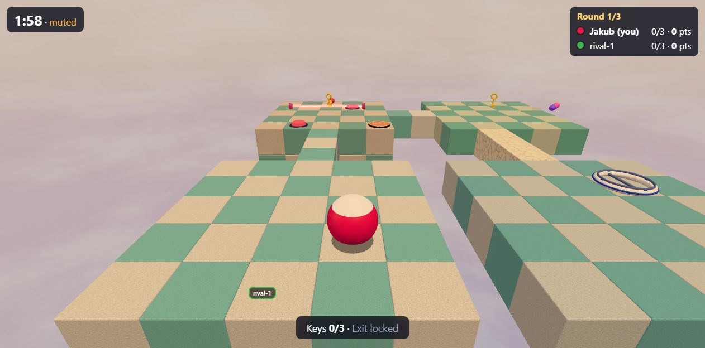
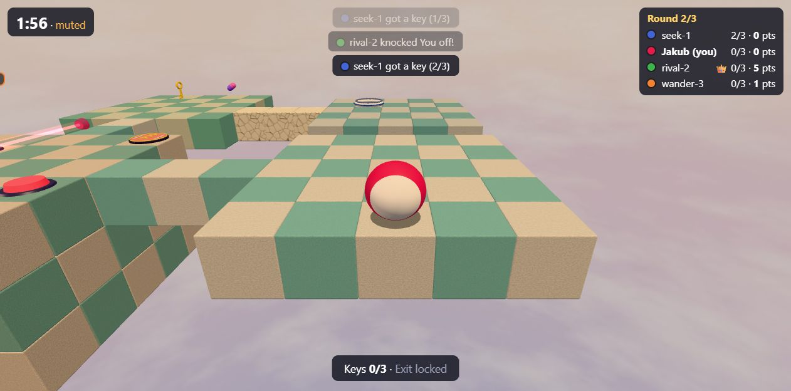
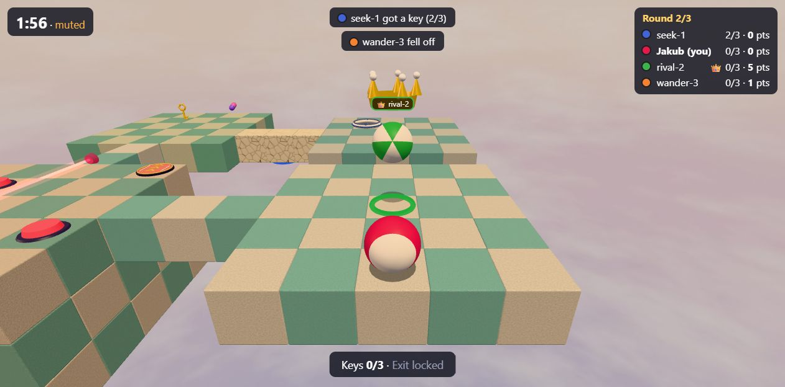
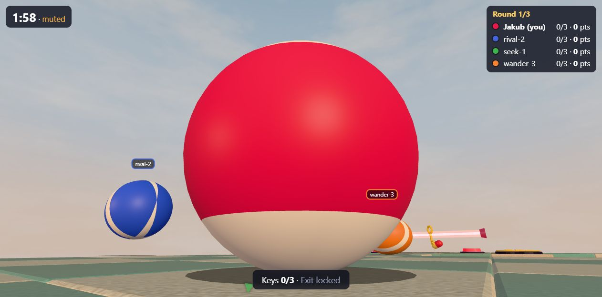
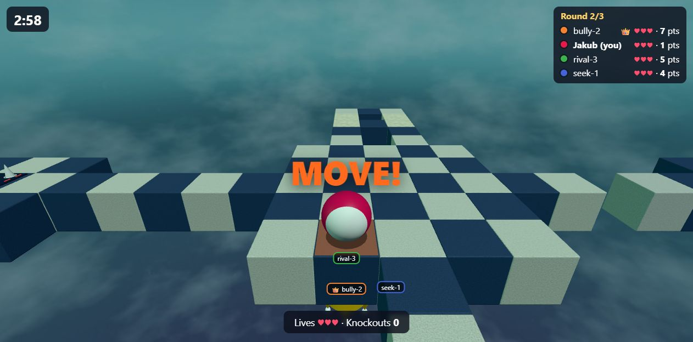
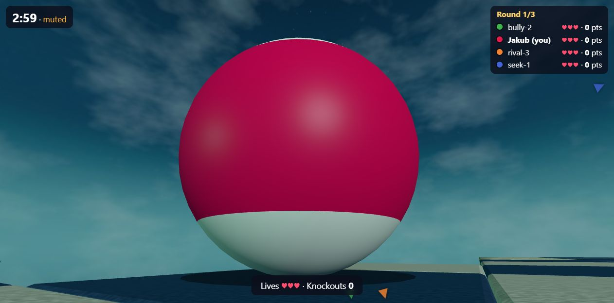
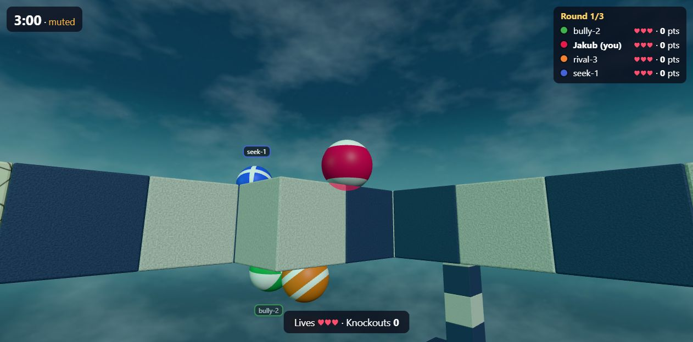

# Phase 18c report: Name labels only in line of sight

## What changed
- **`client/src/render/los.ts`:** `lineClear(opaque, a, b)` is a 3D grid DDA (Amanatides–Woo) over unit block cells, with no allocations.
  - The camera's own cell counts, so a camera inside a block sees nothing.
  - The target's own cell doesn't count.
- **`PlayersView.updateSight(camera, nowMs, opaque)`** runs every frame from `main.ts`, after the camera is placed (not on the podium).
  - Each other player's ball is re-checked about every 100 ms, staggered per ball.
  - It casts three rays: the ball centre, and ±0.4 along the ball's up. Any clear ray means seen.
  - A hidden ball's name label fades out, and a seen one fades back in (a 150 ms CSS opacity transition). This covers the 👑 prefix, free look, the fly-over and spectating.
  - New labels start hidden until their first check.
- **What occludes:** only what's drawn right now.
  - Static blocks minus crumbled bands and gone crumble tiles (`LevelView.solid`).
  - Vanishing blocks while they're there.
  - Invisible blocks only while they're drawn, via the new `Traps2View.opaque`: near your ball, or with sunglasses.
  - Cells outside the level's box are rejected before any key string is built.
  - There are no moving blocks in the game.
- **Crown:** at 2.3× it pokes over block edges, so it hides together with the label while its ball is hidden.
- **Unchanged:** the scoreboard, the off-screen arrows, the podium labels; the local player still has no label.

## Tests
- `npm test`: **1025 passed** (4 skipped by design). `npm run typecheck` and `npm run level:check` pass.
- **`los.test.ts`:**
  - a clear line;
  - a block between (both directions, and from under a floor);
  - rays grazing a block's top edge and a corner (a hair outside is clear, a hair inside is blocked);
  - the camera inside a block (occluded, no throw);
  - the target's own cell never occludes;
  - a zero-length ray.
- **`art.test.ts`**, through the real `PlayersView`:
  - A crowned enemy on a floor with the camera underneath: label opacity `0` and the crown hidden.
  - It isn't re-checked before ~100 ms.
  - With the camera above: label `1` and the crown shown.

## Browser checks
Headless Chrome on the GPU over CDP; a throwaway Vite on :5175 and server on :2568, with bots.

- [x] **race-01: a bot under the plank shows no label, and the label comes back when it rolls into view.** Here it's the crowned rival-2, so this also covers the crown check below.
  - Before (18b): the label floats over the plank: 
  - After, hidden: 
  - After, back in view (label "👑 rival-2" and crown): 
  - Over 2 rounds the log recorded ~40 hide/show transitions, all following the balls.
  - The 18b camera angle, repeated: the pitched camera stops at the floor, seek-1 is under the plank (no label), and rival-2 and wander-3 are in sight (labelled). 
- [x] **arena-02 with the camera pitched down:**
  - Before (18b): labels of seek-1 and 👑 bully-2 under the floor: 
  - After: bully-2 and rival-3 are behind blocks with no labels (seek-1 is off screen; its arrow shows): 
  - Balls actually in line of sight keep their labels: 
- [x] **The crowned bot behind a block:** no 👑 label and no crown (crown mesh `visible: false` in the first run), in the race-01 "hidden" shot above.
- [x] **Free look sweep:**
  - A 4 s yaw sweep over ~340° flipped each label 1–4 times at level height, and 1–2 times under the plank. Each flip is a real pass behind a block, with no frame-to-frame flicker.
  - The 100 ms check interval plus the 150 ms fade smooths block edges.
- [x] **FPS, 8 players on arena-03** (the busiest pool level: 225 blocks, 93 tiles; the browser plus 7 bots):
  - Alternating 4 s windows in the same round, with `updateSight` stubbed out ("before") and live ("after"). FPS climbs as players are knocked out, so compare the pairs.

  | Window | Before (fps) | After (fps) |
  |---:|---:|---:|
  | 1 | 122.9 | 122.7 |
  | 2 | 128.1 | 138.5 |
  | 3 | 159.3 | 164.5 |
  | 4 | 164.5 | 164.5 |
  | Mean | 143.7 | 147.6 |

  - Within noise. `updateSight` itself costs **~0.005 ms per frame**.
- No console errors, 0 STUCK.

## Notes
- The test inside the level's box reuses the string-keyed solid lookups. With 8 players that's a few hundred short strings a second, not literally zero allocations, but negligible given the cost above. A packed grid would remove them if it ever matters.
- Other balls don't block the line of sight. Only blocks do.
