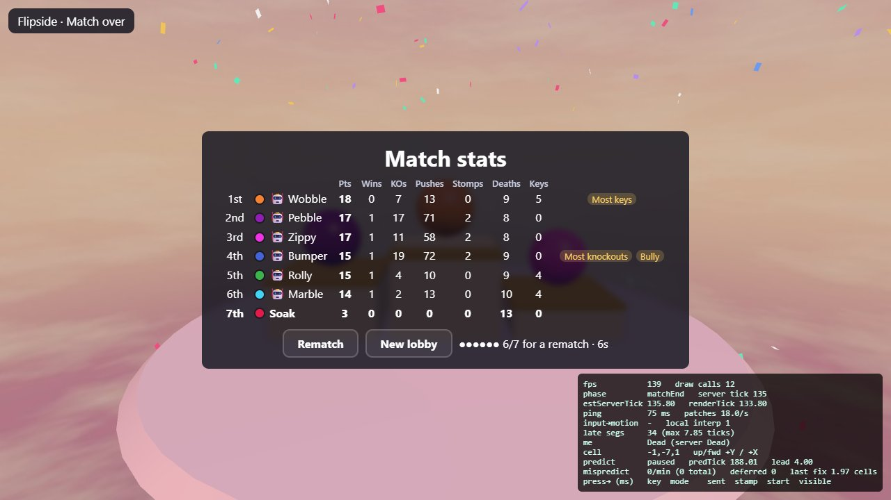
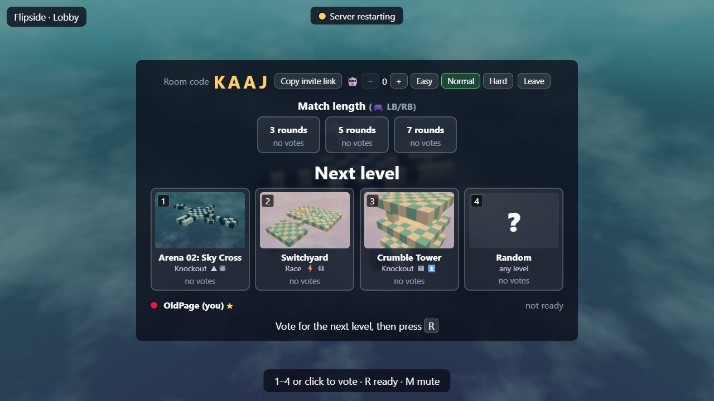
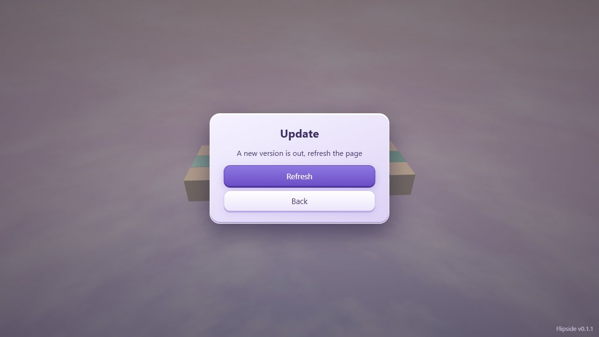
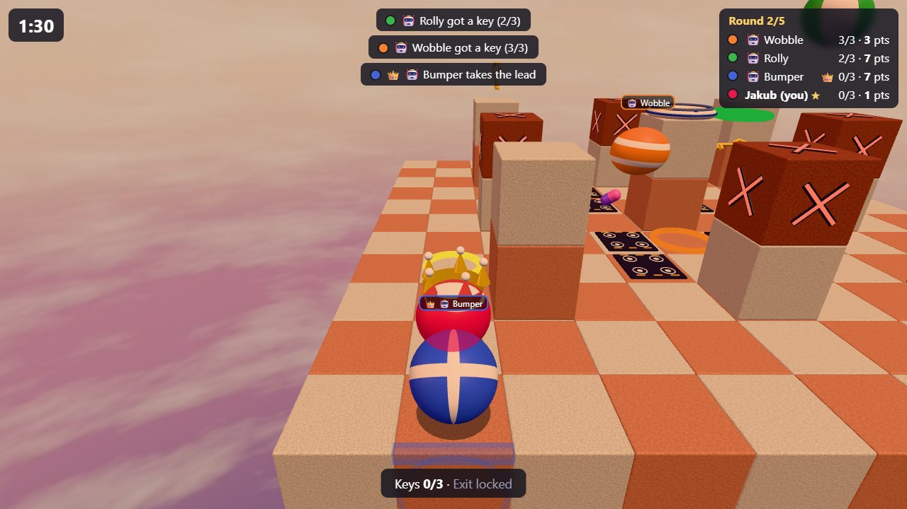
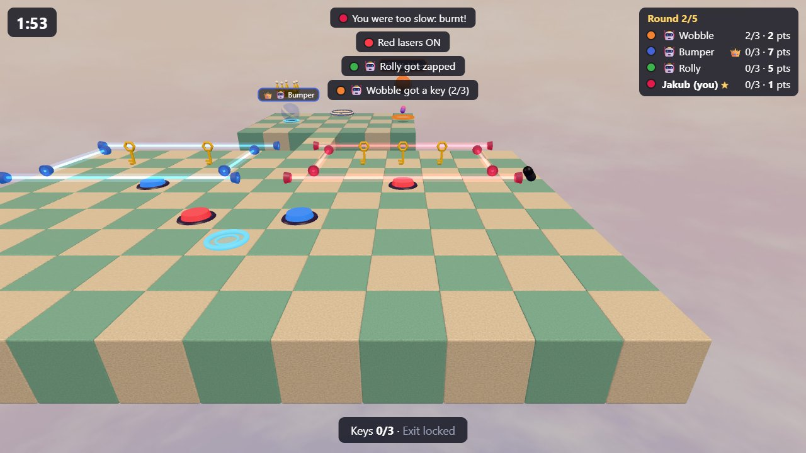
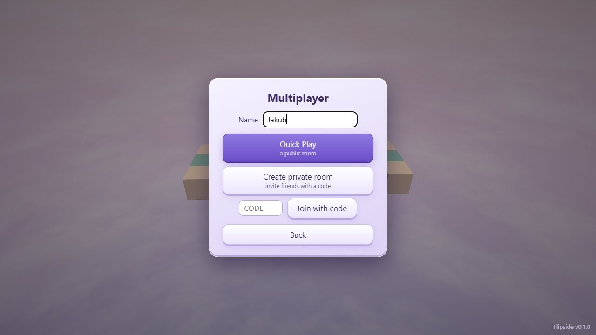
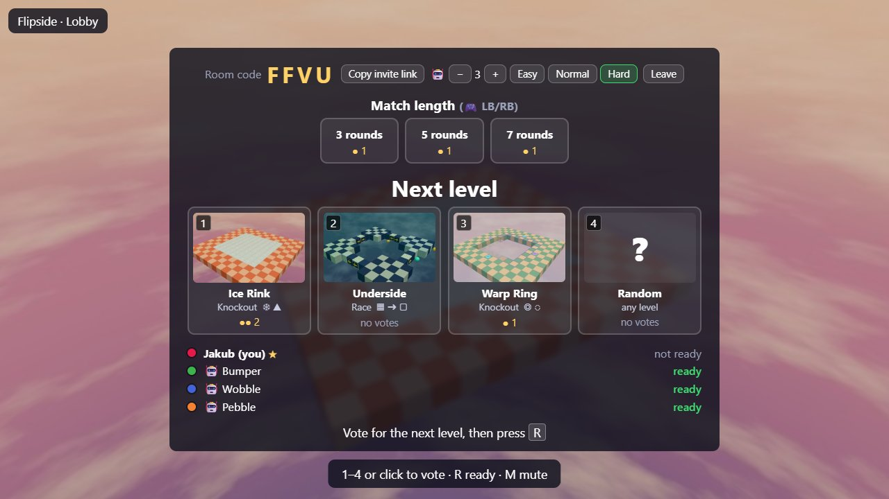
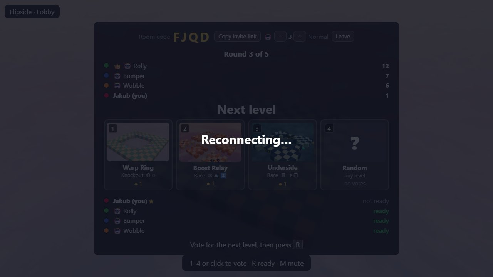

# Phase 19 report: Online hosting (Fly.io) and rooms

## Summary
- **URL:** https://flipside-game.fly.dev (Fly app `flipside-game`, org `personal`)
- **Machine:** one `shared-cpu-1x`, 512 MB, London (`lhr`), no volumes. It auto-stops when idle.
- **Image:** 133 MB, built by Fly's remote builder from the repo's `Dockerfile` (`node:24-slim`, server dependencies only).
- **Cost** (Fly pricing page, checked 2026-09-30):
  - About $7.84/month if the machine never stopped.
  - With auto-stop, billing is per second of running time: about $1/month at 3 h of play a day.
  - Plus $0.15/GB-month for the stopped rootfs, and $0.02/GB outbound data.
  - Details in `docs/HOSTING.md`.
- **Paid resources created:** the app `flipside-game` (`apps create`), and one machine from the first `deploy --ha=false`. The remote builder is Fly's own. Nothing else was created: no volumes, no dedicated IPv4.

> **Your Fly account is still a trial.** Fly stops the machine 5 minutes after every start ("Trial machine stopping. To run for longer than 5m0s, add a credit card", seen at 17:29, 17:40 and 17:46 UTC today). Everything below fit inside those windows, but a real evening of play won't. Add a card at https://fly.io/trial. Idle auto-stop can't be verified until then (see the idle check below).

## Internet checks (the real URL)
- **Phone on mobile data (you):** the invite link opened the private room and joined. Ping wasn't measured. You didn't report on the airplane-mode reconnect. The same reconnect path is covered by the unit test, and by a forced drop in the browser: back in 133 ms, same seat and points.
- **PC:**
  - Ping from this PC in the headless browser (F3): median 35 ms while idle in a lobby.
  - During the soak, with the browser rendering the game and the bots on the same PC: median 99 ms, p95 229 ms, max 293 ms.
  - Menu to a joined lobby while warm: 1.3–1.6 s to the menu, ~1.2 s to a lobby.
  - Whether movement feels as responsive as local with prediction needs your hands on it. The soak's browser only readied up; its F3 showed 0 mispredictions, but its ball barely moved, so that says little.
- **Soak** (both at the same time, 2026-09-30 17:25–17:29 UTC):
  - A public room from this PC: `npm run bots -- --count 4 --behaviour seek,bully,rival,wander --server wss://flipside-game.fly.dev --length 3`. One full match (3 rounds), then the rematch passed 4/4. Bot summary: **stuck 0** for all four, 4 rounds each (the 4th was the rematch's first).
  - A private room with 6 server-side bots and 1 browser: one full match (5 rounds, the bots outvoted my 3), then a rematch 6/7. Browser console: no errors.
  - Machine: peak **178 MB** of 512 MB (the first, trial-cut run peaked at 190 MB), CPU mean 14 % and peak 23 % of one vCPU (the first run briefly hit 32 %), load ≤ 0.38. Idle it sits at 133 MB. Sampled every 30 s from Fly's Prometheus API.
  - The server log showed no STUCK and no errors. `/health` read `rooms 2, players 11` throughout.
  
- **Idle and cold start:**
  - After the last room closed (17:36:18) the machine stopped at 17:40:52. That was **the trial's 5-minute kill, not Fly's idle auto-stop**, which hadn't acted yet. Outside traffic (not mine; new `fly.dev` hosts get crawled) woke it at 17:41 and 17:46. Auto-stop is configured (`auto_stop_machines = "stop"`, `min_machines_running = 0`), but I couldn't observe it.
  - Cold start from stopped, in the browser: **12.7 s to the menu**, then **1.9 s** from Quick Play to a joined lobby. From stopped, `/health` took 9.8 s.
  - Fly's log breaks it down: the machine starts in ~2.2 s, and the server is reachable ~6.2 s after start. Most of that is `tsx` compiling the TypeScript sources. A bundled server (for example esbuild at image build time) would cut several seconds; that's a new build tool, so it's your call.
- **Version-bump deploy:** a browser sat in a private room on 0.1.0 while I deployed 0.1.1.
  - It got the "Server restarting" toast: 
  - Quick Play from that page showed "A new version is out, refresh the page", and Refresh loaded v0.1.1.
  - **Found and fixed:** Fly sent SIGTERM twice, a second apart. Colyseus handles only the first (`process.once`), so the second killed the process mid-grace, and the page saw a dropped socket ("Disconnected") instead of the clean close. After adding a no-op SIGTERM listener and redeploying, the next restart went: toast at 17:35:45, the room closed 3 s later, the page said "The server restarted. Join again.", and the process exited 0.
  - **Found and fixed:** the version screen drew in the bottom-right corner with invisible text. The screen's kind `version` became the panel's CSS class and matched `#menu .version` (the corner label). It's now `update`, and this build is deployed. 
- **Single player from the hosted URL:** New Game started level 1, took a key, no console errors.
- **One machine:** `npm run fly -- machines list` shows one machine after all 4 deploys. The first deploy used `--ha=false`; `scale count 1` reports "already scaled".

## Acceptance
- [x] The crown scales with distance (two screenshots)
- [x] `https://flipside-game.fly.dev` serves the game. Quick Play, private codes and invite links work from outside the LAN (the invite link on your phone on mobile data; Quick Play, private rooms and codes from this PC over the internet).
- [x] Server-side bots: add/remove/difficulty in the lobby, and a full match with bots only plus 1 human (locally 3 bots, 5 rounds; on Fly 6 bots, 5 rounds)
- [x] Reconnect within 20 s keeps the seat (test and browser), and the version mismatch is handled (on Fly)
- [x] Soak clean: 0 STUCK, no errors, memory peak 178–190 MB of 512 MB
- [ ] **Auto-stop and cold start:** cold start works (12.7 s to the menu). Idle auto-stop isn't verified, because the trial's 5-minute kill always comes first. One machine only: yes.
- [x] `docs/HOSTING.md` written. CI's Docker job: see the end of this report.
- [x] typecheck, test and level:check pass; single player works from the hosted URL

## What changed

### Task 0: crown size by distance
- `crownScale(dist)` in `render/players.ts`: 1.2× up to 3 cells, easing (smoothstep) to 2.3× at 8 cells and beyond.
- It's set every frame in `updateSight`, after the camera is placed.
- Tests in `art.test.ts`: the curve's end points and that it never shrinks with distance, plus the scale through the real `PlayersView` at two camera distances.
- Up close (2.8 cells, 1.2×). The crown sits on the blue bot; the translucent red behind it is my own ball's silhouette. The crown is now about ball-sized instead of dwarfing it: 
- Far (18.8 cells, 2.3×): Bumper's crown still reads on the far platform: 

### Task 1: production server
- **Same origin:**
  - `packages/server/src/index.ts` serves `packages/client/dist` through Colyseus 0.18's `express` hook on `defineServer`.
  - `/assets/*` gets `max-age=1y, immutable`, `index.html` gets `no-cache`, and other public files revalidate by ETag.
  - It binds `0.0.0.0` on `PORT`.
  - The startup banner is off, so it doesn't clutter `fly logs`.
- **Client server URL** (`net.ts`): `?server=` wins, then a build-time `VITE_SERVER_URL` (for the itch build), then in production builds the same origin (`wss:` on https), then in dev `ws://<host>:2567`.
- **Version check:**
  - `GAME_VERSION` now lives in shared (read from the root `package.json`), and the client sends it with every join.
  - `RaceRoom.onAuth` refuses a mismatch with HTTP 426.
  - The client shows "A new version is out, refresh the page" with a Refresh button.
- **`/health`:** returns `{ version, rooms, players }`.
- **SIGTERM:** `onBeforeShutdown` broadcasts a "Server restarting" notice (shown as a toast), then closes the room 3 s later with `SERVER_SHUTDOWN`. The client goes back to the Multiplayer menu with "The server restarted. Join again." `fly.toml` has `kill_timeout = 10s`.
- **Names:**
  - `cleanName` (shared) strips control and bidi-override characters, trims, caps at 16 characters by code point, and falls back to `anon`.
  - Toasts and podium labels now use `textContent`, like the name labels already did.
  - The HUD panels stay string templates, but every name goes through `esc()` (see DECISIONS).
- **Logs:** one line each for room created (private/public, with its code) and disposed, and for join, leave, drop and reconnect with `players=N (M human)`. There are no per-tick logs.

### Task 2: rooms
- **Multiplayer menu:** a name field (remembered in `localStorage`), Quick Play, Create private room, and a 4-letter code field with Join with code (case-insensitive; Enter in the field joins). Errors come in plain words: "No room with that code", "Room is full", "Server full, try again soon", "A room code is 4 letters, like KQRT", and the version screen.
  
- **Codes:**
  - Every room's id is a 4-letter code from `ABCDEFGHJKLMNPQRSTUVWXYZ` (no I, O or digits).
  - A set of live codes keeps them unique and counts rooms for `MAX_ROOMS` (default 20, in `.env.example`).
  - Private rooms are `setPrivate`, so they're hidden from Quick Play, which prefers a public room in its lobby (a metadata sort).
- **Private lobby:** the code large, Copy invite link (`<origin>/?room=CODE`), the host's bot controls, and Leave. Opening an invite link goes straight to the Multiplayer screen with "Join room CODE".
  
- **Host:**
  - The host is the longest-connected human (the creator, or a public room's first human), recomputed on every join and leave.
  - The board shows ★ on their line.
  - A player in their reconnect window shows "reconnecting…", greyed.
- **Server-side bots:**
  - The bot brain moved to `tools/bots/src/brain.ts` (`@kula/bots/brain`); `npm run bots` keeps the same flags.
  - The server spawns bots as Colyseus clients of its own port (DECISIONS: this needed no bot path in the room).
  - The host has − / + (up to 8 players) and Easy/Normal/Hard (skill 0.3/0.6/0.9 with the §24 mixes). Difficulty can change before round 1 only; the bots are swapped for new ones.
  - Bots are named "🤖 Name". They count toward `MIN_PLAYERS`, ready themselves, vote randomly, and vote yes on a rematch.
  - When the last human leaves, the room disconnects, bots included.
  - After 30 s alone in a public lobby, the host gets "Fill with bots", which tops the room up to 4 players.
- **Reconnection:**
  - On `onDrop`, the server holds the seat for 20 s (`allowReconnection`). The ball's input is set to idle and its queue cleared.
  - The SDK retries automatically with its token (max delay 2 s, 12 tries) behind a "Reconnecting…" overlay, and prediction restarts from the next patch.
  - A clean leave (Leave button, tab close) is immediate.
  
- **Tests** (`server/test/online.test.ts`, `shared/test/online.test.ts`):
  - code generation and uniqueness;
  - private rooms not joinable by Quick Play;
  - join-by-code errors (not found, full);
  - the version mismatch refused (Quick Play and by code);
  - host handover and name cleaning;
  - add/remove bots capped at 8, and host-only;
  - bots readying into a countdown;
  - difficulty swapping the bots;
  - a room disposed when the last human leaves (bots gone, code freed);
  - a reconnect keeping points and stats, and a player gone after the hold;
  - `MAX_ROOMS` refusing past the cap;
  - the shutdown notice, then a close about 3 s later with `SERVER_SHUTDOWN`.

### Task 3: deploy
- **`Dockerfile`:** multi-stage on `node:24-slim`. The build stage runs `npm ci` and builds the client. The runtime stage has `NODE_ENV=production`, runs `npm ci --omit=dev -w packages/server`, and copies the sources, levels and `dist`. It runs `node --import tsx packages/server/src/index.ts --prod`, the same as `npm run start:prod`. Node's own type stripping can't run the shared sim (it has parameter properties), so `tsx` is a server runtime dependency. `.dockerignore` excludes node_modules, .git, docs, assets, release, .env and coverage.
- **`fly.toml`:**
  - `lhr`, internal port 2567, `force_https`, auto stop/start with `min_machines_running = 0`.
  - A `/health` check every 30 s.
  - `shared-cpu-1x` with 512 MB.
  - `connections` concurrency (soft 200, hard 250).
  - A comment to keep it at one machine.
- **Scripts:**
  - `npm run start:prod`.
  - `npm run fly -- <args>` runs `scripts/fly.mjs`, which loads `FLY_API_TOKEN` from `.env`, runs `.fly/bin/flyctl.exe` (else `flyctl` on the PATH), and never prints the token.
  - `npm run deploy` = `npm run fly -- deploy`.
  - `.env.example` has `MAX_ROOMS` and a commented `# FLY_API_TOKEN=`.
- **Local check:** no Docker here, so I ran `npm run build` and `npm run start:prod` on :2568 (your dev server holds :2567). I checked `/health` and the cache headers, then played through the prod-served client: a private room, 3 bots added, difficulty to Hard, and a round started. A full 5-round match with 3 server bots and 1 browser ran on the same server: no errors, no STUCK, rematch 3/4.
- **`docs/HOSTING.md`:** first-time setup (token, `apps create`, `deploy --ha=false`), deploy, logs, status, rollback (`releases --image`, `deploy --image`), checking there's one machine, metrics (dashboard or the Prometheus API), cost, moving to a VPS with Caddy, and running the prod server locally.
- **CI:** a new `docker` job builds the image, prints its size and checks `/health` in a container. It doesn't push or deploy.

## Checks
- `npm run typecheck`, `npm test` (**1040 passed**, 4 skipped by design) and `npm run level:check` pass.

## Deviations and open questions
- **flyctl installer:** before the prompt's updated "Fly setup" section reached me, I ran the PowerShell installer once. It put a second flyctl in `C:\Users\jjoze\.fly\bin` and added that folder to your user PATH (the `fly` symlink step failed without admin). Nothing uses it: `npm run fly` uses the repo's `.fly\bin\flyctl.exe`. Delete the folder and the PATH entry if you like; I left them, since you didn't say either way.
- **Join error codes are HTTP statuses** (426 version, 503 server full). Colyseus sends a refusal's code as the matchmaking call's HTTP status, and anything else came back as 500.
- **Every room has a code**, public ones too; only private rooms show it.
- **Rooms' bots are local Colyseus clients** (one socket and schema decoder per bot) rather than an in-room hook.
- **HUD names are escaped HTML, not `textContent`:** every name goes through `esc()`. Toasts and the podium use `textContent`.
- **The trial account** (above) is the one open blocker: machines stop after 5 minutes until a card is added.
- **The phone's ping and the phone reconnect** weren't measured. You confirmed the invite link works on mobile data.
- **The CLI bots' version** is the repo's `GAME_VERSION`, so bots from an older checkout are refused like old pages.
- **The SDK won't auto-reconnect a room joined less than 5 s earlier** (its `minUptime`); left as is.
- **Open:** "Fill with bots" tops up to 4. Should it fill to 8?
- **Open:** a cold start is 12.7 s, mostly `tsx` compiling at startup. Bundle the server at image build (a new dev dependency such as esbuild)?
- **Unused screenshot:** `img/19-private-round.jpg` is a round in progress from the local check, kept for reference.

## CI
- I can't see CI from here: `gh` isn't installed and the repo is private. Check the Actions tab for commit `afdc99c`. The new `docker` job builds the image, prints its size (Fly's remote builder reported 133 MB for the same Dockerfile), and checks `/health` in a container.
