# Phase 19b report: Touch controls (phones and tablets)

> **Status:** code done, tested and pushed (`phase 19 follow-ups`, `phase 19b: touch controls`, `phase 19b: version 0.1.2`). **Not deployed yet:** `npm run deploy` was blocked by Claude Code's permission check (production deploy), so it needs your go-ahead. The Fly numbers after the bundle and your phone check are marked *pending* below.

## Task 0: phase 19 follow-ups (commit `phase 19 follow-ups`)

### 1. Server bundle (esbuild)
- `npm run build -w packages/server` bundles the server into one file, `packages/server/dist/server.js` (4.6 MB, every dependency included).
  - It sits inside the server package, so the relative paths to `levels/`, `.env` and the client build resolve the same as from `src/`.
  - Colyseus loads its default transport by a dynamic import the bundler can't follow, so `index.ts` now passes `new WebSocketTransport()` explicitly (same defaults).
- **Runtime:**
  - `npm run start:prod` = `node packages/server/dist/server.js --prod`.
  - `npm run build` now also builds the bundle.
  - The Docker runtime stage copies only `levels/`, the server's `package.json` (for `"type": "module"`), the bundle and the client build: no `npm ci`, no `node_modules`, no tsx. `tsx` left the server's dependencies.
- **Checked:** the bundle ran from a folder with no `node_modules` (`/health`, the client, a private room with 2 server-side bots joining and leaving cleanly).
- **Cold start:**

  | | tsx (before) | bundle (after) |
  |---|---|---|
  | This PC, spawn → `/health` | 1.44 s (tsx cache off), 1.26 s (cache warm) | 0.67–0.71 s |
  | Fly, stopped → `/health` | 9.7 s (measured today before deploying; 9.8 s in phase 19) | *pending deploy* |
  | Image size | 133 MB | *pending deploy* |

### 2. "Fill with bots"
Stays at 4 players, as decided. The host can still add up to 8 with +. No code change.

### 3. Crown position
- The crown's origin is now its band's base, and it sits on the drawn ball's top: its squashed half-height (tracked per frame, fire swell included) plus a gap of 0.03 ± 0.02 bob.
- The gap peaks at 0.05, within 0.15 ball radius (0.06). Scaling from the base keeps it seated at every distance scale.
- Test: the crown's lowest point is 0 to 0.06 above the ball's top, through the bob and at scales 1.2×, ~1.75× and 2.3×.
- Up close, in the browser: 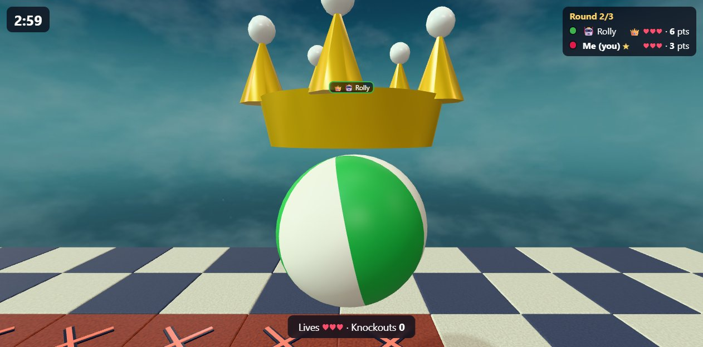

### 4. Own-ball silhouette only through blocks
- **How:** a stencil mark.
  - Level blocks (and vanishing blocks) draw after the other opaque objects (`renderOrder = 1`), so they pass the depth test only where they're the front surface, and write 1 into the stencil there.
  - Ball materials write 0, so a transparent (ghost) ball drawn later clears the mark where it's in front.
  - The silhouette draws only where the mark is 1. The renderer now has `stencil: true`.
- **Render test** (`art.test.ts`): a software raster of single pixels, with the real meshes and materials. It uses three's draw order (opaque by render order then near to far, transparent far to near), LessEqual depth and stencil writes.
  - The silhouette shows through a wall.
  - It doesn't show in plain view, through an enemy ball in front of the wall, through a ghost enemy ball, or through the crown.
  - Without the fix, all three "not over" cases fail. Without the ghost-ball stencil clear, the ghost case fails.
- **In the browser (GPU):**
  - Camera under the floor: the silhouette shows through it. 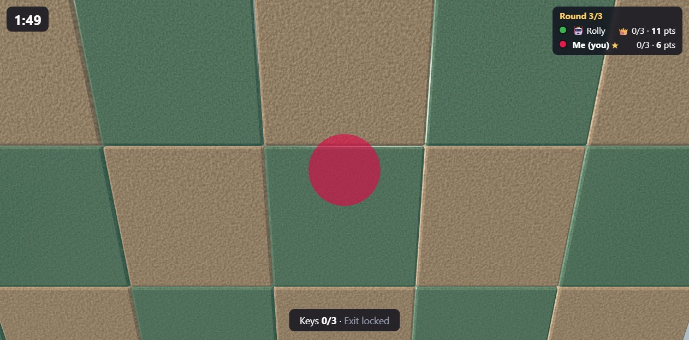
  - The enemy ball moved between the camera and the floor: it covers the silhouette, with no red on it. 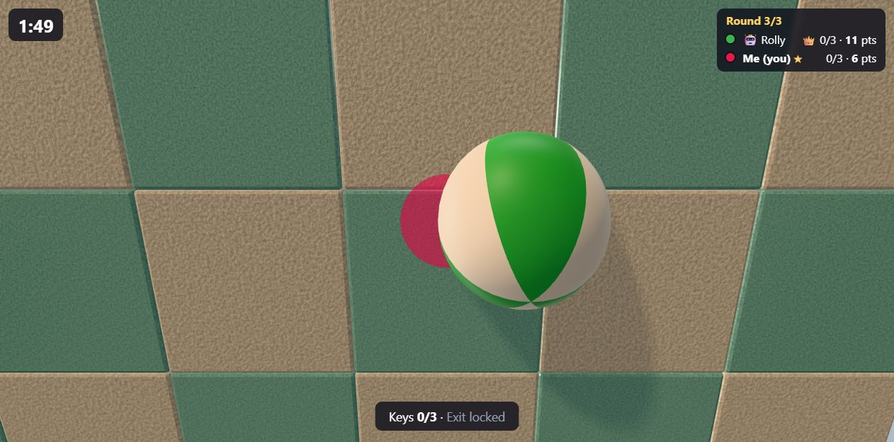

## Touch controls (commit `phase 19b: touch controls`)

### Input (`client/src/input/touch.ts`)
- **Pure mapping:**
  - `dpadSector(dx, dy, radius)`: 8 sectors of 45°, with N centred on straight up. A boundary angle belongs to the sector clockwise of it. The dead zone is ≤ 12 % of the radius.
  - `dpadSectors(...)` → `{ fwd, turn }` per §25: N forward; E/W turn; NE/NW forward + turn; S nothing.
  - SE/SW aren't in the table. They compose the same way (S adds nothing, so they turn only).
  - `turnEdge()`: one pulse when the turn side changes to left or right.
- **`TouchPad`** (no DOM, unit-tested):
  - Tracks one d-pad touch, one Jump touch and one look touch by identifier, each independent.
  - The d-pad's centre floats: it's wherever that thumb went down.
  - Sliding between sectors works without lifting.
  - `releaseAll()` runs on `touchcancel`, blur, a hidden tab, and whenever the controls hide.
- **`setupInput`:**
  - Touch is a third device with its own held state in the union, fed through `input.feed(action, down)`.
  - No new message type, and "sends only on change" still holds (tested).
  - Any touch on the page makes touch the device, and any key or pad input switches away (Auto show/hide). A coarse pointer at start makes touch the device from the start.

### UI (HTML/CSS over the canvas)
- **Left:** the d-pad ring with ▲ ◀ ▶. It jumps to where your thumb lands, and a dot follows the finger (clamped to the ring). The arrows light while their sector is held.
- **Right:** Jump, large (held = bounce). A drag on the rest of the right half is free look, springing back on release.
- **Top-left:** Pause. The timer moves right to make room.
- **Bottom centre:** a large **Ready** in the lobby (✓ and green once ready), and **Rematch** on the match-end stats card.
- **Sizing:** Jump is `clamp(72px, 24vmin, 150px)` × size, and the ring `clamp(110px, 34vmin, 220px)` × size (S 0.8, M 1, L 1.25). 72 CSS px is about 12 mm on a phone.
- **Settings:** opacity (0.2–1), left-handed (swaps sides), and safe-area insets on every edge.
- **Small screens** (height ≤ 520 or width ≤ 720):
  - The scoreboard is compact, and lobby cards are smaller.
  - HUD panels scroll instead of spilling off the screen.
  - On touch, the lobby drops its top label so the panel has room.
- Nothing covers the timer, keys status or scoreboard (screenshots below).

### Menus, portrait, fullscreen, hygiene
- **Menus:**
  - On a coarse pointer every menu button and HUD button is ≥ 44 px, and text inputs are 16 px (iOS zooms into smaller ones).
  - The name field isn't auto-focused on touch, so the keyboard doesn't pop up over the menu.
  - The code field has `autocapitalize="characters"`, `inputmode="text"`, `enterkeyhint="go"` (Enter joins) and shows uppercase. The name field has `autocomplete="nickname"` and `enterkeyhint="go"`.
  - Panels scroll when taller than the screen (Settings on a phone).
- **Settings:**
  - While touch is in use, Settings shows **Touch controls…** instead of **Controls…** (rebinding).
  - That screen has Show Auto/On/Off, Button size S/M/L, Left-handed, Vibration, FPS & ping, and Opacity.
  - The rebinding screen has a "Touch controls: Auto/On/Off" button, so a desktop can force it On.
  - **Graphics: Auto/High/Low** is on the main Settings screen.
  - Everything is saved in `localStorage` (`kula.touch`, `kula.graphics`) inside try/catch.
- **Pause menu:** adds Mute/Unmute. It now also opens in multiplayer (titled "Menu": Resume, Mute, Leave room) over the running round.
- **Portrait:**
  - During gameplay with touch controls, a "Rotate your device" overlay covers the game. Menus work in portrait.
  - Turning to portrait mid-level pauses single player.
- **Fullscreen:** `requestFullscreen` + `screen.orientation.lock('landscape')` on the first Play tap (Continue, New Game, a level, Quick Play, Create, Join), in try/catch. iOS Safari on iPhone has no element fullscreen, which is fine.
- **Web app:**
  - `manifest.webmanifest` (`display: fullscreen`, `orientation: landscape`) with placeholder 192/512 icons (the logo purple and a two-tone ball, full bleed so they work as maskable), plus a 180 px `apple-touch-icon`.
  - `apple-mobile-web-app-capable`, `mobile-web-app-capable`, `theme-color` and a status-bar style meta.
- **Hygiene:**
  - `viewport-fit=cover`, no user scaling, and `gesturestart` prevented (iOS ignores `user-scalable=no`).
  - `touch-action: none` on the canvas and the controls, `manipulation` elsewhere (no double-tap zoom).
  - No text selection, callout or tap highlight; `overscroll-behavior: none`.
  - The touch layer calls `preventDefault` on its touches and blocks `contextmenu`.
  - Audio now also unlocks on `touchend`, since mobile Safari and Chrome count a touch as a gesture when it ends. Checked only in emulation so far; your iPhone would confirm it.
- **Vibration** (`navigator.vibrate`, while touch controls show and Vibration is on): jump press 8 ms, key 20 ms, a knockout 60 ms as the victim or 30 ms as the pusher. iOS Safari has no `vibrate`.
- **Graphics:**
  - High: pixel ratio up to 2 (unchanged), shadows on.
  - Low: pixel ratio 1, shadows off (materials recompile), 2 instead of 5 puff particles.
  - Auto starts High and drops to Low once per session after 5 s of 1 s windows under 45 fps (a gap over 0.5 s restarts the count), with a toast.
  - Checked in the browser: Low gives pixel ratio 1 with shadows off, and back to Auto restores 2 with shadows on, with no console errors.
- **FPS/ping readout:** Touch controls → FPS & ping shows `fps · ping ms` (plus `low` on Low graphics) at the top centre during play.

### Tests (1052 passed, 4 skipped by design)
- `input/touch.test.ts`:
  - every sector, the dead zone (inclusive 12 %) and the boundaries
  - the pulse edge (one per entry, none while holding, one on each re-entry, straight across)
  - the floating centre and sliding
  - multi-touch independence: jump while holding forward, a look drag, a second d-pad thumb ignored
  - release on cancel
  - Auto show/hide on the first touch vs a keyboard press, through the real `setupInput` with stand-in browser globals
  - touch feeding the same held/pulse messages, sending only on change
  - blur releasing touch-held input
- `render/graphics.test.ts`: the auto-drop threshold (60 fps never, 30 fps after 5 s, 45 fps is enough, 44 isn't, a good second or a gap restarts the count).
- `render/art.test.ts`: the crown seating and the silhouette render test (Task 0).

## Screenshots (Chrome device emulation, headless, local dev server)

**Phone, landscape (844×390 @3×):**
- Single player: 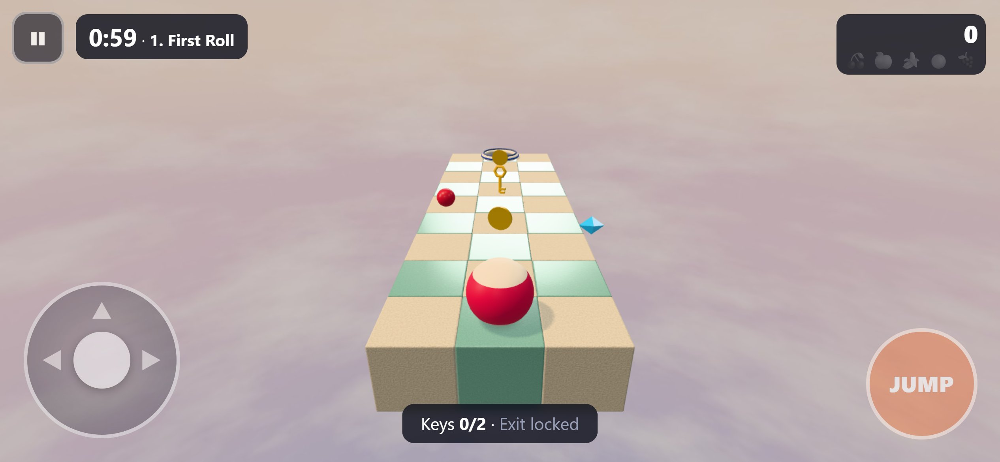
- Thumb on the d-pad (re-centred where it landed, ▲ lit, ball rolling): 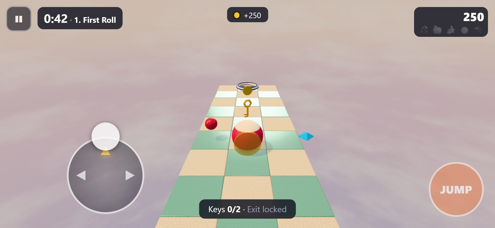
- Private lobby with Ready: 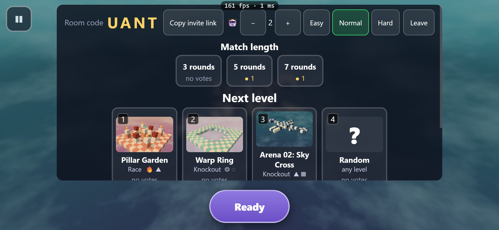
- A knockout round (compact board): 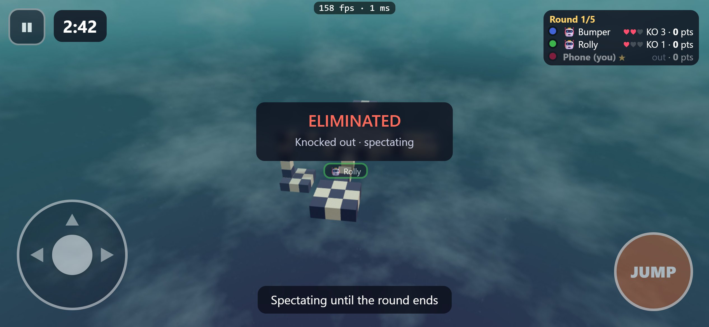
- Pause menu in single player: 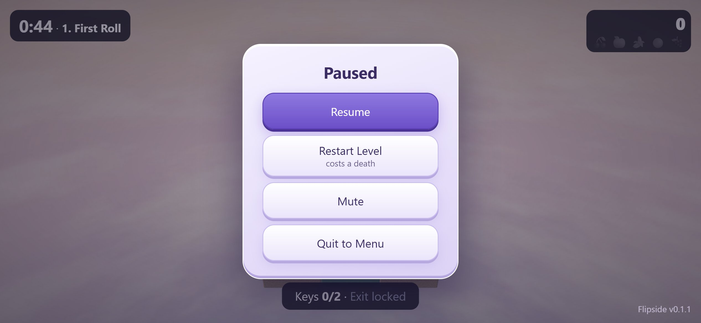
- Pause menu in multiplayer: 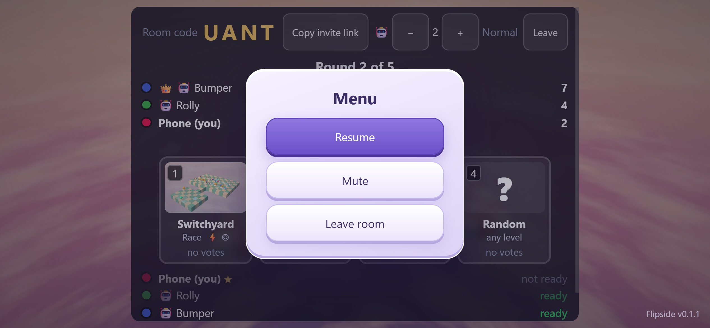
- Touch settings: 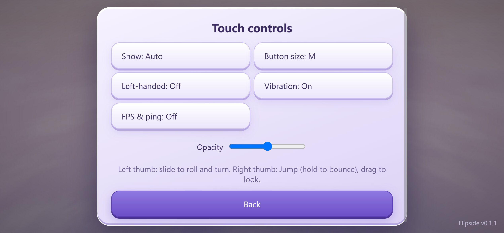
- Portrait overlay: 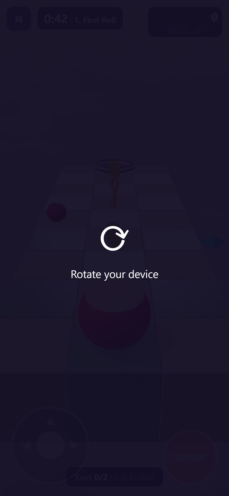

**iPad, landscape (1180×820 @2×):**
- Lobby: 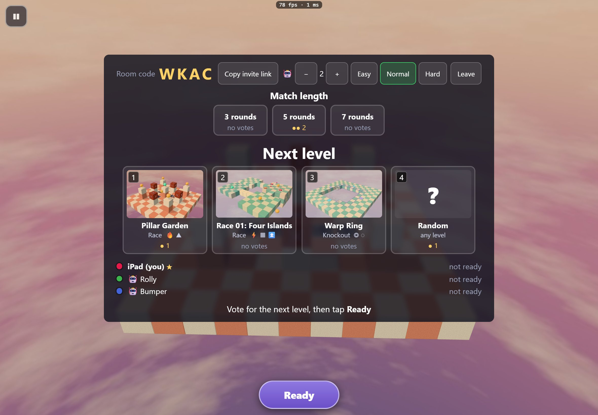
- Play: 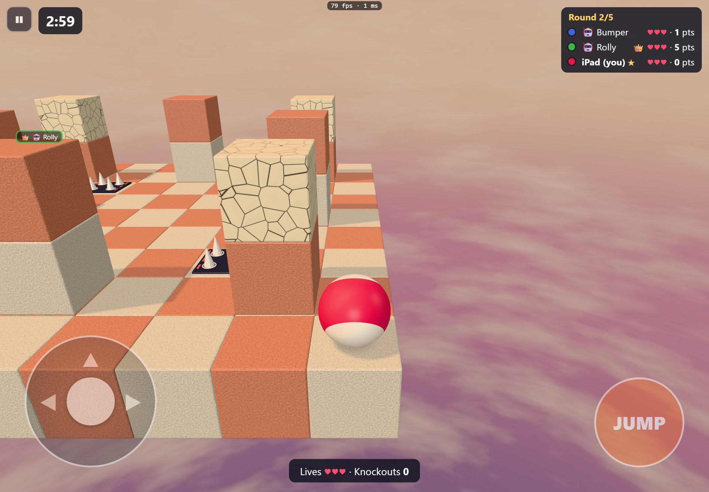

**Driven with real touch events** (CDP `Input.dispatchTouchEvent`):
- Menu taps; a d-pad hold rolled the ball 3 cells.
- A second finger on Jump while forward stayed held.
- Free look turned the camera (yaw −0.64) and sprang back to 0 on release.
- Pause, Mute/Unmute, Leave room; Ready in the lobby started the round.

**Desktop (no emulation):**
- No coarse pointer, the device is the keyboard, and the touch layer stays hidden.
- W rolled the ball. The gamepad path is unchanged apart from the held union (no pad here to try).

## Acceptance
- [ ] **Deployed-site check:** *pending deploy.* Everything above ran against the local dev server.
- [x] Device emulation (phone landscape, iPad): play, lobby with Ready, pause menu, touch settings, portrait overlay.
- [ ] **Your phone:** single-player levels 1–3, one match against server bots, and how turning mid-roll, held-jump bounce and jump-forward feel. Also the FPS and ping (Touch controls → FPS & ping), and the airplane-mode reconnect (10 s off, then back: same seat). *Pending.*
- [ ] Tablet, if you have one: *pending.*
- [x] Keyboard still works on desktop, and the touch UI never shows there unless forced On. Gamepad: code path unchanged, not tried here.
- [x] typecheck, test (1052 passed) and level:check pass.

## Devices and FPS
- Only emulation so far, on this PC's GPU: 130–160 fps on the phone profile and ~80–140 on the iPad profile. That says nothing about a real phone.
- Phone FPS at High and Low: *pending your check* (the FPS & ping readout shows it; switch Graphics in Settings).

## Deviations
All are logged in `docs/DECISIONS.md`.
- **The bundle is `packages/server/dist/server.js`,** not `dist/server.js` at the root, so the server's relative paths stay the same as from `src/`.
- **D-pad SE/SW turn** (S + E), and the pulse follows the turn side, so E → NE doesn't turn twice.
- **Ready shows in the lobby and as Rematch on the match-end card,** not on a round's results screen: the server ignores ready outside the lobby, so a Ready there would do nothing.
- **The pause menu opens in multiplayer too** (Mute, Leave room). On a phone it was the only way to mute or leave mid-round. Esc and pad Start open it on desktop as well.
- **Single player pauses when the phone turns to portrait.**
- **Version bumped to 0.1.2,** so pages still open on 0.1.1 get the refresh prompt after the deploy.

## Open questions
- Should S on the d-pad do a 180° turn? It's nothing now, per §25. Two quick turn pulses would do it without any sim change.
- Graphics Auto drops once per session and never climbs back. Should it try High again later (for example on the next level)?
- Vibration is off on iOS (Safari has no `navigator.vibrate`); nothing to do there.
