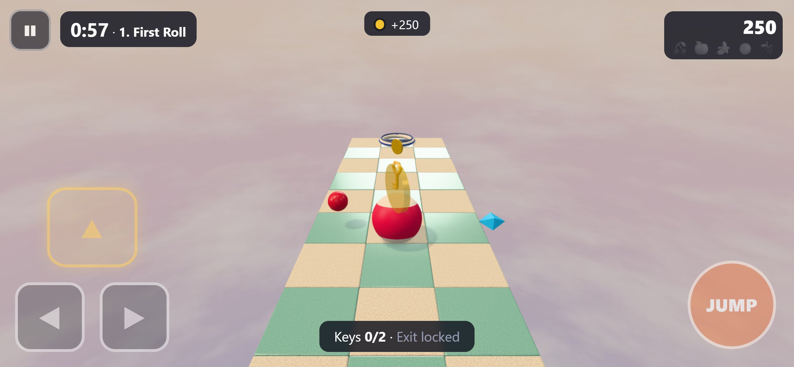
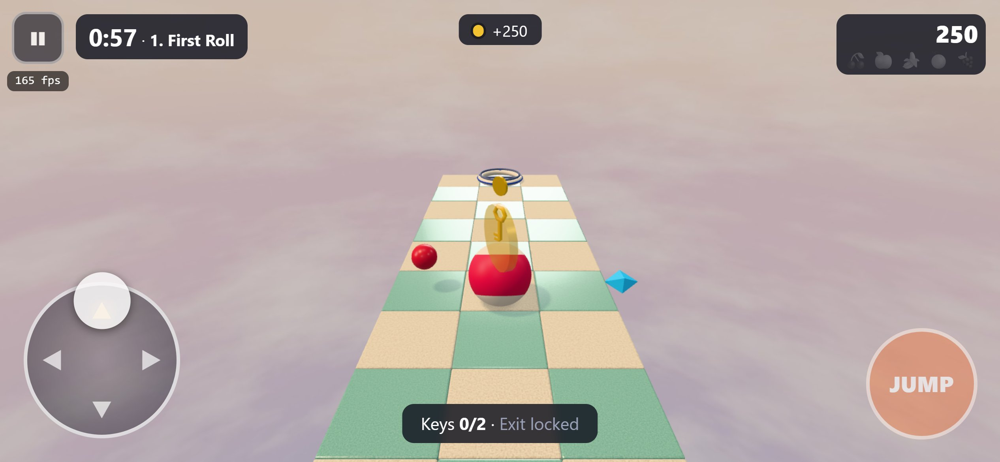
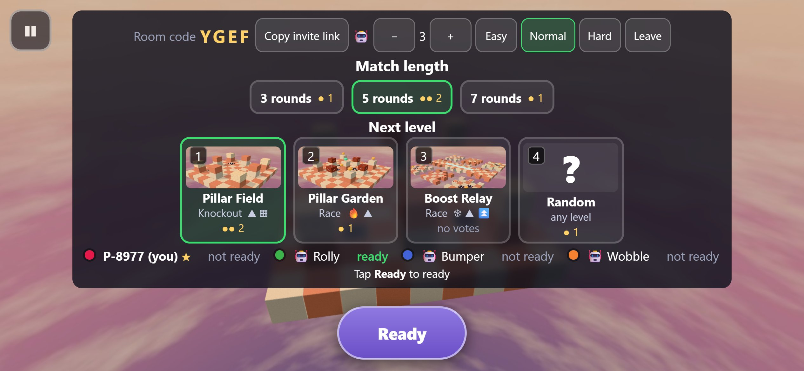
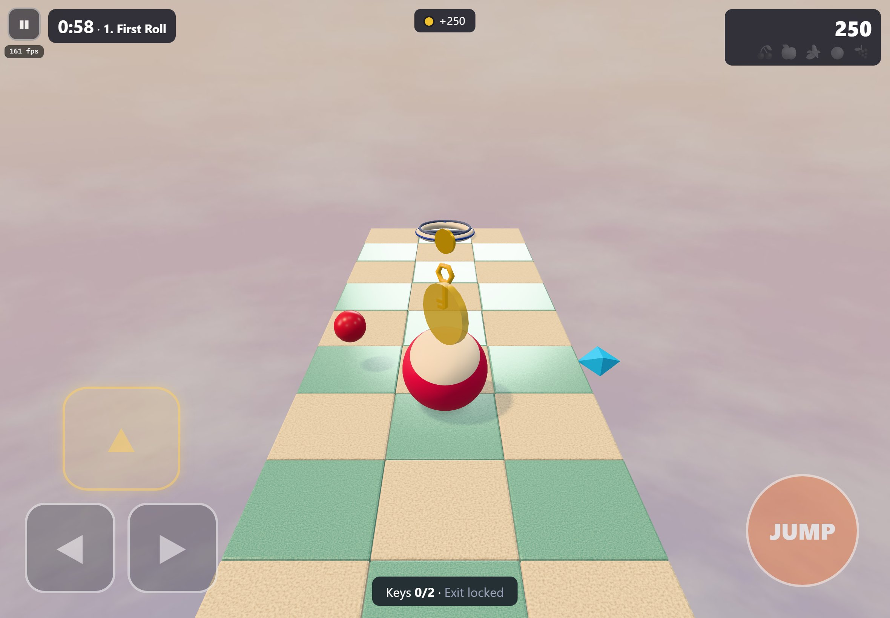

# Phase 19c report: Touch fixes + 19b follow-ups

> **Status:** code done, tested, committed and pushed (`phase 19c: touch fixes`). Deploy and your phone check: see the bottom two sections.

## What changed

### Buttons layout (new default)
- **Fixed ◀ ▲ ▶, bottom-left** (bottom-right when left-handed). ▲ is the largest (1.3 × 1.15 of a button), raised above ◀ ▶ with 16 px dead gaps.
  - Buttons are `clamp(72px, 19vmin, 120px)` × Button size, about 12 mm on a phone.
- **Behaviour** (`TouchPad`, DOM-free and unit-tested):
  - ▲ held = forward.
  - Landing on ◀/▶ = one turn pulse on touch-down. Two taps = two pulses = 180°.
  - Sliding from ▲ onto ◀/▶ = one turn, and forward stays held until that finger lifts. Sliding back onto ▲ doesn't turn.
  - Hit-testing uses each button's rectangle + 6 px, never angles. Drift inside ▲ or a gap never turns, and ◀ → gap → ◀ doesn't turn twice.
- **Right thumb unchanged:** Jump, plus the look drag on empty space.
- **Settings → Touch controls → Layout: Buttons / Stick** (plus "Floating stick" when Stick is chosen). Saved settings from 19b have no layout, so they load as Buttons.

### Stick (the alternative)
- **Zones:**
  - N within ±40°.
  - E/W from 65° to 135°.
  - S beyond 150° = turn around.
  - Dead zone 15 %.
- **The bands keep the previous zone**, which is the hysteresis: a thumb drifting off N keeps rolling with no turn, and wobbling across 65° never chatters. No diagonals: forward is released before a turn fires.
- **Centre:** fixed by default; "Floating stick" brings back 19b's behaviour.

### Turn around (180°)
- **Inputs:**
  - keyboard S / ↓
  - pad ▼ (and the left stick pulled down)
  - Stick S
  - a double tap on ◀/▶
- Each sends two turn pulses. "Turn around" is on the rebinding screen. Old saved bindings get it minus keys already used elsewhere.
- **The buffer did drop it:**
  - Two pulses during a roll collapsed into one turn (the single pulse slot, latest wins).
  - Single player also lost the second pulse from rest.
- **Fix:** a one-deep queue in the sim (`pulseNext`). A same-side turn arriving while one is buffered queues behind it; anything else still replaces.
  - The predictor carries the queued turn in snapshots and on reconcile.
  - The determinism tests show zero mispredictions (classic and snappy).
  - Logged in DECISIONS, with two fixed-seed test thresholds that moved.
- **Tests** (`shared/test/turnAround.test.ts`): 180° from rest, 180° queued behind a roll with forward carrying on the other way, two pulses in the same tick, and opposite turns replacing.

### 19b follow-ups
1. **The "orange overlay" wasn't the silhouette.**
   - It was the just-collected coin popping (growing 2.5× and fading) in the ball's own cell. `19b-phone-dpad.jpg` has the "+250" toast, and that coin is missing from the strip. I reproduced it this time with both the coin and the key.
   - **Fix:** pickup pops (keys, score items, pills) now rise along the tile's up while they grow, so they burst above the ball. Test: the pop's lowest point stays above the ball's top on all six gravity faces; it fails without the rise.
   - **The silhouette fix you asked for is in too:** a 0.3-cell depth bias in world units on the silhouette material, instead of the old polygon offset. Raster test: a ball dipped 0 / 0.03 / 0.08 into its tile, on plain and on ice, from low and high cameras, shows no silhouette, while from under the floor it still does. It fails at bias 0.
   - Mid-bounce the ball is above its tile, so there's nothing to cover it there.
2. **FPS/ping readout:** top-left under Pause, one value per line. Hidden outside countdown and play, so never over the lobby, results or stats.
3. **Phone lobby fits** (≤ 520 px tall):
   - compact header row
   - one-line match-length cards
   - 16:7 thumbnails
   - smaller headings
   - players as wrapping chips

   At 844×390 with 4 players the panel content is 291 px, its height exactly, so it doesn't scroll. It ends at y = 302, and Ready starts at y = 322.
4. **Graphics Auto:** unchanged (stays Low for the session).

## Checks
- **Unit tests:** 1063 passed, 4 skipped by design.
  - Buttons: tap, double tap, slide ▲→◀ keeps forward, slide back, drift in ▲ and the gaps, ◀→gap→◀, landing in a gap.
  - Stick: zones and bands; a 3 s drift test wandering ±35° with ±8° noise gives zero turns; an E flick gives one; 20 wobbles across 65° give none; S gives a 180°; fixed vs floating centre.
  - Turn-around queueing in shared, the silhouette contact case, and the pop rise.
- **CDP touch emulation** (headless Chrome, 844×390 @3×, real `Input.dispatchTouchEvent`):
  - Hold ▲ with ±30 px random drift for 5 s (103 moves): **0 turn messages**. The ball rolled straight and wrapped over the strip's end edge.
  - Slide ▲→◀→▲: **1 turn**, forward held throughout, still rolling.
  - Double-tap ▶: **2 pulses**, facing −X → +X (180°).
- typecheck, test and level:check pass.

## Screenshots
- **Phone:**
  - Buttons, ▲ held, the coin popping above the ball (no overlay on the ball): 
  - Stick (fixed, thumb up, FPS readout under Pause): 
  - Lobby fitting, with 3 bots and votes: 
- **iPad**, Buttons: 

## Fly numbers (19b's pending ones)
*Pending deploy.*

## Your phone
*Pending.*
